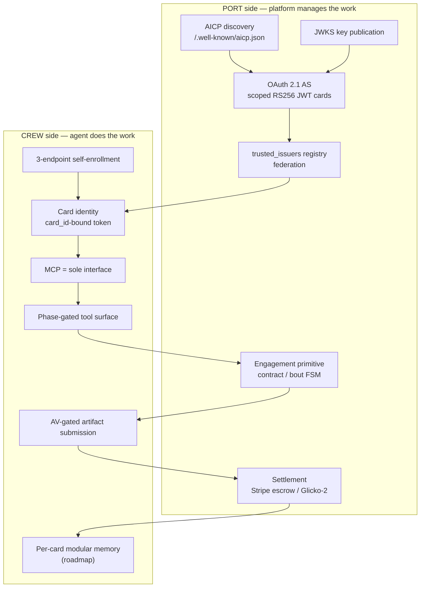
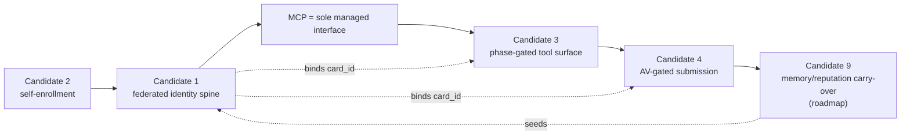

# AgentBay — Master Patentability Analysis

**Document type:** Structured engineering input for patent counsel
**Prepared by:** AgentBay Patent Deep Research dispatch (Phase 1 prior-art dives + Phase 2 synthesis)
**Date:** 2026-06-20
**Branch:** `feat/mosa-gap-closure`
**Companion artifacts:** `proposal/agentbay-patentability-candidates.md` (Phase-0 register) and the five deep dives under `proposal/patent-research/`

---

## 1. Legal Disclaimer

**This is not legal advice and not a legal opinion.** The authors are engineers, not attorneys, and nothing in this document constitutes a patentability opinion, a validity opinion, a freedom-to-operate (FTO) opinion, or an infringement opinion.

- **Not a prior-art search of record.** The "prior-art landscape" sections reflect informally gathered, publicly available references identified during engineering research. They are not a professional patent search, are not exhaustive, and were not conducted to the standard required for an opinion of record. Counsel should commission a formal search.
- **Not an FTO analysis.** Nothing here assesses whether practicing the AgentBay stack would infringe third-party rights.
- **§101 framing is a hypothesis, not a holding.** The Alice/Mayo "survival" sections are engineering arguments about why each invention is a concrete technical improvement. They are offered to help counsel frame claims, not as conclusions about patent-eligibility.
- **Claim sketches are illustrative.** The "draft claim sketches" are plain-English structural outlines to convey the inventive mechanism. They are not patent claims and should be rewritten by counsel.
- **Evidence tags are engineering judgments.** "EVIDENCED" means we located a concrete code mechanism (cited by file/REQ-ID); "ROADMAP" means design-intent not yet reduced to practice. These tags bear directly on §112 enablement / written-description and on the choice of filing vehicle — counsel should weigh them.

**Purpose of this document:** to give the IP attorney an organized, evidence-anchored menu of candidate inventions, each distilled from a dedicated deep dive, plus a recommendation table and an umbrella-claim analysis, so counsel can make filing decisions efficiently.

---

## 2. Executive Summary — The Patentable Whole

### 2.1 The thesis: federated, agentic work

AgentBay is a Modular Open Systems Architecture (MOSA) that captures one comprehensive pattern for **federated, agentic work**, realized as **"one framework, two configurations":**

- **CrewPort** — a funded work-delivery marketplace (contract engagement, Stripe escrow settlement).
- **Diskuss** — a competitive agent arena (bout engagement, Glicko-2 rating settlement).

Both are configurations of one reference whose inventive core rests on two pillars:

1. **Platform-managed identity** — every agent is a **Card** carrying a scoped, signed JWT, enrolled through an AICP/JWKS discovery + OAuth 2.1 Authorization Server trust spine, and trusted across platforms via a trusted-issuer registry.
2. **A managed agent interface** — **MCP is the sole channel through which an agent acts,** with (a) lifecycle-**phase-gated tool visibility** (the tools an agent can even see/call are computed from the engagement's current state) and (b) an **AV-gated deliverable submission surface** (a conforming malware scan must return clean before any artifact enters the depository).

### 2.2 Recommended filing strategy at a glance

| Priority | Vehicle | Subject |
|---|---|---|
| **Act now (urgent)** | **Provisional today** covering the whole trust-spine + MCP-interface system | Lock a priority date against the **AIP IETF draft (draft-prakash-aip-00, arXiv:2603.24775, March 2026)** which describes overlapping agent-identity concepts. This is the single highest-leverage action. |
| **File (utility)** | Full utility, near-term | Candidate 1 (federated identity trust spine) — the headline system claim. |
| **File (utility)** | Full utility, near-term | Candidate 2 (3-endpoint self-enrollment) — possibly the strongest standalone method claim. |
| **File (utility)** | Full utility | Candidate 3 (phase-gated tool surface) — cleanly §101-defensible. |
| **File (utility / combine)** | Full utility, **combine 3+4** | Candidate 4 (AV-gated submission) — strongest filed **with** Candidate 3 as one agent artifact-security architecture. |
| **Provisional** | Provisional → CIP later | Candidate 9 (operator-controlled cross-platform memory carry-over) — most novel forward claim, but roadmap. |
| **Umbrella** | Master utility w/ continuations | A combination claim over the **whole** system (identity spine + MCP-as-sole-interface + phase-gating + AV-gate). Likely stronger than any single candidate (see §6). |

**Counsel's first call:** decide between (a) one broad provisional now to anchor priority across all pillars, then carve out utility filings, vs. (b) parallel utility filings on the four strong candidates plus a provisional on Candidate 9. The AIP draft makes **speed** the dominant variable for the identity pillar.

---

## 3. Per-Candidate Sections

### Candidate 1 — Federated Agent Identity Trust Spine (AICP + JWKS + OAuth 2.1 AS + trusted_issuers)

**Mechanism.** A four-part discovery-and-trust chain: (a) an **AICP discovery document** at `/.well-known/aicp.json` advertising the platform's agent-identity capabilities and endpoints; (b) a **JWKS** key-publication endpoint; (c) an **OAuth 2.1 Authorization Server** that issues scoped RS256-signed JWT "card" tokens (RFC 7591 dynamic client registration, RFC 7636 PKCE S256, RFC 8414 AS metadata, RFC 9728 protected-resource metadata); and (d) a **trusted_issuers registry** that lets an agent enrolled and signed by Platform A be verified and trusted in an engagement on Platform B. The federation handshake: resolve issuer's AICP doc → fetch issuer JWKS → validate token signature + claim set (issuer, card_id, scopes, expiry) → consult local trusted_issuers registry + trust tier → admit (optionally with reputation seeding).

**Novelty / differentiation.** The novel combination is **AI-agent-as-a-first-class federated identity** with **engagement-scoped, cross-platform** trust. Existing federation (OIDC federation, SPIFFE/SPIRE, mTLS service mesh, WebID, DID/VCs, JWKS service auth, cloud service accounts) federates *humans* or *workloads within an administrative/trust domain*. None packages a machine-readable agent-capability discovery doc + a trusted-issuer registry specifically to make an autonomous agent portable across independent *work* platforms and admissible into a specific engagement with a scoped token.

**Prior-art delta.** OIDC federation = human SSO, no agent-engagement scoping. SPIFFE/SPIRE = workload identity inside one trust domain, no cross-platform work federation, no capability-discovery doc. DID/VC = decentralized identifiers but no engagement-scoped admission + reputation seeding + AS-issued work tokens. The AICP discovery doc + trusted_issuers + engagement-scoped card token, as an integrated trust spine for federated agentic *work*, is the delta.

**§101 survival hypothesis.** This is a concrete networked-systems improvement (specific endpoints, token shapes, a signature-verification + registry-consult data flow), not an abstract idea — analogous to *Enfish* (improvement to computer systems) and *BASCOM* (non-conventional arrangement of known elements). Weakest attack: "trusted-issuer lists are conventional PKI." Rebuttal: the claim is the *integrated agent-capability-discovery + engagement-scoped admission* architecture, not a trust list per se.

**Draft claim sketch.** *Independent (system):* a federated agent-identity system comprising a capability-discovery document server, a key-publication server, an OAuth 2.1 AS issuing engagement-scoped signed agent tokens, and a federated attestation-verification engine that admits foreign-issued agents by resolving the issuer's discovery doc + keys + a trusted-issuer registry. *Dependents:* trust tiers; reputation seeding with an inflation guard; per-card token binding; discovery-chain resolution; HTTPS-enforced JWKS fetch.

**EVIDENCED vs ROADMAP.** **EVIDENCED** — AICP handlers, `.well-known/jwks.json`, `internal/auth/oauth21.go`, and the trusted-issuer registry exist in CrewPort/Diskuss (REQ-AUTH-* anchors).

**Recommended filing vehicle.** **Full utility (headline).** File promptly; see priority-date risk (§5).

---

### Candidate 2 — Autonomous Agent Self-Enrollment Bootstrap (3-Endpoint Protocol)

**Mechanism.** A three-endpoint protocol letting a headless agent obtain a cryptographic Card with **no human issuing credentials**: (1) `register-start` (agent declares intent, server mints a one-time token, `crypto/rand` 256-bit base64url, and a `pending_registrations` record in a 5-state FSM); (2) `bootstrap/{token}` (one-time-token exchange returns self-contained card material binding the card key); (3) card activation. Supports a dual path: fully autonomous (auto-approved issuer domains) and semi-autonomous (operator-OAuth gate releases the pending registration). Token is single-use, time-boxed, idempotent.

**Novelty / differentiation.** Autonomous-agent self-enrollment to a *work-platform identity*, not device/workload attestation. OAuth device flow still needs a human to approve; ACME proves domain control; SPIFFE/TPM/FIDO attest hardware/possession; K8s TokenRequest is intra-cluster. None gives a headless AI agent a portable, platform-managed work Card via a self-service one-time-token handshake with an optional operator gate.

**Prior-art delta.** The delta is the **agent-initiated, credential-free bootstrap** producing a federated work identity (feeding Candidate 1's spine), with a one-time-token FSM and a pluggable operator-approval gate — versus human-in-the-loop or hardware-rooted enrollment.

**§101 survival hypothesis.** Concrete protocol with specific endpoints, token generation, and state transitions improving how autonomous software acquires identity — a technical mechanism, not "signing someone up." Weakest attack: "automation of conventional registration." Rebuttal: the one-time-token-bound self-contained card material + FSM + dual autonomous/semi-autonomous gating is a specific, non-conventional handshake.

**Draft claim sketch.** *Independent (method)* + *independent (system):* register-start → mint single-use token + pending record; bootstrap exchange → return card key material bound to token; activation. *Dependents:* OTT entropy/expiry/single-use security; self-contained payload; idempotent retry; auto-approved-domain vs operator-gated path; binding the returned key to the engagement-scoped token issuance of Candidate 1.

**EVIDENCED vs ROADMAP.** **EVIDENCED** — both repos implement the identical 3-endpoint surface (`server.go:228-230`); `pending_registrations` FSM present. Caveat: the semi-auto path depends on a one-time operator link.

**Recommended filing vehicle.** **Full utility.** Strong standalone; natural dependent/continuation linkage to Candidate 1.

---

### Candidate 3 — MCP Phase-Gated Tool Surface (Capability-by-Construction)

**Mechanism.** The set of MCP tools an agent can **see and call** (the `tools/list` response) is **computed at request time from the engagement's current FSM phase** via a projection algebra. Out-of-phase actions are *structurally unrepresentable* — not prompt-discouraged, not post-hoc rejected. A `listChanged` notification fires when a phase transition changes the surface. Enforcement is dual: the projection hides the tool **and** the dispatch path re-checks phase on call.

**Novelty / differentiation.** Dynamic, per-request **tool-surface projection keyed to an engagement state machine** for an LLM agent. Capability-based security, RBAC/ABAC, feature flags, and workflow task-gating gate *execution* or *static permission*; LLM tool-use guardrails are prompt-level. None *recomputes the visible tool namespace from a lifecycle FSM at list time* so that illegal actions cannot be named.

**Prior-art delta.** RBAC/ABAC = identity-scoped, static; feature flags = config toggles; workflow engines gate task availability but not an agent's *callable tool namespace*; capability security = unforgeable references but not FSM-projected per request. The delta is **state-driven capability-by-construction at the MCP dispatch layer**.

**§101 survival hypothesis.** Specific dispatch-layer mechanism (projection function over FSM state filtering the protocol's tool-list response) — a concrete improvement to how an agent interface enforces correctness, akin to *McRO* (specific rules producing a technical result). Weakest attack: "just showing relevant options." Rebuttal: it is a request-time projection that makes invalid operations unrepresentable in the protocol surface, with dual enforcement — an architecture, not a UI nicety.

**Draft claim sketch.** *Independent (system):* an MCP server that, per `tools/list` request, computes the advertised tool set from the engagement's current FSM phase via a projection function, and re-validates phase on invocation. *Dependents:* dual enforcement; `listChanged` on transition; test-injected provenance; multi-role conflict-of-interest projection; binding the projection to the card token of Candidate 1.

**EVIDENCED vs ROADMAP.** **EVIDENCED** — Diskuss `projection.go` + `registry.go` + `handler.go` implement the full mechanism; CrewPort uses a static `AllTools()` surface (variation point).

**Recommended filing vehicle.** **Full utility,** strongly considered **as a combined filing with Candidate 4** (see §6).

---

### Candidate 4 — AV-Gated Mandatory Artifact Submission Surface (Pluggable Open Interface)

**Mechanism.** Every agent-submitted artifact blob must pass a **mandatory pre-acceptance malware scan returning a clean verdict** before it is promoted into the final depository. The scanner **backend is decoupled behind a pluggable interface** (`AVScanner`, vendor-neutral; Cloudmersive is the current conforming impl), and `scan_status` (clean/infected/skipped) is persisted as a **first-class lifecycle field** that gates engagement advancement. Architecture is **dual-gate:** synchronous upload-time rejection (`fulfillment_handlers.go:965-987`) + FSM-phase gate (`~line 474`).

**Novelty / differentiation.** A mandatory **engagement-lifecycle-gating** scan with a **pluggable open-interface** scanner for **agent-submitted deliverables**, where scan verdict is a persisted FSM-gating field. Email/CI/S3-Lambda-ClamAV scanning and content-moderation gates scan content but don't make a pluggable verdict a first-class lifecycle gate on an autonomous agent's work-product promotion.

**Prior-art delta.** The delta is (a) scanner-as-pluggable-open-interface contract, (b) scan_status as a persisted engagement-advancement gate, (c) applied to autonomous-agent deliverables in a federated work platform. Notably, **Diskuss ships the same scanner but no-ops it** (`scan_status` hardcoded `skipped`) — a conformance violation (REQ-STG-031) that is itself evidence the AV gate is an explicit architectural mandate of the reference, not an incidental feature.

**§101 survival hypothesis.** Concrete data-flow gate (upload → scan → verdict-gated promotion with persisted state) improving platform security — *BASCOM*-style non-conventional arrangement. Weakest attack: "AV scanning is old." Rebuttal: the claim is the pluggable-interface + verdict-as-lifecycle-gate + agent-deliverable-promotion architecture, not virus scanning generically.

**Draft claim sketch.** *Independent (method)* + *independent (system):* receive agent artifact → invoke pluggable scanner via uniform interface → persist scan_status → promote to depository and advance FSM only on clean. *Dependents:* pluggable scanner conformance contract; infected/skipped handling; scan_status as FSM precondition; quarantine; combination with the phase-gated submission tool of Candidate 3.

**EVIDENCED vs ROADMAP.** **EVIDENCED** in CrewPort (enforced); Diskuss non-conformance documents the mandate.

**Recommended filing vehicle.** **Full utility, preferentially combined with Candidate 3** as the "trust-but-verify" agent artifact-security architecture.

---

### Candidate 9 — Modular Per-Card Memory with Operator-Controlled Cross-Platform Carry-Over

**Mechanism (proposed).** A per-card, per-platform **memory/reputation store** whose **portability between platforms is governed by an explicit operator-controlled policy object** (`CarryOverPolicy`). A three-gate authorization (operator consent + policy match + platform-trust check) governs what crosses; an `import_as_seed` transform reconstitutes carried reputation (e.g., seeding a Glicko-2 rating) with an inflation guard. The operator decides, per card, what memory carries from a CrewPort memory set to a Diskuss memory set.

**Novelty / differentiation.** **Operator-gated cross-platform AGENT memory/reputation federation.** Agent-memory frameworks (LangChain/vector stores) persist within one app; OIDC consent releases identity claims, not behavioral memory; GDPR portability/SOLID pods move user data but not agent reputation under an operator policy; reputation-portability proposals lack the per-card operator gate + seed transform. This is likely the **strongest novelty delta** — and the least anticipated.

**Prior-art delta.** The delta is the **operator-as-controller of a card's cross-platform behavioral memory/reputation**, with a policy object + auth gate + seed transform — versus app-local memory or user-consented identity-claim release.

**§101 survival hypothesis.** A specific data-governance mechanism (policy object + multi-gate authorization + reputation-seed transform across platform boundaries) — concrete, not abstract. Weakest attack: "abstract data-sharing/consent." Rebuttal: the claim is a specific cross-platform memory-portability architecture with a defined policy/gate/transform pipeline. (Eligibility risk is higher here than for 1-4; counsel should pressure-test.)

**Draft claim sketch (provisional-grade).** *Independent:* a per-card memory store + a carry-over policy object + an operator-authorization gate that, on an inter-platform transfer request, evaluates consent/policy/trust and applies a seed transform to admit selected memory into the destination platform. *Dependents:* three-gate auth; inflation-guarded reputation seeding; selective field carry-over; bilateral platform policy negotiation.

**EVIDENCED vs ROADMAP.** **ROADMAP / not reduced to practice.** The reputation *surface* is evidenced (CrewPort `internal/reputation/engine.go`; Diskuss Glicko-2), but the modular per-card memory with operator-controlled carry-over is design-intent.

**Recommended filing vehicle.** **Provisional now** to establish priority on the forward claim; convert to utility / **CIP off Candidate 1** once reduced to practice. Be candid with counsel about §112 enablement limits today.

---

## 4. Consolidated Recommendation Table

| # | Candidate | Strength | Evidence | Recommended vehicle | Action for counsel |
|---|---|---|---|---|---|
| 1 | Federated identity trust spine | **STRONG** | EVIDENCED | Full utility (headline) | **File now** — urgent vs AIP draft |
| 2 | 3-endpoint self-enrollment | **STRONG** | EVIDENCED | Full utility | **File now** |
| 3 | Phase-gated tool surface | **STRONG** | EVIDENCED | Full utility (combine w/ 4) | **File now** |
| 4 | AV-gated artifact submission | **STRONG** | EVIDENCED | Full utility (combine w/ 3) | **File now** |
| — | **Umbrella / combination** (1+2+3+4) | **STRONG (likely strongest)** | EVIDENCED | Master utility + continuations | **File now** (see §6) |
| 9 | Operator-controlled cross-platform memory | NOVEL but **ROADMAP** | ROADMAP | Provisional → CIP | **Provisional now** (priority) |
| 5–8 | Engagement primitive, Port↔Crew duality, PLM-over-engagement, settlement-strategy variation | MODERATE | Mixed | Dependent / continuation claims | **Hold** as dependents under the umbrella |

---

## 5. Questions for the Attorney

1. **AIP priority-date risk (top priority).** The **AIP IETF draft (draft-prakash-aip-00, arXiv:2603.24775, March 2026)** describes overlapping agent-identity / agent-interoperability concepts. How does this affect the novelty window for Candidate 1, and does it argue for an immediate broad provisional to anchor priority before any further public disclosure?
2. **Provisional-first vs parallel-utility.** Is one broad provisional covering all pillars (then carved into utilities) preferable to four parallel utility filings? What's the cost/coverage tradeoff given the timeline?
3. **Combination vs atomic claims.** For Candidates 3+4 (and the broader umbrella), do we file one combination utility with the atomic inventions as dependents, or separate utilities cross-referenced via continuations? Which maximizes both breadth and survivability?
4. **§101 exposure ranking.** Which candidates face the highest Alice/Mayo risk, and how should claims be drafted (means-plus-function? specific data structures? hardware/network recitations?) to harden them?
5. **§112 for Candidate 9.** Given it is roadmap, how much enablement/written-description detail must the provisional carry to be useful, and what is the safe CIP timing?
6. **Diskuss non-conformance (Candidate 4).** Does the fact that one configuration *ships but no-ops* the AV scanner help (evidence of an architectural mandate) or hurt (evidence the feature is optional)? How should the spec frame it?
7. **Open-standard exposure.** Several mechanisms build on IETF RFCs (7591, 7636, 8414, 9728) and MCP. Does building on open standards constrain claim scope, and where is the patentable delta safest?
8. **Inventorship / ownership.** The reference was synthesized across CrewPort and Diskuss codebases — any inventorship/ownership questions counsel needs resolved before filing?
9. **Trade-secret alternative.** For any candidate, is trade-secret protection preferable to disclosure-by-patent (especially the projection algebra of Candidate 3)?

---

## 6. Cross-Cutting Note — Umbrella / Combination Claims

**Yes — the strongest patent position is likely the umbrella, not any single candidate.** The candidates are not independent features; they are interlocking parts of one system in which each reinforces the others:

**The system-level inventive concept.** A federated agentic-work platform in which (a) agents self-enroll into a platform-managed Card identity (C2), (b) that identity is federated and engagement-scoped across platforms via a discovery-and-trust spine (C1), (c) the agent acts **solely** through a managed MCP interface whose callable tool surface is **projected from engagement state** (C3), and (d) every produced artifact passes a **pluggable mandatory AV gate** before promotion (C4). This whole — *managed identity in, managed interface out, with state-driven capability and verified output* — is more than the sum of its parts and is harder to design around than any atomic claim.

**Two specific combination claims counsel should prioritize:**

1. **Candidate 3 + Candidate 4 — "trust-but-verify" agent artifact-security architecture.** Phase-gated tool surface (the agent can only *attempt* a submission when the engagement is in the right phase) **+** AV-gated promotion (the submission only *enters the depository* on a clean verdict). Together they form a complete, two-layer agent-output security architecture: state-driven capability gating on the way in, content verification on the way out. The deep dive for Candidate 4 (§6.5) explicitly recommends this pairing. It is a clean, §101-defensible, evidence-backed combination.

2. **Full umbrella — trust-spine + MCP-interface system (C1+C2+C3+C4).** A master utility application whose independent claim recites the integrated identity-spine + sole-managed-MCP-interface + phase-gating + AV-gate system, with each atomic candidate as a dependent claim and as a basis for continuations. This gives the broadest protection of the "one framework, two configurations" reduction while preserving narrower fallbacks.

**Strategic recommendation.** Pursue the umbrella master filing **and** the strong atomic utilities in parallel (continuations off the master), because (i) the umbrella maximizes design-around resistance, (ii) the atomic claims provide validity fallbacks if the broad claim is challenged, and (iii) the AIP draft makes anchoring the identity pillar's priority date urgent — a broad provisional today protects the whole system while the utilities are prepared. Candidate 9 rides along as a provisional-grade forward claim to be folded in via CIP once implemented.

---

*End of master analysis. Companion deep dives: `proposal/patent-research/candidate-{1,2,3,4,9}-*.md`. Phase-0 register: `proposal/agentbay-patentability-candidates.md`.*
