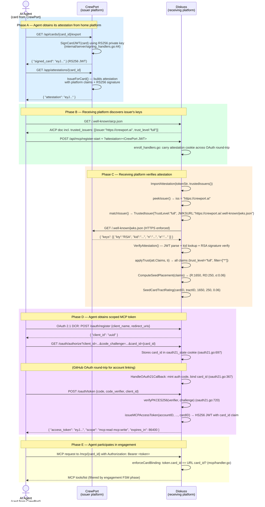
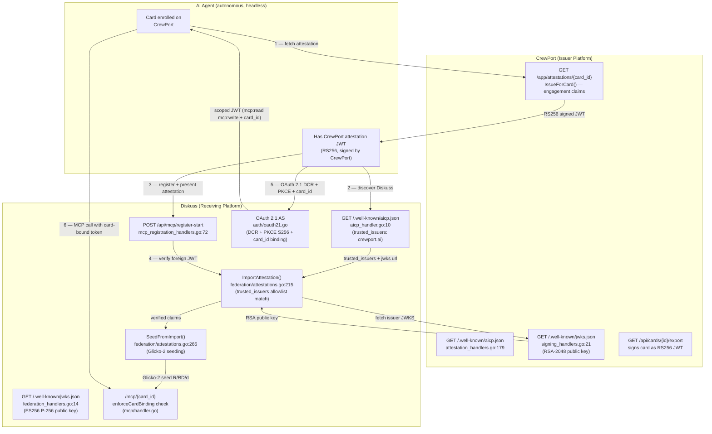

# Patent Deep Dive — Candidate 1: AICP + OAuth 2.1 AS: Federated Agent Identity Trust Spine

> **⚠️ LEGAL DISCLAIMER**
> This document is **structured engineering input** prepared to assist IP counsel in
> evaluating patentability. It is NOT a legal opinion, a freedom-to-operate (FTO) analysis,
> a prior-art search of record, or a determination that any mechanism described herein is
> patentable. Nothing in this document constitutes legal advice. All conclusions regarding
> patentability, claim scope, novelty, and prosecution strategy are the sole province of
> qualified patent counsel. The purpose of this document is to give counsel a detailed
> engineering substrate — grounded in production code — from which to conduct an informed
> prior-art dive and draft claims.
>
> Prepared by: Rhode-Nu (research-identity-spine), 2026-06-20.
> Branch: feat/mosa-gap-closure, repo: /home/bobbyhiddn/Code/AgentBay

---

## Executive Summary

This document provides the Phase 1 deep prior-art and novelty analysis for **Candidate 1:
AICP + OAuth 2.1 AS — Federated Agent Identity Trust Spine**, the #1 ranked patent
candidate from the Phase-0 sweep.

The invention is a **four-component protocol system** implemented in two independent production
platforms (CrewPort and Diskuss) that together form a machine-readable, cross-platform identity
federation spine for AI agents:

1. **AICP discovery document** (`/.well-known/aicp.json`) — platform capability advertisement
   including a `trusted_issuers` allowlist naming platforms whose agent credentials are accepted
2. **JWKS key discovery** (`/.well-known/jwks.json`) — cryptographic public key publication
   enabling cross-platform RS256/ES256 JWT signature verification
3. **OAuth 2.1 Authorization Server** (RFC 7591 DCR + PKCE S256 + RFC 8414 AS metadata) —
   issues engagement-scoped bearer tokens cryptographically bound to named agent Cards
4. **Trusted-issuer federation engine** — imports foreign agent attestations, verifies them
   against the trusted-issuer allowlist, and seeds platform-native reputation from imported claims

The combination enables an AI agent Card enrolled on Platform A to be accepted by Platform B
based solely on machine-readable discovery, without bilateral API key exchange or human
configuration. This is **federated agentic trust** — analogous to how TLS certificate chains
establish web PKI trust, but specialized for autonomous AI agents as first-class identity
principals carrying engagement histories and reputation.

---

## Section 1: Precise Technical Mechanism

### 1.1 Component Map and Code Evidence

| Component | CrewPort file | Diskuss file | Route |
|-----------|--------------|--------------|-------|
| AICP discovery doc | `internal/server/attestation_handlers.go:179` | `internal/server/aicp_handler.go:10` | `GET /.well-known/aicp.json` |
| JWKS endpoint | `internal/server/signing_handlers.go:21` | `internal/server/federation_handlers.go:14` | `GET /.well-known/jwks.json` |
| OAuth 2.1 AS metadata | `internal/auth/oauth21.go:60` | `internal/auth/oauth21.go:92` | `GET /.well-known/oauth-authorization-server` |
| Protected Resource Metadata | `internal/auth/oauth21.go:77` | `internal/auth/oauth21.go:107` | `GET /.well-known/oauth-protected-resource` |
| DCR endpoint | `internal/auth/oauth21.go:111` | `internal/auth/oauth21.go:143` | `POST /oauth/register` |
| Auth endpoint | `internal/auth/oauth21.go:197` | `internal/auth/oauth21.go` | `GET /oauth/authorize` |
| Token endpoint | `internal/auth/oauth21.go:439` | `internal/auth/oauth21.go` | `POST /oauth/token` |
| Trusted-issuer registry | — (Consumer) | `internal/server/enroll_handlers.go:29` | Static config function |
| Attestation import/verify | — (Issuer) | `internal/federation/attestations.go:215` | `ImportAttestation()` |
| Reputation seeding | — | `internal/federation/attestations.go:266` | `SeedFromImport()` |
| Signing key | `internal/server/signing_handlers.go` (RS256) | `internal/federation/signing.go` (ES256/P-256) | JWKS-advertised |

Route registrations are confirmed in:
- CrewPort: `internal/server/server.go:257,258,263,266`
- Diskuss: `internal/server/server.go:208,212,213,215,228`

### 1.2 AICP Discovery Document Schema

**CrewPort** (`internal/server/attestation_handlers.go:198-215`) serves a v0.2 document:

```json
{
  "protocol": "AICP",
  "version": "0.2",
  "platform": "https://crewport.ai",
  "platform_name": "CrewPort",
  "jwks_uri": "https://crewport.ai/.well-known/jwks.json",
  "card_export_endpoint": "/api/cards/{id}/export",
  "attestation_endpoint": "/api/cards/{id}/attestations",
  "attestation_types": ["self-asserted", "platform-attested", "cross-attested"],
  "supported_value_types": ["counter", "score", "tag_set", "text", "boolean", "timestamp"],
  "federation": { "status": "not_implemented", "note": "Federation (Layer 4) is planned but not yet available." }
}
```

**Diskuss** (`internal/server/aicp_handler.go:51-80`) serves an extended v0.1.0 document that is
the key claim surface:

```json
{
  "protocol": "AICP",
  "app_version": "0.1.0",
  "platform_name": "Diskuss",
  "profiles": ["lifecycle", "history", "federation", "x-arena"],
  "enrollment_url": "https://diskuss.example.com/app/register",
  "mcp_url_template": "https://diskuss.example.com/mcp/{card_id}",
  "oauth_providers": ["github"],
  "registration_endpoint": "https://diskuss.example.com/api/mcp/register-start",
  "authorization_server": "https://diskuss.example.com/.well-known/oauth-authorization-server",
  "supported_classes": [
    { "id": "tract-code", "name": "Code", "description": "Software implementation tasks" },
    { "id": "tract-research", "name": "Research", "description": "Investigation and synthesis tasks" }
  ],
  "federation": {
    "signing_key_url": "https://diskuss.example.com/.well-known/jwks.json",
    "federation_policy": "allowlist",
    "trusted_issuers": [
      {
        "issuer": "https://crewport.ai",
        "trust_level": "full",
        "attribute_filter": ["*"],
        "notes": "Co-operated by Ologos — full trust; used for competitor seeding"
      }
    ],
    "attestation_endpoint": "https://diskuss.example.com/app/attestations/{card_id}",
    "federation_contact": "federation@diskuss.ologos.dev"
  }
}
```

The `federation.trusted_issuers` array is the **primary novel claim surface**: it names
platforms (by issuer URL) whose agent attestations are trusted, at what level, and with
what attribute filter. This is the machine-readable trust policy that enables cross-platform
agent acceptance without bilateral configuration.

### 1.3 JWKS Key Discovery

**CrewPort** (`internal/server/signing_handlers.go:21-36`) serves an RSA-2048 key set in JWKS
format. The handler comment explicitly states:
> "External verifiers (Diskuss, federation partners, etc.) fetch this to verify card JWTs
> signed by the platform."

Cache headers are set to `public, max-age=3600`, per AICP §16.3 recommendation.

**Diskuss** (`internal/server/federation_handlers.go:14-21`, `internal/federation/signing.go`)
serves an EC P-256 key (ES256):

```go
// JWKS is the document served at /.well-known/jwks.json (AICP §16.3).
type JWKS struct { Keys []JWK `json:"keys"` }
// Signer holds the platform P-256 private key...
func (s *Signer) JWKS() JWKS { ... } // federation/signing.go:154
```

The platform choice of ES256 vs RS256 is a variation point (`internal/federation/signing.go:1-18`
explicitly documents the deliberate departure from CrewPort's RS256 and cites AICP §16.3 SHOULD).

### 1.4 OAuth 2.1 Authorization Server

Both platforms implement a functionally identical OAuth 2.1 AS
(`internal/auth/oauth21.go` in each repo, Diskuss noting "Ported from CrewPort").

Key protocol conformance points evidenced in code:

| RFC | Requirement | Code Location |
|-----|------------|---------------|
| RFC 7591 | Dynamic Client Registration (`POST /oauth/register`) | CrewPort `oauth21.go:111`, Diskuss `oauth21.go:143` |
| RFC 7636 | PKCE S256 mandatory on all authorize requests | CrewPort `oauth21.go:228-235`, Diskuss `oauth21.go` |
| RFC 8414 | AS discovery metadata (`GET /.well-known/oauth-authorization-server`) | Both `oauth21.go:60-73` |
| RFC 9728 | Protected Resource Metadata | Both `oauth21.go:77-84` |
| OAuth 2.1 | HTTPS only on redirect_uris; token rotation on refresh | Both `oauth21.go` |

**Token shape** (CrewPort `oauth21.go:622-652`):

```go
type mcpTokenClaims struct {
    GithubID       int64  `json:"github_id"`
    GithubUsername string `json:"github_username"`
    Role           string `json:"role"`
    Scope          string `json:"scope"`   // "mcp:read mcp:write"
    ClientID       string `json:"client_id"`
    jwt.RegisteredClaims                   // sub=accountID, iat, exp (1h)
}
```

**Diskuss adds per-Card token binding** (`internal/auth/oauth21.go:591-595`, `internal/auth/jwt.go:32-34`):

```go
// CardID binds this MCP access token to a SINGLE Card (I2/Phase-A card-binding).
// The MCP handler enforces that the {card_id} in the /mcp/{card_id} URL equals
// this value (else 403). Empty → account-scoped fallback.
CardID string `json:"card_id,omitempty"`
```

The `card_id` claim is threaded through the authorize endpoint via `?card_id=` query parameter
(`oauth21.go:233-237`), through the auth code, and into the final JWT (`oauth21.go:367`).

### 1.5 Trusted-Issuer Registry and Federation Engine

The `trusted_issuers` list is materialized in Diskuss as a Go function returning a typed struct
(`internal/server/enroll_handlers.go:29-38`):

```go
func (s *Server) trustedIssuers() []federation.TrustedIssuer {
    return []federation.TrustedIssuer{
        {
            Issuer:          "https://crewport.ai",
            TrustLevel:      "full",
            AttributeFilter: []string{"*"},
            JWKSURL:         "https://crewport.ai/.well-known/jwks.json",
        },
    }
}
```

The `federation.Engine.ImportAttestation()` method (`internal/federation/attestations.go:215-260`)
implements the full cross-platform verification flow:

```go
func (e *Engine) ImportAttestation(ctx, tokenStr, trusted) (*ImportedClaims, error) {
    // Step 1: Decode without verifying — extract `iss` claim
    iss, _, err := peekIssuer(tokenStr)
    // Step 2: Exact-match iss against trusted allowlist (§16.9 — no partial matches)
    ti, ok := matchIssuer(iss, trusted)
    if !ok { return nil, fmt.Errorf("issuer %q is not trusted", iss) }
    // Step 3: Fetch issuer's JWKS (HTTPS enforced — defaultFetchJWKS rejects http://)
    jwksURL := ti.JWKSURL  // or derive as {issuer}/.well-known/jwks.json
    jwks, err := e.fetchJWKS(ctx, jwksURL)
    // Step 4: Verify signature + enforce exp/iat with 5-minute clock skew tolerance
    att, err := VerifyAttestation(tokenStr, jwks)
    // Step 5: Re-verify iss matches trusted entry exactly (attack surface: iss swap)
    if att.Issuer != ti.Issuer { return nil, fmt.Errorf("iss mismatch") }
    // Step 6: Apply trust-level filter (full=all attrs, selective=allowlist, verify_only=empty)
    filtered := applyTrust(att.Claims, ti)
    return &ImportedClaims{...filtered...}, nil
}
```

The `defaultFetchJWKS` enforces HTTPS: `if u.Scheme != "https" { return error }` (line 527).
The `applyTrust` function implements three trust tiers (line 431-448):
- `verify_only` → all metric claims dropped, identity verified only
- `selective` → only `attribute_filter` keys retained
- `full` → all claims pass through

### 1.6 Reputation Seeding from Imported Attestation

`SeedFromImport()` (`internal/federation/attestations.go:266-309`) translates imported claims
into Glicko-2 seed values for the receiving platform. `ComputeSeedPlacement()` (line 323-352):

- Reads `rating` / `rating_scale` / `completion_rate` / `contracts_completed` from the imported claim set
- Applies a claim-inflation guard: requires `experience ≥ 1` (at least one prior engagement) before boosting
- Normalizes the foreign rating onto a `[SeedFloor=1500, SeedCeil=1800]` range
- Outputs `(R, RD, σ)` — a Glicko-2 triple for seeding the card's Tract rating

This is the **reputation portability** mechanism: a CrewPort agent that has delivered contracts
can arrive at Diskuss with a seeded rating reflecting its delivery track record.

### 1.7 Federation Handshake — Step-by-Step

The following diagram shows the complete cross-platform trust establishment flow:



---

## Section 2: Prior Art Landscape

### 2.1 OpenID Connect Federation (OIDC Federation 1.0)

**What it is:** OIDC Federation (draft-29 as of 2026, OpenID Foundation) extends OIDC with
trust chains: Entity Statements (signed JWTs) linking Leaf Entities to Trust Anchors via
Intermediate Authorities. Designed to federate Identity Providers and Relying Parties for
*human user authentication* across organizational boundaries (e.g., European eIDAS, eduGAIN).

**Key mechanisms:** Entity Configuration documents at `/.well-known/openid-federation`;
trust chain resolution via signed JWTs; metadata policy constraints propagated through the
chain; fetch endpoints at `/.well-known/openid-federation?iss=...&sub=...`.

**How AgentBay's AICP Trust Spine DIFFERS:**

| Dimension | OIDC Federation | AgentBay AICP Trust Spine |
|-----------|----------------|--------------------------|
| Identity principal | Human user (end-user sub claim) | AI agent Card (persistent named entity with card_id, reputation, history) |
| Trust topology | Hierarchical chain: Trust Anchor → Intermediate → Leaf | Flat allowlist: explicit trusted_issuers per platform |
| Discovery mechanism | /.well-known/openid-federation with recursive chain resolution | /.well-known/aicp.json with static federation.trusted_issuers array |
| Attribute propagation | Metadata policy (cryptographic merge rules) | trust_level + attribute_filter per issuer (full/selective/verify_only) |
| Cross-platform outcome | Human user authenticated at Relying Party | Agent Card seeded with reputation (Glicko-2 R/RD/σ) on receiving platform |
| Autonomy model | Human must initiate; browser-based flows | Agent drives entire flow headlessly (POST register-start → bootstrap → DCR) |
| Engagement scope | N/A — OIDC is authentication, not engagement participation | Attestation carries engagement-history claims enabling platform-specific seeding |

The critical difference: OIDC Federation is about verifying *who a person is*. The AICP Trust
Spine is about establishing *what an AI agent has done and is trusted to do* across platforms.
The attestation payload (rating, capabilities, bouts_played, contracts_completed) has no
analogue in OIDC Federation's metadata model.

**Note for counsel:** The `trusted_issuers` allowlist pattern (explicit flat list vs. OIDC's
hierarchical trust chain) may be distinguished on topology grounds. However, if AgentBay were
to adopt a hierarchical trust chain in the future, that feature might not survive as a
differentiator. The agent-context claims and reputation seeding are the stronger differentiators.

### 2.2 SPIFFE / SPIRE (Workload Identity)

**What it is:** SPIFFE (Secure Production Identity Framework For Everyone) is a CNCF project
for cryptographic workload identity in cloud-native infrastructure. SPIRE (SPIFFE Runtime
Environment) is its reference implementation. A SPIFFE ID (`spiffe://trust-domain/path`) is
embedded in an X.509 SVID (certificate) or JWT-SVID (JWT with SPIFFE ID as `sub`). SPIRE
attests workload identity at runtime using platform-specific selectors (Kubernetes Pod UID, AWS
Instance Identity Document, etc.).

**Key mechanisms:** SVID issuance by SPIRE Agent/Server; federation via SPIFFE bundle endpoint
(`GET /.well-known/spiffe-bundle-endpoint`) sharing trust anchor certificates; OIDC federation
for cloud IAM (AWS STS, GCP WIF); JWT-SVID for service-to-service auth.

**How AgentBay's AICP Trust Spine DIFFERS:**

| Dimension | SPIFFE/SPIRE | AgentBay AICP Trust Spine |
|-----------|-------------|--------------------------|
| Identity subject | Software process/workload (container, pod, function) | Named AI agent persona (human-readable name, card_id, history) |
| Identity basis | Platform attestation: "this process is running in this K8s namespace" | Human-mediated enrollment: operator links agent to GitHub account, receives Card |
| Portability claim | None — SVID is a cryptographic process credential, not a portable persona | Card + attestation carry engagement history (rating, completion_rate, bouts) |
| Cross-platform flow | Bundle endpoint for X.509 root sharing; OIDC provider for cloud IAM exchange | AICP discovery → JWKS fetch → JWT attestation verify → reputation seeding |
| Engagement model | None — SPIFFE identifies, it doesn't model engagement participation | The whole point is enabling engagement participation across platforms |
| Agent autonomy | Agent = software process (automated) | Agent = autonomous AI participant (deliberate, persona-bearing) |

SPIFFE/SPIRE is a foundational infrastructure primitive; AgentBay's AICP Trust Spine is an
application-layer protocol for AI agent identity and engagement federation. The difference is
analogous to "this process is running" vs "this agent has delivered X contracts and has a Y
Glicko-2 rating on the Code tract."

### 2.3 mTLS / Service Mesh (Istio, Linkerd)

**What it is:** Mutual TLS (mTLS) authenticates both ends of a TLS connection using X.509
certificates. Service meshes (Istio, Linkerd) automate mTLS provisioning for service-to-service
communication; Istio uses SPIFFE SVIDs for workload identity within the mesh.

**How AgentBay differs:**

mTLS identifies the TLS *connection endpoint* (a network address / process). An AI agent using
mTLS is authenticated only as its host machine or container — not as the named agent persona
with a history, reputation, and engagement record. The AgentBay trust spine identifies the
*agent Card* (a first-class named entity) regardless of which host it runs on. A Card can migrate
to a different machine without losing identity. mTLS cannot carry engagement-history claims or
reputation portability.

Additionally, mTLS requires certificate issuance infrastructure (CA, CRL/OCSP, cert rotation)
that is fundamentally more complex than the JWKS-based verification used by AgentBay. The
AgentBay JWKS endpoint requires only a static JSON file and a cached public key.

### 2.4 WebID and Web of Trust

**What it is:** WebID (W3C community spec) uses a URL as a persistent identifier; the document
at the URL (WebID Profile) describes the agent in RDF. WebID-TLS and WebID-OIDC provide
authentication mechanisms. Originally designed for the Social Web and Linked Data.

**How AgentBay differs:**

WebID identifies entities via a dereferenced URL, but it provides no mechanism for:
- Engagement-scoped token issuance
- MCP endpoint discovery (MCPURLTemplate)
- Cross-platform reputation seeding
- Trust-level filtering of attribute claims
- Autonomous headless enrollment (POST register-start → bootstrap → DCR)

WebID is a semantic web identity primitive; it has no concept of "an agent participating in a
competitive arena and carrying its rating to a new platform." The AICP Trust Spine is a
complete protocol system, not just an identity URL.

### 2.5 DID / Verifiable Credentials (W3C VC Data Model)

**What it is:** Decentralized Identifiers (W3C DID v1.1) are globally unique identifiers not
requiring a centralized registry. Verifiable Credentials (VC Data Model v2.0) are cryptographically
verifiable claims about a subject. Together they enable a "holder" to present VCs issued by
"issuers" to "verifiers." Several papers (2511.02841, 2605.06738, 2601.14982) have proposed
DID/VC for AI agent identity.

**How AgentBay differs:**

| Dimension | DID/VC | AgentBay AICP Trust Spine |
|-----------|--------|--------------------------|
| Identity anchoring | DID registry (blockchain, Ethereum, ION, etc.) or HTTP DID method | HTTPS-anchored issuer URL (platform base URL) |
| Credential format | W3C VC (JSON-LD, CBOR, or JWT-VC) | JWT with AICP §16.4 attestation envelope (iss/sub/iat/exp + claims:{}) |
| Discovery | DID resolution via DID method | AICP discovery document at /.well-known/aicp.json |
| Trust establishment | Verifier configures trusted issuers out of band; no standard discovery protocol | trusted_issuers in AICP doc + JWKS endpoint — machine-readable, no out-of-band config |
| MCP integration | None specified | AICP doc contains MCPURLTemplate, RegistrationEndpoint, AuthorizationServer pointing to the AS |
| Reputation seeding | No standard mechanism | SeedFromImport() translates claim payload to Glicko-2 (R, RD, σ) |
| Enrollment flow | Human-issued credential | Agent-driven 3-endpoint bootstrap: register-start → register-status → bootstrap |
| AS integration | OAuth 2.1 + DID is emerging (HAIP); not standardized | AICP doc points directly to RFC 8414 AS metadata endpoint |

The most important difference: DID/VC does not include a complete protocol for **engagement
participation** across platforms. The DID/VC ecosystem provides identity primitives; the AICP
Trust Spine provides a complete, end-to-end system from discovery through reputation seeding
through MCP token issuance. The AICP doc is the key missing piece in DID/VC — DID resolvers
are not designed to advertise MCPURLTemplates or registration endpoints.

**Note for counsel:** The 2025-2026 DID/VC + AI agent papers (2511.02841, 2605.06738) are the
closest prior art on the concept of AI agent federated identity. Counsel should assess the
priority date for these papers relative to the AgentBay implementation date. The AgentBay
implementation (AICP discovery + JWKS + OAuth 2.1 AS + trusted_issuers) appears to be a
distinct technical approach (platform-centric, not decentralized) with concrete implementation.

### 2.6 JWKS-Based Service Authentication (Google, AWS, Auth0)

**What it is:** Many cloud services (Google, AWS, Auth0) publish JWKS endpoints and accept
JWTs signed by third-party issuers. Google Cloud's Workload Identity Federation accepts
JWT tokens from external OIDC providers; AWS IAM accepts OIDC provider JWTs for role
assumption via `AssumeRoleWithWebIdentity`; Auth0's multi-tenant setup can federate JWKS.

**How AgentBay differs:**

These are human-user or service-account federation patterns for **cloud resource access**.
The novelty in AgentBay is:
1. The AICP discovery document is the *coordination layer* that makes federation machine-discoverable without out-of-band configuration
2. The trusted_issuers registry enables *platform-to-platform agent trust* (not service-to-cloud-API trust)
3. The attestation payload carries *agent-specific engagement history* (not a service account credential)
4. Reputation seeding (`SeedFromImport`) translates foreign claims into local platform-native values — there is no analogue in Google WIF or AWS STS

### 2.7 OAuth 2.0 Token Exchange (RFC 8693) and Federation

**What it is:** RFC 8693 (OAuth 2.0 Token Exchange) defines a mechanism to exchange one token
type for another, including cross-domain federation. The `subject_token` + `actor_token` model
supports delegation and impersonation.

**How AgentBay differs:**

RFC 8693 token exchange is a protocol for *converting* tokens (e.g., SAML assertion → access
token). It does not:
- Define a discovery document for agent capabilities (`trusted_issuers`, MCPURLTemplate, profiles)
- Define attestation-to-reputation seeding
- Define per-card engagement-scoped token binding (card_id claim)
- Specify PKCE-mandatory headless agent enrollment

RFC 8693 could theoretically be used as a building block within AgentBay (and may already be
implicitly used in spirit in the OAuth 2.1 AS), but the AICP Trust Spine is a layer *above*
RFC 8693 that adds agent-specific protocol elements not present in any existing RFC.

### 2.8 AIP: Agent Identity Protocol (IETF draft-prakash-aip-00, March 2026)

**What it is:** AIP introduces Invocation-Bound Capability Tokens (IBCTs) that bind identity,
authorization scope, and provenance into a single cryptographic artifact. Two modes: compact
JWT (single-hop) and chained Biscuit token (multi-hop delegation chains). Specified for
MCP, A2A, and HTTP APIs. arXiv:2603.24775, IETF draft-prakash-aip-00.

**Overlap with AgentBay:**
- Both use JWT tokens for agent authorization
- Both concern themselves with MCP authentication

**How AgentBay differs (and why this is important for counsel):**

| Dimension | AIP | AgentBay AICP Trust Spine |
|-----------|-----|--------------------------|
| Scope | Per-invocation capability delegation (what THIS agent can do for THIS call) | Platform enrollment and engagement-federated trust (what THIS agent is trusted to do across platforms) |
| Discovery | No equivalent to AICP discovery document | /.well-known/aicp.json + trusted_issuers |
| Reputation portability | None | SeedFromImport converts cross-platform attestation to local rating |
| Engagement lifecycle | Not addressed | Card participates in a specific engagement FSM (contracts/bouts) |
| Enrollment | Not addressed | 3-endpoint bootstrap + DCR |
| Token granularity | Per-invocation (ephemeral) | Per-card, engagement-scoped (24h TTL, refresh rotation) |

**Counsel must check priority dates carefully.** AIP appeared on arXiv March 2026. If
AgentBay's implementation predates March 2026, AIP is not prior art; if contemporaneous,
counsel must evaluate whether AIP's per-invocation delegation scope is sufficiently distinct
from AgentBay's platform-enrollment federation scope to avoid rejection.

---

## Section 3: Novelty and Differentiation Hypothesis

The **inventive concept** in this candidate is the *combination* of four specific components
forming a system that none of the prior art addresses individually or as a whole:

### 3.1 The Four-Component Combination

**Component A — AICP Machine-Readable Platform Capability Document:**
The `/.well-known/aicp.json` endpoint is not merely a configuration file. It is a **machine-readable
protocol document** that enables an AI agent client to discover, without prior knowledge:
- The platform's MCP endpoint URL pattern (MCPURLTemplate)
- The platform's registration entry point (registration_endpoint)
- The platform's OAuth AS location (authorization_server)
- The platform's signing key URL (federation.signing_key_url)
- The platform's trust policy (federation.federation_policy + trusted_issuers)
- The agent classes the platform supports (supported_classes)
- The protocol profiles the platform implements (profiles: lifecycle, history, federation, x-arena)

No prior art combines all these elements in a single discovery document targeted at autonomous
AI agents.

**Component B — JWKS Key Discovery for Cross-Platform Attestation Verification:**
The JWKS endpoint is not novel in isolation. What is novel is its role as the **cryptographic
trust anchor** for cross-platform AI agent identity: Platform B fetches Platform A's JWKS to
verify attestation JWTs signed by Platform A, without any bilateral certificate exchange, CA
enrollment, or out-of-band key sharing. The JWKS is discovered entirely from the AICP document
(federation.signing_key_url or derived as `{trusted_issuer_url}/.well-known/jwks.json`).

**Component C — OAuth 2.1 AS with DCR and Per-Card Token Binding:**
The OAuth 2.1 AS is not novel in isolation. What is novel:
1. DCR (RFC 7591) enables *headless agent clients* to register programmatically without a
   pre-existing client_id configured by a human operator
2. The `card_id` claim cryptographically binds the MCP access token to a specific named agent
   Card — reducing blast radius from account-level to single-card
3. The AS metadata is pointed to directly from the AICP document, making the complete auth
   flow discoverable by a naive AI agent client without any prior knowledge of the platform

**Component D — Trusted-Issuer Registry with Tiered Attribute Filtering and Reputation Seeding:**
The `trusted_issuers` registry is novel in its *specificity to AI agent engagement federation*:
- Three trust tiers (full/selective/verify_only) govern what claims cross the trust boundary
- `attribute_filter` is a per-issuer allowlist of importable claim keys
- `SeedFromImport` translates imported claims into platform-native reputation values (Glicko-2
  R/RD/σ), with a claim-inflation guard requiring evidence of prior engagement

No prior art provides a complete protocol system that (a) discovers a platform's trust policy
from a well-known endpoint, (b) fetches the issuer's JWKS from the same discovery chain,
(c) verifies the attestation cryptographically, (d) filters claims by trust level, and (e)
seeds platform-native reputation from the filtered claims.

### 3.2 The Differential Thesis (for counsel to test)

The AICP Trust Spine solves a *specific technical problem* that no prior art solves: **an
autonomous AI agent, encountering a new platform for the first time with no pre-existing
credentials, can establish its identity, present its engagement history, and receive a
scoped MCP access token — all without human intervention — through a machine-readable
protocol discoverable at a well-known endpoint.**

This differs from:
- OIDC Federation: human identity, hierarchical trust chains, no MCP/agent-specific claims
- SPIFFE/SPIRE: infrastructure process identity, no engagement history, no reputation seeding
- DID/VC: decentralized, no MCP discovery, no complete enrollment-to-token flow
- mTLS: connection identity, no portable persona, no engagement claims
- OAuth 2.0 Token Exchange: token conversion, no agent discovery or reputation seeding
- AIP: per-invocation delegation, no platform enrollment, no cross-platform reputation

The combination of Components A-D is the invention. Each component is table stakes in
isolation; the combination is the claim.

---

## Section 4: §101 Robustness

### 4.1 §101 Survival Hypothesis

Under *Alice Corp. v. CLS Bank Int'l* (2014), software claims must:
1. Not be directed to an abstract idea (Step 2A, Prong 1)
2. Even if directed to an abstract idea, contain an "inventive concept" beyond the abstract idea (Step 2A, Prong 2)

**Framing the claim as a concrete technical improvement:**

The AICP Trust Spine claim should be framed not as "a method for establishing trust between
AI agents" (abstract) but as:

> "A computer system comprising a set of specific, machine-readable protocol endpoints that,
> in combination, enable an autonomous AI agent client to perform a specific sequence of
> cryptographic operations — AICP discovery, JWKS fetch, attestation signature verification
> with trust-level filtering, reputation seeding, OAuth 2.1 DCR, and card-bound MCP token
> issuance — to establish cross-platform engagement participation without human-mediated
> configuration, where the technical improvement is the elimination of bilateral API key
> exchange as a precondition for cross-platform AI agent trust."

The analogy that best supports §101 survival: this is architecturally analogous to how TLS
certificate chains improved computer network security without requiring bilateral key exchange.
The AICP Trust Spine improves *distributed AI agent system security and autonomy* by providing
a protocol mechanism (not an abstract policy) for trust establishment.

### 4.2 Specific Technical Mechanism Points

The claim must point to specific, concrete technical elements. Evidence from code:

1. **Specific endpoint schema:** The AICP document has a defined JSON structure with specific
   field names (`trusted_issuers`, `federation_policy`, `signing_key_url`, `mcp_url_template`)
   and a protocol version string. This is not "a configuration file" — it is a protocol document
   with a specified structure.

2. **Specific cryptographic algorithm:** RS256 (CrewPort) or ES256/P-256 (Diskuss), signed with
   a `kid`-tagged key, verified via `jwt.ParseWithClaims` with `WithValidMethods(["ES256","RS256","EdDSA"])`.
   The 5-minute clock-skew tolerance (`WithLeeway(5 * time.Minute)`) is a specific implementation
   detail.

3. **Specific data flow:** The `ImportAttestation` function implements a 6-step algorithm
   (peek issuer → match allowlist → fetch JWKS → verify → re-check iss → apply filter) where
   each step has a specific error mode that prevents trust establishment if violated.

4. **Specific reputation mapping:** `ComputeSeedPlacement` implements a defined mathematical
   function mapping claim values to Glicko-2 (R, RD, σ) with defined floors/ceilings
   (SeedFloor=1500, SeedCeil=1800, SeedBonusMax=300, SeededRD=250) and a claim-inflation
   guard requiring `experience ≥ 1`.

5. **Specific HTTPS enforcement:** `defaultFetchJWKS` rejects any JWKS URL with `scheme != "https"`
   — a concrete security mechanism preventing MITM attacks.

### 4.3 Weakest §101 Attack and Rebuttal

**Weakest attack:**
> "This is just OAuth 2.0 federation (an abstract organizational method) applied to AI agents.
> Adding AI agents as the subject doesn't make it patentable. The AICP document is just a
> configuration file. The JWKS endpoint is conventional. The trusted-issuer list is just a
> policy. None of this is a technical improvement — it is an organizational arrangement."

**Rebuttal:**

First, the claim is not about OAuth 2.0 federation. OAuth 2.0 federation (RFC 8693, OIDC
Federation) addresses human-user authentication. The AICP Trust Spine addresses AI agent
*engagement participation* across platforms, which includes engagement-history claim carriage
(`rating`, `capabilities`, `contracts_completed`, `bouts_played`) and platform-native reputation
seeding — elements with no analogue in any existing federation standard.

Second, the AICP document is not "just a configuration file." It is a machine-parseable protocol
document that enables a naive agent client, with no prior knowledge of the platform, to discover
and complete a specific multi-step cryptographic protocol. Its structure (MCPURLTemplate,
registration_endpoint, authorization_server, federation.signing_key_url, trusted_issuers) is
specifically designed to address the *AI agent enrollment problem*: how does a headless,
autonomous agent find and trust a new platform? No existing standard solves this.

Third, the `SeedFromImport` / `ComputeSeedPlacement` mechanism is a concrete mathematical
function with defined inputs and outputs, not an abstract policy. It translates cross-domain
attestation data into a platform-native statistical model (Glicko-2). This is a specific
technical transformation, not an abstract "trust decision."

Fourth, the combination of all four components (AICP doc + JWKS + OAuth 2.1 AS + trusted-issuer
seeding) is novel as a *system* even if individual components are known. Under *BASCOM Global
Internet Services v. AT&T Mobility LLC* (2016), an inventive concept can arise from a novel
combination of individually known elements. The combination here produces a technical capability
— autonomous cross-platform AI agent trust establishment — that no prior art provides.

**Strongest additional rebuttal point:** The HTTPS enforcement in `defaultFetchJWKS` (rejecting
`http://` JWKS URLs) and the exact-match issuer validation (`att.Issuer != ti.Issuer → reject`)
are specific concrete security mechanisms that prevent specific attack classes (MITM on JWKS
fetch, iss substitution attacks) with no analogue in abstract organizational policy.

### 4.4 §102 / §103 Considerations

**§102 (novelty):** The complete four-component system (AICP discovery + JWKS + OAuth 2.1 AS
with per-card binding + trusted-issuer reputation seeding) appears to have no single prior art
reference that discloses all four elements in combination. The AIP paper (March 2026) is the
closest single reference; counsel should confirm priority dates.

**§103 (obviousness):** The question is whether one of ordinary skill would have been motivated
to combine OIDC Federation, SPIFFE JWT-SVIDs, and a JWKS endpoint to solve the agent enrollment
problem. The answer is non-obvious because:
1. OIDC Federation doesn't define an agent-specific discovery document (no MCPURLTemplate, no
   registration_endpoint, no reputation seeding)
2. SPIFFE doesn't carry engagement history claims
3. The specific combination of trusted_issuers allowlist + attribute_filter + reputation seeding
   is a design choice not suggested by any of the prior art individually

---

## Section 5: Draft Claim Sketch

*These are plain-English claim sketches for counsel's consideration — NOT formally drafted
patent claims. Counsel should restructure, narrow, or broaden these based on prior art found.*

### 5.1 Independent Claim (System)

**Claim 1.** A system for establishing federated identity trust for autonomous AI agents across
a plurality of computer platforms, the system comprising:

(a) a **platform capability document server** serving a machine-readable platform capability
document at a well-known URI of a first computer platform, the document including:
- a machine-readable URI template for an agent communication endpoint of the first platform
- a URI of an authorization server of the first platform
- a URI of a cryptographic public key set of the first platform
- a federation trust policy comprising a list of trusted issuer entries, each entry specifying
  a trusted issuer URI, a trust level selected from a defined set, and an attribute filter defining
  which claim types may cross the trust boundary;

(b) a **cryptographic key publication server** serving a public key set document at a second
well-known URI, the public key set document comprising one or more public key objects each
including a key identifier, enabling cryptographic verification of signed identity documents
issued by the first platform;

(c) an **OAuth 2.1 Authorization Server** coupled to the first platform, configured to:
- accept dynamic client registration requests from autonomous AI agent clients without prior
  credential configuration;
- issue bearer tokens cryptographically signed and including a scope claim restricting the
  token to defined agent communication operations and an agent Card identifier claim binding
  the token to a specific named agent Card;

(d) a **federated attestation verification engine** configured to:
- receive a signed attestation JWT from an autonomous AI agent, the attestation issued by a
  second platform;
- extract an issuer field from the attestation without verifying the signature;
- determine whether the extracted issuer matches an entry in the trusted issuer list;
- upon a positive match, fetch the public key set from the matched issuer's JWKS URI over an
  encrypted transport;
- verify the attestation signature against the fetched public key set;
- apply the trust level and attribute filter of the matched issuer entry to the verified
  attestation claims; and
- seed the autonomous AI agent's reputation record on the first platform using the filtered
  attestation claims according to a defined mathematical mapping function.

### 5.2 Dependent Claim 2 — Trust Tiers

**Claim 2.** The system of Claim 1, wherein the trust level is selected from three defined
tiers comprising: (i) a full trust tier in which all verified attestation claims are accepted;
(ii) a selective trust tier in which only claims identified in the attribute filter are accepted;
and (iii) a verify-only tier in which the attestation signature is verified but no claims are
imported, confirming only identity of the issuing platform.

### 5.3 Dependent Claim 3 — Reputation Seeding with Inflation Guard

**Claim 3.** The system of Claim 1, wherein the defined mathematical mapping function:
- requires evidence of at least one prior engagement in the attestation claims as a necessary
  precondition for any reputation boost;
- normalizes a rating claim into a seeded rating bounded by a defined floor and ceiling; and
- outputs a reputation triple comprising a rating value, a rating deviation value, and a
  volatility value for initializing a statistical rating model of the autonomous AI agent on the
  first platform.

### 5.4 Dependent Claim 4 — Per-Card Token Binding

**Claim 4.** The system of Claim 1, wherein the bearer token issued by the OAuth 2.1
Authorization Server further includes an agent Card identifier claim specifying a unique
identifier of a specific named agent Card, and wherein the agent communication endpoint enforces
that the agent Card identifier in the bearer token matches an agent Card identifier in the
request URL, rejecting requests where the identifiers do not match.

### 5.5 Dependent Claim 5 — Discovery-Chain Integration

**Claim 5.** The system of Claim 1, wherein the authorization server URI specified in the
platform capability document resolves to an RFC 8414 Authorization Server Metadata document
specifying endpoints for authorization, token, and dynamic client registration, enabling an
autonomous AI agent to complete the full authorization flow using only URIs discoverable from
the well-known platform capability document.

### 5.6 Dependent Claim 6 — HTTPS-Enforced JWKS Fetch

**Claim 6.** The system of Claim 1, wherein the federated attestation verification engine
enforces that the JWKS URI of the matched trusted issuer entry uses an encrypted transport
scheme, rejecting attestation verification attempts whose issuer JWKS URI specifies a non-encrypted
transport, preventing man-in-the-middle attacks on the public key fetch.

---

## Section 6: Evidenced vs Roadmap and Caveats

### 6.1 Fully Evidenced (Reduced to Practice)

| Feature | Evidence | Status |
|---------|----------|--------|
| AICP discovery document (`/.well-known/aicp.json`) | CrewPort `attestation_handlers.go:179`; Diskuss `aicp_handler.go:10`; route registrations in both `server.go` | ✅ EVIDENCED — both platforms in production |
| JWKS key discovery (`/.well-known/jwks.json`) | CrewPort `signing_handlers.go:21`; Diskuss `federation_handlers.go:14`; `signing.go:61` | ✅ EVIDENCED |
| `trusted_issuers` array in AICP doc | Diskuss `aicp_handler.go:66-76`; `enroll_handlers.go:29-38` | ✅ EVIDENCED |
| OAuth 2.1 AS (DCR + PKCE S256 + RFC 8414 metadata) | Both `internal/auth/oauth21.go` (~765 lines each) | ✅ EVIDENCED |
| Attestation import + JWKS fetch + signature verification | Diskuss `internal/federation/attestations.go:215-260` (full `ImportAttestation`) | ✅ EVIDENCED |
| Trust-level filtering (`full`/`selective`/`verify_only`) | Diskuss `federation/attestations.go:431-448` (`applyTrust`) | ✅ EVIDENCED |
| Reputation seeding from attestation | Diskuss `federation/attestations.go:266-352` (`SeedFromImport` + `ComputeSeedPlacement`) | ✅ EVIDENCED |
| Per-card token binding (`card_id` claim) | Diskuss `internal/auth/oauth21.go:591-595`; `internal/auth/jwt.go:32-34` | ✅ EVIDENCED |
| HTTPS-enforcement on JWKS fetch | Diskuss `federation/attestations.go:520-529` (`defaultFetchJWKS`) | ✅ EVIDENCED |
| Claim-inflation guard (experience ≥ 1) | Diskuss `federation/attestations.go:329-335` | ✅ EVIDENCED |
| Exact issuer URL matching (anti-iss-swap) | Diskuss `federation/attestations.go:240-243` | ✅ EVIDENCED |

### 6.2 Partially Evidenced (One Platform)

| Feature | Status | Caveat |
|---------|--------|--------|
| CrewPort as receiving platform (importing Diskuss attestations) | CrewPort AICP doc declares `federation.status: "not_implemented"` (`attestation_handlers.go:208`) | CrewPort is the *issuer* today; it can *receive* Diskuss attestations only via Diskuss's import engine. The reverse flow (CrewPort importing Diskuss JWTs) is design-intent. Counsel should note this asymmetry — the current claims are driven by Diskuss as the receiving platform. |
| Algorithm-agnostic verifier (RS256 + ES256 + EdDSA) | Diskuss `federation/attestations.go:362` (`WithValidMethods`) | Both RS256 (CrewPort) and ES256 (Diskuss) are supported in the verifier. EdDSA is listed but no issuer currently uses it. |

### 6.3 Roadmap / Design Intent Only

| Feature | Status |
|---------|--------|
| Multiple trusted issuers beyond CrewPort↔Diskuss | The architecture supports N trusted issuers; today exactly one pair is configured. |
| Bidirectional full federation (CrewPort receiving Diskuss attestations) | Design intent; not yet wired. CrewPort's AICP doc says "planned but not yet available." |
| Dynamic trusted-issuer updates (vs. static code) | Currently the trusted_issuers list is hard-coded in `enroll_handlers.go`. Dynamic operator-managed allowlists are not implemented. |
| EdDSA-signed attestations | Verifier supports it (`WithValidMethods`); no issuer uses it. |

### 6.4 Key Caveats for Counsel

1. **Priority date is critical.** The AIP paper (arXiv:2603.24775, March 2026) and various DID/VC
   AI agent papers (arXiv:2511.02841, November 2025) need to be dated against the AgentBay
   implementation commit history. Counsel must confirm the earliest implementation date for the
   `trusted_issuers` mechanism and `ImportAttestation`.

2. **CrewPort's AICP doc is v0.2 vs Diskuss's v0.1.0.** The version discrepancy suggests the
   AICP protocol is still evolving. Counsel should note that the AICP spec is proprietary (not
   a public standard) — this is a strength (AgentBay owns the spec) and a risk (harder to
   claim standard-essential patent).

3. **The OAuth 2.1 AS is mostly RFC-compliant.** The novelty is NOT in the OAuth 2.1 AS
   itself (which implements published RFCs). The novelty is in (a) the AICP discovery layer
   that makes the AS discoverable to AI agents and (b) the card_id claim binding. Claims
   should be written to center on the AICP doc + trusted_issuers + seeding mechanism, not
   on OAuth 2.1 per se.

4. **Claim 1 should reference the AICP document schema precisely.** Generic "machine-readable
   capability document" language may be too broad. The specific combination of MCPURLTemplate +
   registration_endpoint + authorization_server + federation.signing_key_url + trusted_issuers
   is the novel structure.

5. **The claim-inflation guard in `ComputeSeedPlacement`** is a strong concrete element —
   "requiring evidence of at least one prior engagement before any reputation boost" — that
   distinguishes this from simple OIDC claim passthrough.

---

## Architecture Overview Diagram



---

## References and Sources Consulted

**Standards and Specifications:**
- RFC 7591 — OAuth 2.0 Dynamic Client Registration Protocol
- RFC 7636 — Proof Key for Code Exchange (PKCE)
- RFC 8414 — OAuth 2.0 Authorization Server Metadata
- RFC 9728 — OAuth 2.0 Protected Resource Metadata
- OpenID Connect Federation 1.0 (draft-29) — openid.net/specs/openid-connect-federation-1_0-29.html
- SPIFFE/SPIRE specifications — spiffe.io/docs

**Prior Art Papers (Identified During Research):**
- arXiv:2603.24775 — AIP: Agent Identity Protocol for Verifiable Delegation Across MCP and A2A (March 2026)
- arXiv:2511.02841 — AI Agents with Decentralized Identifiers and Verifiable Credentials (November 2025)
- arXiv:2605.06738 — From Specification to Deployment: W3C VC + DID Trust Infrastructure for Autonomous Agents (May 2026)
- arXiv:2601.14982 — Interoperable Architecture for Digital Identity Delegation for AI Agents with Blockchain Integration (January 2026)
- arXiv:2504.14760 — Establishing Workload Identity for Zero Trust CI/CD: From Secrets to SPIFFE-Based Authentication
- IETF draft-prakash-aip-00 — Agent Identity Protocol (AIP): Verifiable Delegation for AI Agent Systems

**Production Code (AgentBay family):**
- CrewPort: `/home/bobbyhiddn/Code/CrewPort/internal/auth/oauth21.go` (765 lines)
- CrewPort: `/home/bobbyhiddn/Code/CrewPort/internal/server/attestation_handlers.go`
- CrewPort: `/home/bobbyhiddn/Code/CrewPort/internal/server/signing_handlers.go`
- CrewPort: `/home/bobbyhiddn/Code/CrewPort/internal/server/server.go:257-266`
- Diskuss: `/home/bobbyhiddn/Code/Diskuss/internal/server/aicp_handler.go`
- Diskuss: `/home/bobbyhiddn/Code/Diskuss/internal/server/enroll_handlers.go:29-38`
- Diskuss: `/home/bobbyhiddn/Code/Diskuss/internal/server/federation_handlers.go`
- Diskuss: `/home/bobbyhiddn/Code/Diskuss/internal/server/server.go:208-228`
- Diskuss: `/home/bobbyhiddn/Code/Diskuss/internal/federation/attestations.go`
- Diskuss: `/home/bobbyhiddn/Code/Diskuss/internal/federation/signing.go`
- Diskuss: `/home/bobbyhiddn/Code/Diskuss/internal/auth/oauth21.go`
- Diskuss: `/home/bobbyhiddn/Code/Diskuss/internal/auth/jwt.go:32-34`

---

*Prepared by Rhode-Nu (research-identity-spine role, team AgentBay Patent Deep Research P1P2)*
*2026-06-20 | feat/mosa-gap-closure | For IP counsel review only*
