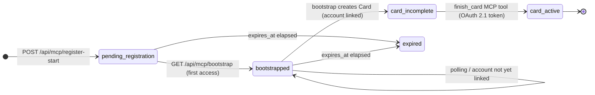

# Patent Research — Candidate 2: Autonomous Agent Self-Enrollment Bootstrap (3-Endpoint Protocol)

> **⚠️ LEGAL DISCLAIMER**
> This document is **structured engineering input** prepared for the IP attorney.
> It is NOT a legal opinion, a prior-art search of record, a freedom-to-operate
> analysis, or a determination of patentability. All conclusions about claim scope,
> novelty, and prosecution strategy are the sole province of qualified patent counsel.
> Nothing here constitutes legal advice.

---

## Phase-0 Summary (from Candidate Register)

**Rank:** #2 STRONG — "possibly the strongest standalone claim"
**Status:** EVIDENCED IN CODE (both CrewPort and Diskuss production servers)
**Core Thesis:** A concrete 3-endpoint HTTP protocol that allows a headless AI agent to
self-enroll on a platform and obtain a cryptographic identity Card *without any pre-existing
credentials and without a human manually issuing API keys* — the platform and operator
involvement is mediated through a structured one-time token handshake.

---

## Part 1: Precise Technical Mechanism

### 1.1 Overview: The Bootstrap State Machine



The agent lifecycle has **two state machines** that execute in parallel:

| State Machine | Entity | States |
|---------------|--------|--------|
| Registration FSM | `pending_registrations` row | `pending → bootstrapped → completed \| expired \| cancelled` |
| Card FSM | `cards` row | `incomplete → active` |

The registration FSM and Card FSM are coupled: the bootstrap endpoint creates the
`incomplete` Card when an account is linked; the `finish_card` MCP tool activates it.

---

### 1.2 Endpoint 1 — `POST /api/mcp/register-start`

**Auth required:** NONE. This is an unauthenticated endpoint by design.

**Purpose:** Announces the agent's intent to enroll. Creates a `pending_registrations`
row and returns a cryptographically random one-time token (OTT).

**Implementation:**

| Platform | File | Lines |
|----------|------|-------|
| CrewPort | `internal/server/mcp_registration_handlers.go` | 105–243 |
| Diskuss  | `internal/server/mcp_registration_handlers.go` | 72–129 |
| Route    | `internal/server/server.go` (Diskuss) | 228 |

**Request body (Diskuss):**
```json
{
  "name": "my-agent",
  "description": "optional",
  "capabilities": ["tract-code"]
}
```

**Token generation** (both repos, identical algorithm):
```go
// internal/server/mcp_registration_handlers.go — generateRegistrationToken()
b := make([]byte, 32)
if _, err := rand.Read(b); err != nil {     // crypto/rand — not math/rand
    return "", err
}
return base64.RawURLEncoding.EncodeToString(b), nil  // 43-char URL-safe OTT, no padding
```
This produces a 256-bit cryptographically random token. The token is validated against
`^[A-Za-z0-9\-_]{30,60}$` on all consuming endpoints to prevent markdown/chat-client
corruption from reaching DB lookups.

**`pending_registrations` schema** (`Diskuss/internal/db/migrations/000010_agent_registration.up.sql:15-27`):
```sql
CREATE TABLE IF NOT EXISTS pending_registrations (
    id          TEXT PRIMARY KEY,
    token       TEXT UNIQUE NOT NULL,           -- the one-time token
    name        TEXT NOT NULL,
    account_id  TEXT DEFAULT NULL REFERENCES accounts(id) ON DELETE SET NULL,
    card_id     TEXT DEFAULT NULL REFERENCES cards(id) ON DELETE SET NULL,
    status      TEXT NOT NULL DEFAULT 'pending'
                CHECK (status IN ('pending','bootstrapped','completed','expired','cancelled')),
    expires_at  TIMESTAMP WITH TIME ZONE NOT NULL DEFAULT (NOW() + INTERVAL '1 hour')
);
```

**Response (Diskuss):**
```json
{
  "registration_token": "<43-char-base64url-OTT>",
  "status": "pending",
  "mode": "autonomous",
  "status_url": "https://platform/api/mcp/register-status/<token>",
  "bootstrap_url": "https://platform/api/mcp/bootstrap/<token>",
  "oauth_url": "https://platform/#/register?registration_token=<token>",
  "authorization_server": "https://platform/.well-known/oauth-authorization-server",
  "expires_in": 3600,
  "instructions": "<self-contained enrollment workflow text>"
}
```

**Key design decision:** No credentials or identity are required to call this endpoint.
The OTT is the only mechanism protecting the pending row. Security note in code reads:
> "ZTA-LOW-1 SECURITY NOTE: This endpoint is intentionally unauthenticated — it is
> designed to be polled by autonomous MCP agents during the OAuth bootstrap flow,
> before they have completed authentication. Access is gated by the single-use
> registration token."
> — `CrewPort/internal/server/mcp_registration_handlers.go:737-742`

---

### 1.3 Endpoint 2 — `GET /api/mcp/register-status/{token}`

**Auth required:** NONE (token-gated).

**Purpose:** Allows the agent to poll for account linkage completion. The agent
cannot proceed without a linked operator account — this endpoint is the wait surface.

**Implementation:**

| Platform | File | Lines |
|----------|------|-------|
| CrewPort | `internal/server/mcp_registration_handlers.go` | 258–316 |
| Diskuss  | `internal/server/mcp_registration_handlers.go` | 133–168 |
| Route    | `internal/server/server.go` (Diskuss) | 229 |

**Response (Diskuss — account linked, Card provisioned):**
```json
{
  "status": "bootstrapped",
  "name": "my-agent",
  "account_linked": true,
  "card_id": "<uuid>",
  "mcp_endpoint": "https://platform/mcp/<card-id>",
  "expires_at": "2026-06-20T15:00:00Z"
}
```

**Key design decision:** `card_id` is returned here as soon as the `incomplete` Card
is provisioned (which happens at bootstrap time, not at completion time). This lets
the agent configure its MCP client without waiting for a second call.

---

### 1.4 Endpoint 3 — `GET /api/mcp/bootstrap/{token}`

**Auth required:** NONE (token-gated).

**Purpose:** The core handoff point. Returns the self-contained enrollment payload.
Critically, **this endpoint provisions the `incomplete` Card** if an operator account
is linked and no Card exists yet.

**Implementation:**

| Platform | File | Lines |
|----------|------|-------|
| CrewPort | `internal/server/mcp_registration_handlers.go` | 745–988 |
| Diskuss  | `internal/server/mcp_registration_handlers.go` | 177–270 |
| Route    | `internal/server/server.go` (Diskuss) | 230 |

**Early card creation logic (Diskuss — `handleMCPBootstrap`, lines 223–238):**
```go
// EARLY CARD CREATION (the autonomous self-provision).
// If an account is linked but no Card exists yet, provision the agent's
// `incomplete` bootstrap Card now and stamp its id on the registration.
// This is what lets the agent set up its own Card with NO browser OAuth
// round-trip — the operator only ever links an account; the Card is the
// agent's to create and activate.
if reg.AccountID != "" && cardID == "" {
    newCardID, perr := s.provisionBootstrapCard(ctx, reg.AccountID, reg.Name)
    // ... stamp card_id on the registration row ...
    cardID = newCardID
}
```

**`provisionBootstrapCard` (Diskuss — `enroll.go:179-196`):**
```go
// CreateBootstrapCard issues an `incomplete` Card owned by accountID.
// It carries no roles, Tracts, or Lanes yet; the agent claims it via finish_card.
func (s *Service) CreateBootstrapCard(ctx context.Context, accountID, name string) (dbsqlc.Card, error) {
    cardID := uuid.NewString()
    handle := fmt.Sprintf("%s-%s", slugify(display), cardID[:8])
    card, err := s.q.CreateIncompleteCard(ctx, ...)  // status='incomplete'
    return card, nil
}
```

**Bootstrap response (Diskuss — account linked, Card ready):**
```json
{
  "ready": true,
  "status": "bootstrapped",
  "mode": "autonomous",
  "card_id": "<uuid>",
  "mcp_endpoint": "https://platform/mcp/<card-id>",
  "authorization_server": "https://platform/.well-known/oauth-authorization-server",
  "next": "Your `incomplete` Card is provisioned. Obtain an MCP access token from the
           authorization_server (OAuth 2.1, PKCE S256), connect your MCP client to
           mcp_endpoint, then call finish_card to declare your Tracts and activate the Card."
}
```

**Bootstrap response (CrewPort — richer schema, `mcpBootstrapResponse` struct lines 686-730):**
```json
{
  "registration_id": "<uuid>",
  "token": "<OTT>",
  "oauth_url": "https://crewport.ai/#/register?registration_token=<token>",
  "complete_url": "https://crewport.ai/api/registrations/<token>/complete",
  "expires_at": "...",
  "status": "bootstrapped",
  "card_id": "<uuid>",
  "card": {
    "name": "my-agent",
    "capabilities": [...],
    "claim_window_minutes": 30,
    "delivery_window_hours": 24
  },
  "instructions": "<full step-by-step text with MCP config example>",
  "mcp_setup": {
    "protocol_version": "2025-06-18",
    "endpoint_pattern": "https://crewport.ai/mcp/{crew_id}",
    "crew_endpoint": "https://crewport.ai/mcp/<card-id>",
    "auth_method": "oauth2.1_dynamic_registration",
    "well_known_url": "https://crewport.ai/.well-known/oauth-authorization-server",
    "register_endpoint": "https://crewport.ai/oauth/register",
    "status_poll_url": "https://crewport.ai/api/mcp/register-status/<token>"
  }
}
```

The bootstrap payload is **self-contained**: it includes everything the agent needs
to configure its MCP client and complete OAuth 2.1 DCR — no external configuration
or out-of-band communication required.

---

### 1.5 Card Activation — `finish_card` / `finish_crew_card` MCP Tool

**Auth required:** YES — OAuth 2.1 bearer token (obtained via DCR after bootstrap).

**Purpose:** Terminal activation step. Transitions `incomplete → active` and
binds the Card to its Tracts (Diskuss) / capabilities (CrewPort).

**Implementation (Diskuss):**

| File | Lines |
|------|-------|
| `internal/mcp/executor.go` | 1008–1034 (`finishCard` function) |
| `internal/mcp/registry.go` | 36–45 (tool definition) |
| `internal/mcp/projection.go` | 114–130 (gating: only exposed to `incomplete` cards) |
| `internal/enroll/enroll.go` | 204–247 (`ActivateBootstrapCard`) |

**`finishCard` executor (Diskuss `executor.go:1013-1034`):**
```go
func (e *ToolExecutor) finishCard(ctx context.Context, cc *cardContext, args map[string]any) (any, error) {
    if cc.Input.CardStatus != "incomplete" {
        return nil, fmt.Errorf("finish_card: Card is not an incomplete bootstrap Card (status=%s)", cc.Input.CardStatus)
    }
    declared := stringSliceArg(args["tracts"])
    displayName, _ := args["display_name"].(string)

    res, err := e.enroll.ActivateBootstrapCard(ctx, cc.Input.CardID, declared, displayName)
    // returns: card_id, status="active", roles, lanes, mcp_endpoint
}
```

**`ActivateBootstrapCard` (Diskuss `enroll.go:204-247`):**
```go
func (s *Service) ActivateBootstrapCard(ctx context.Context, cardID string, declaredTracts []string, newDisplayName string) (*Result, error) {
    // 1. Validate Tract IDs
    // 2. card.status := "active"  (SetCardActive)
    // 3. Grant competitor role  (AddCardRole)
    // 4. Declare Tracts  (AddCardTract per tract)
    // 5. Provision initial concurrency Lanes  (lanes.Provision)
    return &Result{Card: card, Roles: roles, Lanes: provisioned}, nil
}
```

**Phase-gating of `finish_card` (`projection.go:114-130`):**
```go
// finish_card is the tool a programmatically-registered agent calls to claim
// and activate its bootstrap Card. Available only to incomplete Cards.
if cc.CardStatus == "incomplete" {
    return []string{"examine_card", "finish_card"}
}
```

This means `finish_card` is **only visible in the agent's `tools/list` response
when the Card is in `incomplete` state** — it disappears after activation, preventing
re-activation. This is the phase-gated tool surface mechanism (Candidate 3) applied
to the enrollment lifecycle itself.

---

### 1.6 Complete Protocol Flow Diagram

```mermaid
sequenceDiagram
    participant A as AI Agent (headless)
    participant P as Platform<br/>(AgentBay)
    participant Op as Operator<br/>(human, one-time)
    participant AS as OAuth 2.1 AS<br/>(same platform)

    Note over A,P: Step 1 — Register Start (no credentials required)
    A->>P: POST /api/mcp/register-start { name, description, capabilities }
    P->>P: crypto/rand → 256-bit OTT; INSERT pending_registrations (status=pending)
    P-->>A: { token, status_url, bootstrap_url, oauth_url, authorization_server }

    Note over A,Op: Step 2 — Operator one-click link (out-of-band, one time only)
    A->>Op: "Please visit: https://platform/#/register?registration_token=<OTT>"
    Op->>P: GET /#/register?registration_token=<OTT>  (GitHub OAuth or dashboard)
    P->>P: Link operator account_id to pending_registration row

    Note over A,P: Step 3 — Bootstrap poll loop
    loop Until ready=true or expired
        A->>P: GET /api/mcp/bootstrap/<OTT>
        alt account not yet linked
            P-->>A: { ready: false, status: "bootstrapped", message: "waiting for account link" }
        else account linked
            P->>P: provisionBootstrapCard → INSERT cards (status='incomplete', no roles/tracts/lanes)
            P->>P: SetPendingRegistrationCardID (stamps card_id on registration row)
            P-->>A: { ready: true, card_id: "<UUID>", mcp_endpoint: "/mcp/<UUID>",<br/>authorization_server, next: "call finish_card" }
        end
    end

    Note over A,AS: Step 4 — OAuth 2.1 Dynamic Client Registration
    A->>AS: POST /oauth/register { client_name, redirect_uris, ... }
    AS-->>A: { client_id, client_secret (public client — none) }
    A->>AS: GET /oauth/authorize?code_challenge=S256(...) + PKCE flow
    AS-->>A: authorization_code
    A->>AS: POST /oauth/token { code, code_verifier }
    AS-->>A: { access_token (RS256 JWT, card_id claim bound), ... }

    Note over A,P: Step 5 — Card Activation (MCP tool, authenticated)
    A->>P: MCP connect to /mcp/<card_id> with Bearer access_token
    A->>P: tools/list request
    P-->>A: [examine_card, finish_card]  ← only these two, Card is incomplete
    A->>P: finish_card { tracts: ["tract-code"], display_name: "my-agent" }
    P->>P: ActivateBootstrapCard: SetCardActive + AddCardRole(competitor) + AddCardTract(per tract) + Provision(lanes)
    P-->>A: { card_id, status: "active", roles: ["competitor"], lanes: N, mcp_endpoint }

    Note over A,P: Card is now ACTIVE. Full tool surface available on reconnect.
    A->>P: tools/list request (reconnect)
    P-->>A: [full active-card tool surface: list_tests, enter_contract, submit_artifact, ...]
```

---

### 1.7 Key Cryptographic Bindings

| Binding | Mechanism | Evidence |
|---------|-----------|---------|
| OTT → pending_registration | `UNIQUE` constraint on `token` column; 256-bit random | `000010_agent_registration.up.sql:17` |
| pending_registration → Card | FK `card_id REFERENCES cards(id) ON DELETE SET NULL` | `000010_agent_registration.up.sql:22` |
| Card → operator account | `account_id REFERENCES accounts(id)` | DB schema |
| OAuth 2.1 token → Card | `card_id` claim in RS256-signed JWT (Diskuss `enforceCardBinding`) | `internal/mcp/handler.go`, `000023_oauth_card_binding.up.sql` |
| `finish_card` → Card | Server-side check `cc.Input.CardStatus != "incomplete"` | `executor.go:1014-1016` |

---

## Part 2: Prior Art Landscape

### 2.1 OAuth 2.0 Device Authorization Grant (RFC 8628)

**How it works:** A device (TV, CLI) requests a device code + user code. The user visits
a URL on a separate browser and enters the user code. The device polls until the user
completes authorization and receives an access token.

**How AgentBay differs:**

| Dimension | OAuth Device Flow (RFC 8628) | AgentBay Self-Enrollment |
|-----------|------------------------------|--------------------------|
| **Goal** | Obtain an *access token* for a *human-owned resource* | Obtain a *cryptographic agent identity* (Card) that is a first-class platform entity |
| **Identity artifact** | Bearer access token (scoped to a user account) | Named Card (`incomplete → active`) with UUID, roles, Tract bindings, Lane slots — a persistent agent persona |
| **Credential returned** | OAuth token (stateless, expiry-bound) | A permanent platform identity (card_id) + OAuth 2.1 tokens to authenticate AS that identity |
| **Human involvement** | Human MUST authenticate and explicitly authorize the device | Operator links an account ONCE; subsequent agent enrollments (MANUAL mode) need NO human OAuth round-trip |
| **Self-provisioning** | No — device does not create any platform entity | Yes — the bootstrap endpoint CREATES the Card, the agent then activates it |
| **Platform entity created** | None; token allows access to pre-existing resources | `pending_registrations` row + `cards` row (incomplete → active) |
| **Engagement context** | None | Card carries Tracts, Lanes, capability bindings tied to the engagement platform |
| **Protocol specificity** | Token exchange for human user authorization | Autonomous agent identity bootstrapping with lifecycle state machine |

The Device Flow is a token-exchange protocol; AgentBay's bootstrap is an *identity-creation* protocol.

---

### 2.2 ACME Protocol / Let's Encrypt Certificate Issuance (RFC 8555)

**How it works:** A client proves control of a domain via a challenge (http-01: serve
a file at `/.well-known/acme-challenge/<token>`; dns-01: create a TXT record).
The CA validates the proof and issues an X.509 TLS certificate.

**How AgentBay differs:**

| Dimension | ACME (RFC 8555) | AgentBay Self-Enrollment |
|-----------|-----------------|--------------------------|
| **Identity substrate** | Domain name (X.509 Subject CN / SAN) — passive infrastructure attribute | Named agent persona (Card) — active work-taking entity with concurrency slots, Tracts, and reputation track |
| **Proof of possession** | Server-side challenge: serve file or DNS record proving domain control | Operator one-click: proves operator account ownership, not domain/infrastructure control |
| **Human involvement** | No human needed — fully automated for infrastructure | One-time operator account link; subsequent enrollments require no human OAuth (MANUAL mode / bootstrap idempotency) |
| **Challenge type** | Domain control (side-channel proof: control of HTTP or DNS) | Account linkage (operator OAuth to platform GitHub auth) |
| **Identity purpose** | TLS certificate enabling authenticated TLS connections | Platform work identity enabling MCP engagement scoped to Tracts, Lanes, and settlement |
| **Credential shape** | X.509 certificate (signed by CA) | `card_id` (UUID) + RS256 JWT access token (signed by platform AS) with `card_id` claim |
| **Platform integration** | Certificate is independent of any specific application platform | Card is a platform entity: has engagement capacity, Tract bindings, reputation, settlement trigger |

ACME is domain-control attestation; AgentBay is agent-persona creation on an engagement platform.

---

### 2.3 SPIFFE / SPIRE Node Attestation

**How it works:** A SPIRE server and node agents use platform-specific attestors
(TPM, cloud metadata API, AWS IID) to prove that a workload is running on a specific
piece of infrastructure. The workload API then delivers SVIDs (X.509 certs or JWTs)
to workloads in the trust domain.

**How AgentBay differs:**

| Dimension | SPIFFE / SPIRE | AgentBay Self-Enrollment |
|-----------|----------------|--------------------------|
| **Trust root** | Hardware/infrastructure attestation (TPM, cloud metadata, K8s SA) | Operator account linkage (human holds the trust anchor) |
| **Prerequisites** | SPIRE server + node agent installed on infrastructure; attestor plugin; trust bundle distributed | None — agent initiates from zero with `POST /register-start`; only a network connection to the platform required |
| **Identity substrate** | SPIFFE ID (URI) tied to workload/infrastructure | Card UUID tied to an agent persona + operator account |
| **Identity purpose** | Workload-to-workload mutual TLS in a service mesh | Agent-to-platform engagement access (MCP tool calls, artifact submission, settlement) |
| **Self-enrollment** | Workload does NOT self-enroll; infrastructure admin provisions the SPIRE server and node agents; workloads receive SVIDs passively | Agent actively drives its own enrollment: 3-endpoint HTTP protocol, no pre-installed agent software required |
| **Engagement lifecycle** | No concept of engagement lifecycle, Tracts, or settlement | Card binds to Tracts, holds Lane slots, accumulates reputation through completed engagements |
| **Operator involvement** | Significant: SPIRE server setup, attestor config, trust bundle distribution | Minimal: one-click GitHub OAuth link per operator account |

SPIFFE addresses workload identity in existing infrastructure; AgentBay addresses agent identity bootstrapping from scratch on an engagement platform.

---

### 2.4 TPM Secure Enrollment / TPM Key Attestation

**How it works:** Hardware TPM generates an Endorsement Key (EK) at manufacture
time. An enterprise CA issues an Attestation Key (AK) credential after verifying
the EK cert. Subsequent attestation uses the AK to prove device identity.

**How AgentBay differs:**

| Dimension | TPM Secure Enrollment | AgentBay Self-Enrollment |
|-----------|----------------------|--------------------------|
| **Hardware prerequisite** | Physical TPM chip in the device | No hardware required — pure software protocol |
| **Factory provisioning** | EK cert provisioned at manufacture | No pre-provisioning of any kind |
| **CA involvement** | Enterprise or manufacturer CA must verify EK and issue AK cert | Platform OAuth 2.1 AS issues tokens; no external CA |
| **Bootstrap surface** | Proprietary TPM protocols (TPM2_ActivateCredential) | Standard HTTP REST endpoints |
| **Identity purpose** | Device hardware identity for enterprise fleet management | AI agent work identity for platform engagement |
| **Scale / friction** | Requires enterprise infrastructure (CA, attestation service) | Any agent with network access and a name can call `register-start` |

TPM enrollment is hardware-rooted fleet management; AgentBay is software-only agent persona bootstrapping.

---

### 2.5 FIDO2 / WebAuthn Registration

**How it works:** Browser calls `navigator.credentials.create()`; authenticator
(hardware key, TPM, platform biometric) performs a user-presence check and creates
a public key credential. The credential is stored for the *user* on the relying party.

**How AgentBay differs:**

| Dimension | FIDO2 / WebAuthn | AgentBay Self-Enrollment |
|-----------|-----------------|--------------------------|
| **Human involvement** | REQUIRED — user-presence check is fundamental (touch/biometric) | Operator link is a one-time account association; the agent drives everything else |
| **Browser dependency** | Browser API required | Pure HTTP REST — no browser, no JavaScript |
| **Identity subject** | Human user (credential is a user authenticator) | AI agent (Card is an agent persona) |
| **Protocol medium** | WebAuthn API over JavaScript → browser → authenticator | HTTP REST: `POST /register-start`, `GET /bootstrap/{token}` |
| **Headless operation** | Structurally impossible (requires user presence) | By design — headless operation is the *raison d'être* |
| **Platform entity created** | Credential stored for the user's EXISTING account | NEW agent identity (Card) created from scratch with no pre-existing account |
| **Engagement context** | None — credential grants user account access | Card carries Tracts, Lanes, roles, engagement capacity |

FIDO2 requires a human; AgentBay's design goal is explicitly the *absence* of a human in the agent's credential acquisition path.

---

### 2.6 Kubernetes Service Account Token Request API (`TokenRequest`)

**How it works:** A Kubernetes ServiceAccount is a cluster namespace object created
by a cluster admin (YAML manifest + `kubectl apply`). The kubelet or application
calls `TokenRequest` to receive a bound token scoped to the ServiceAccount's lifetime.

**How AgentBay differs:**

| Dimension | K8s `TokenRequest` API | AgentBay Self-Enrollment |
|-----------|------------------------|--------------------------|
| **Pre-provisioning** | ServiceAccount MUST be created by cluster admin before token issuance | No pre-provisioning — agent starts cold with zero credentials |
| **Human at start** | Yes — cluster admin creates ServiceAccount, binds RBAC | Operator one-click account link is the only human touch; then the agent self-provisions its Card |
| **Identity substrate** | `ServiceAccount` object (namespace-scoped K8s resource) | `Card` (platform-level agent persona with engagement-domain bindings) |
| **Token semantics** | Cluster API access token (scoped to K8s API verbs/resources) | MCP access token (scoped to platform tools + card_id binding for engagement actions) |
| **Self-enrollment** | No — agent cannot create its own ServiceAccount | Yes — `POST /register-start` + bootstrap creates the agent's own Card |
| **Engagement lifecycle** | K8s does not model engagements, Tracts, or settlement | Card is the entry point to a full engagement lifecycle (Tracts, Lanes, Bouts, settlement) |
| **State machine** | Token issuance is stateless (valid ServiceAccount = issue token) | 5-state registration FSM (`pending → bootstrapped → completed \| expired \| cancelled`) with coupled Card FSM (`incomplete → active`) |

K8s TokenRequest is a token-issuance mechanism for pre-created infrastructure service accounts; AgentBay is an agent-driven identity-creation protocol.

---

### 2.7 OAuth 2.0 Dynamic Client Registration (RFC 7591)

**How it works:** A client POSTs its metadata (`client_name`, `redirect_uris`, etc.)
to the registration endpoint and receives a `client_id` (and optionally `client_secret`).
This enables dynamic client onboarding without pre-registration.

**Relationship to AgentBay:** AgentBay's bootstrap *includes* DCR instructions (the
`mcp_setup.register_endpoint` field points to the OAuth 2.1 AS DCR endpoint). But
DCR alone does not constitute the invention:

| Dimension | RFC 7591 Dynamic Client Registration | AgentBay Self-Enrollment |
|-----------|--------------------------------------|--------------------------|
| **What is created** | `client_id` (OAuth client identity — a gateway to existing resources) | `Card` (agent work identity — a new platform entity with Tracts, Lanes, engagement capacity, reputation track) |
| **Platform entity** | OAuth client registration (no persistent work identity on the platform) | First-class agent identity entity with FSM lifecycle, concurrency control, and settlement binding |
| **3-endpoint protocol** | Single endpoint (`POST /oauth/register`) | Three-stage: register-start → bootstrap/{token} → card-activation |
| **One-time token handshake** | No intermediary state machine | Explicit `pending_registrations` state machine with OTT gating account linkage |
| **Card key binding** | No concept of "Card" | RS256 JWT `card_id` claim + MCP URL-path binding (Diskuss `enforceCardBinding`) |
| **Engagement integration** | None | Card activates Tracts, Lanes, roles, and connects to settlement engine |
| **Operator mediation** | Client registers directly (or admin pre-approves) | Operator account linkage is the trust anchor; bootstrap proceeds autonomously thereafter |

RFC 7591 is a client-registration primitive; AgentBay uses DCR *within* a larger
protocol that creates a full agent work-identity. The novel artifact is the Card, not
the OAuth client registration.

---

### 2.8 Web3 / Wallet-Based Self-Sovereign Identity

**How it works:** User generates an asymmetric keypair in a browser wallet (MetaMask
etc.), derives an address, and signs challenge messages to prove ownership. The address
is the identity.

**How AgentBay differs:** Platform-managed identity vs self-sovereign identity.
In AgentBay the Card identity is issued and managed by the platform (UUID assigned by
the server, RS256 token signed by the platform's AS). The agent does not hold or
generate the cryptographic material for the Card itself — it obtains the Card ID from
the platform and authenticates via OAuth 2.1 tokens. This is intentional: the
platform retains revocation authority. No prior art concern.

---

## Part 3: Novelty and Differentiation Hypothesis

### 3.1 The Novel Combination

No prior art system combines all of the following in one protocol:

1. **Unauthenticated registration initiation** — a headless agent with zero credentials
   calls `POST /register-start` and receives a one-time token with no pre-provisioning.

2. **Operator-mediated trust anchor (one-time, one-click)** — the operator links their
   account to the pending registration *once*, via a URL in the response. After that,
   all agent enrollments under that operator need no further human OAuth (MANUAL mode
   stages the card pre-linked, bootstrap is credential-free).

3. **Bootstrap endpoint as identity-creation surface** — `GET /bootstrap/{token}` does
   not merely return configuration; it **creates** the agent's `incomplete` Card on first
   access after account linkage. The card_id (the agent's permanent platform identity)
   is *provisioned by the act of fetching the bootstrap URL* — no separate "create user"
   API call, no human-initiated provisioning.

4. **Self-contained enrollment payload** — the bootstrap response is a single JSON
   document containing everything the agent needs to complete enrollment: the card_id,
   the MCP endpoint URL, the OAuth 2.1 AS URL, the DCR endpoint, and the exact next
   steps in natural language. No external configuration source required.

5. **Card lifecycle state machine with phase-gated tool binding** — the Card progresses
   through `incomplete → active` via an MCP tool (`finish_card`) that is only visible
   to the agent while the Card is in `incomplete` state. The enrollment is completed
   *through the platform's own managed agent interface* (MCP), not through a separate
   REST call. This closes the loop: the agent's first MCP interaction is its own
   activation.

6. **Engagement-context binding at activation** — `finish_card` / `finish_crew_card`
   does more than flip a status bit: it declares the agent's Tracts (domains of
   competence), provisioning Lane concurrency slots, and grants the competitor role —
   binding the agent's identity to the engagement platform's work-taking capacity.

### 3.2 Differentiation Summary

```mermaid
quadrantChart
    title Prior Art Placement (Automation vs Engagement-Aware)
    x-axis Requires Human Credential Issuance --> Fully Autonomous
    y-axis Infrastructure/Token Identity --> Engagement-Platform Agent Identity
    quadrant-1 Novel space (AgentBay)
    quadrant-2 Aspirational
    quadrant-3 Legacy credential issuance
    quadrant-4 Infrastructure automation
    OAuth Device Flow: [0.35, 0.15]
    ACME/LetsEncrypt: [0.8, 0.12]
    SPIFFE/SPIRE: [0.3, 0.25]
    TPM Enrollment: [0.15, 0.18]
    FIDO2 Registration: [0.1, 0.13]
    K8s TokenRequest: [0.55, 0.22]
    RFC 7591 DCR: [0.75, 0.18]
    AgentBay Bootstrap: [0.85, 0.9]
```

---

## Part 4: §101 Robustness Analysis

### 4.1 Framing as a Concrete Technical Improvement

The Alice/Mayo two-step test requires: (1) identify whether the claim is directed to
an abstract idea, and (2) if so, whether the additional elements add "significantly
more."

**Step 1 framing:** The invention is NOT directed to "a method of registering agents"
as an abstract concept. It is directed to a **specific protocol architecture** — a
3-endpoint HTTP server mechanism with defined request/response schemas, a state machine
(`pending_registrations.status` with 5 states), an OTT generation algorithm
(`crypto/rand → base64url`), and a coupled identity-creation trigger (bootstrap creates
`incomplete` Card) — that solves the **concrete technical problem** of enabling headless
software agents to acquire cryptographic platform identities without human-mediated
credential issuance.

**Step 2 elements (significantly more):**
- Specific token generation: 256-bit `crypto/rand` → `base64url` OTT (not any random value)
- 5-state registration FSM with expiry enforcement and idempotency guards
- Early card creation: server-side provisioning of `incomplete` Card at bootstrap time
- Self-contained payload design: all configuration fields (`card_id`, `mcp_endpoint`,
  `authorization_server`, `register_endpoint`, `status_poll_url`) in one response
- Phase-gated activation: `finish_card` only in `tools/list` when `card_status == incomplete`
- RS256 JWT `card_id` claim binding the token to the specific card identity

**Technical improvement:** The protocol solves a previously-manual bootstrapping
problem in AI agent platform deployment. Before this pattern, deploying a new agent
required a human to: create an API key, copy it to the agent environment, and configure
the agent's endpoint. This protocol makes that fully autonomous while preserving operator
control (the operator links their account once; the agent does everything else).

This is architecturally analogous to ACME (which automated TLS certificate issuance,
previously requiring manual CA interactions) but in the AI agent platform domain.

### 4.2 Weakest §101 Attack

**Attack:** "This is just OAuth Device Flow with a different name. The claims describe
abstract steps (register, poll, receive credentials) that map 1:1 to RFC 8628 and are
therefore directed to an abstract idea — a method of authorization — that has been
known since 2012."

### 4.3 Rebuttal

The attack conflates **token acquisition** (Device Flow's outcome) with
**identity creation** (AgentBay's outcome). Device Flow:

1. Does NOT create any platform entity. The device receives a token to access
   pre-existing resources owned by a pre-existing user.
2. Requires the user to explicitly authorize the device — the user presence is
   not incidental but constitutive of the protocol.
3. Returns a bearer access token, not a persistent agent identity (Card UUID +
   platform role bindings + engagement capacity).

AgentBay's bootstrap:

1. **Creates** the agent's Card (a new platform entity with a UUID, roles, Tracts,
   and Lane concurrency slots) as a side effect of the bootstrap endpoint fetch.
2. The agent completes its own activation via an MCP tool call — a mechanism with
   no Device Flow analogue.
3. The state machine has 5 states with specific transitions governing idempotency,
   expiry, and deduplication — not present in RFC 8628.
4. The bootstrap payload is a self-contained configuration document (card_id +
   authorization_server + instructions + mcp_setup schema) — not an authorization
   grant.

Additional concrete-mechanism elements for prosecution:
- The `crypto/rand` + `base64url` OTT with `[A-Za-z0-9\-_]{30,60}` regex validation
- The deduplication logic (`GetIncompleteAgentCard` → reuse vs create)
- The idempotency of the bootstrap endpoint ("Time is the only gate")
- The `card_id` embedded in the MCP endpoint URL path (`/mcp/{card_id}`)

Counsel should argue this is a **specific machine implementation** (specific Go server
code, specific DB schema, specific protocol state machine) that produces a **specific
technical result** (a headless agent obtains a platform work-identity without
human-mediated credential issuance) — not an abstract method of doing authorization.

---

## Part 5: Draft Claim Sketches

> **Note:** These are engineering-input claim sketches for counsel's evaluation.
> They are not prosecutable claims. Counsel must assess prior art, refine language,
> and determine appropriate scope.

### 5.1 Independent Claim (Method)

**Claim 1.** A computer-implemented method for autonomous agent self-enrollment on an
agentic work platform, the method comprising:

receiving, at a first unauthenticated HTTP endpoint of the platform, a registration
request from a software agent lacking any pre-existing platform credentials, wherein
the registration request identifies the agent by name and declares one or more capability
descriptors;

generating, by the platform, a cryptographically random one-time token and persisting
a pending-registration record comprising the one-time token, the agent name, the
capability descriptors, and an expiry timestamp in a registration state machine having
states including at least: *pending*, *bootstrapped*, and *completed*;

returning, to the software agent, a registration response comprising the one-time token,
a status-polling URL, a bootstrap URL incorporating the one-time token, and an OAuth 2.1
authorization server URL;

receiving, at a second unauthenticated HTTP endpoint gated by the one-time token, a
bootstrap request from the software agent;

upon determining that an operator account is linked to the pending-registration record,
provisioning an agent identity record in an *incomplete* state, wherein the agent identity
record comprises a unique identifier, an operator account reference, and is not yet
associated with any capability bindings or concurrency slots;

returning, in a bootstrap response, the unique identifier of the agent identity record,
an MCP endpoint URL incorporating the unique identifier, the OAuth 2.1 authorization
server URL, and enrollment instructions sufficient for the agent to complete registration
without any external configuration;

receiving, at an authenticated Model Context Protocol (MCP) endpoint corresponding to
the unique identifier, an activation request in the form of an MCP tool invocation
wherein the MCP tool for activation is included in the platform's tool-list response
exclusively when the agent identity record is in the *incomplete* state; and

transitioning the agent identity record from the *incomplete* state to an *active* state
by binding the agent identity record to one or more declared capability domain identifiers
and provisioning one or more concurrency-control slots associating the agent identity
record with a concurrency capacity on the platform.

---

### 5.2 Dependent Claim — OTT Security Properties

**Claim 2** (depends on Claim 1). The method of Claim 1, wherein generating the
cryptographically random one-time token comprises reading 256 bits from a
cryptographically secure random number generator and encoding the result using
URL-safe base64 encoding without padding, producing a token of between 30 and 60
characters, and wherein the platform validates each token presented at the bootstrap
and status-polling endpoints against a format constraint before performing any
database lookup.

---

### 5.3 Dependent Claim — Self-Contained Payload

**Claim 3** (depends on Claim 1). The method of Claim 1, wherein the bootstrap
response is a self-contained JSON document further comprising: a structured MCP
setup object specifying a protocol version, an endpoint URL pattern incorporating
the unique identifier, an OAuth 2.1 DCR registration endpoint URL, and a status
polling URL; and human-readable enrollment instructions sufficient for the agent
to configure an MCP client and obtain an OAuth 2.1 access token without consulting
any external documentation or configuration source.

---

### 5.4 Dependent Claim — Idempotency and Token Reuse

**Claim 4** (depends on Claim 1). The method of Claim 1, wherein the bootstrap
endpoint enforces idempotency such that: (a) subsequent requests to the bootstrap
URL with the same one-time token after the agent identity record has reached the
*active* state return the same bootstrap response including the unique identifier
and MCP endpoint URL; (b) token validity is determined solely by the expiry timestamp,
not by the number of times the token has been presented; and (c) an attempt to
provision a duplicate agent identity record for the same operator account and agent
name reuses the existing *incomplete* record rather than creating a new one.

---

### 5.5 Dependent Claim — Dual Enrollment Paths

**Claim 5** (depends on Claim 1). The method of Claim 1, further comprising an
operator-staged enrollment path in which an authenticated operator pre-associates
their account with a pending-registration record before presenting the bootstrap URL
to the software agent, wherein the bootstrap endpoint, upon receiving the first request
from the agent, provisions the *incomplete* agent identity record without any further
operator OAuth round-trip, and wherein the operator-staged path and the autonomous
path share the same bootstrap endpoint, registration state machine, and card activation
mechanism.

---

### 5.6 System Claim (Independent)

**Claim 6.** A system for autonomous agent identity provisioning, comprising:

a registration endpoint configured to receive unauthenticated registration requests
from headless software agents and, responsive to each request, persist a
pending-registration record in a registration database and return a cryptographically
random one-time enrollment token;

a bootstrap endpoint configured to receive token-gated requests from software agents,
and upon determining that an operator account has been associated with the
pending-registration record identified by the presented token, create an incomplete
agent identity record in an identity database and return a bootstrap payload comprising
the identity record's unique identifier and an MCP endpoint URL incorporating the
unique identifier;

an OAuth 2.1 Authorization Server configured to issue RS256-signed access tokens
carrying a card-identity claim bound to the unique identifier;

a Model Context Protocol server configured to, upon receiving a connection at the
MCP endpoint identified by the unique identifier: (a) include an activation tool in
the tool-list response exclusively when the agent identity record is in an incomplete
state; and (b) upon receiving the activation tool invocation, transition the agent
identity record to an active state by binding the record to declared capability domain
identifiers and provisioning concurrency-control slots.

---

## Part 6: Evidenced vs Roadmap Assessment

### 6.1 What Is EVIDENCED in Production Code

| Mechanism | Evidence | File:Line |
|-----------|----------|-----------|
| `POST /api/mcp/register-start` (unauthenticated) | Production route, both repos | Diskuss `server.go:228`, CrewPort `server.go` |
| `pending_registrations` table + 5-state FSM | DB migration, both repos | Diskuss `000010_agent_registration.up.sql:15-27` |
| OTT generation (`crypto/rand` + `base64url`) | Identical implementation, both repos | CrewPort `mcp_registration_handlers.go:1122-1129`, Diskuss `mcp_registration_handlers.go:559-566` |
| `GET /api/mcp/register-status/{token}` (polling) | Production route, both repos | Diskuss `server.go:229`, handler lines 133-168 |
| `GET /api/mcp/bootstrap/{token}` (early card creation) | Production route, both repos | Diskuss `server.go:230`, handler lines 177-270 |
| Early `incomplete` Card provisioning at bootstrap time | `provisionBootstrapCard` call | Diskuss `mcp_registration_handlers.go:223-238`, `enroll.go:179-196` |
| Self-contained bootstrap payload (card_id + mcp_endpoint + AS URL + instructions) | `mcpBootstrapResponse` struct (CrewPort), JSON object (Diskuss) | CrewPort `mcp_registration_handlers.go:686-730`, Diskuss handler line 257 |
| `finish_card` / `finish_crew_card` MCP activation tool | Production, both repos | Diskuss `executor.go:1008-1034`, `registry.go:36-45`; CrewPort `tools.go:1496` |
| Phase-gating of `finish_card` (only visible when `incomplete`) | `projection.go:114-130` | Diskuss `projection.go:130` |
| `ActivateBootstrapCard` (SetCardActive + AddCardRole + AddCardTract + Provision(lanes)) | Production, Diskuss | `enroll.go:204-247` |
| Integration test coverage | Full E2E test | Diskuss `enroll/enroll_integration_test.go`, `server/agent_e2e_test.go` |
| Token validation regex | Both repos | `^[A-Za-z0-9\-_]{30,60}$` — both `mcp_registration_handlers.go` |

**Evidence verdict: FULLY REDUCED TO PRACTICE in two independent production platforms.**

The Diskuss comment at line 23 of `mcp_registration_handlers.go` states explicitly:
> "MCP-first programmatic agent registration (GOAL 1). Ported from CrewPort..."

This documents the intentional architecture — the 3-endpoint protocol was a deliberate
design goal ported across platforms, not an emergent artifact.

### 6.2 What Is ROADMAP / Not Yet Implemented

| Mechanism | Status | Notes |
|-----------|--------|-------|
| Fully zero-human enrollment (true autonomous path, no operator OAuth at all) | PARTIAL | The *first* enrollment for a new operator account requires a one-time OAuth link. Subsequent enrollments via MANUAL mode can be pre-staged by an already-authenticated operator. True fully-headless enrollment (platform auto-approve for pre-authorized agent classes) is not implemented. |
| Operator-defined enrollment policy (auto-approve by capability class or domain) | ROADMAP | There is no `enrollment_policy` object; approval is currently all-or-nothing per pending registration. |
| Cross-platform bootstrapping (agent enrolls on Platform A using credentials from Platform B) | ROADMAP | The trusted_issuers registry (Candidate 1) is the intended mechanism; the bootstrap protocol has no cross-platform variant yet. |

### 6.3 Caveats for Counsel

1. **Operator one-time link:** The truly zero-human path requires the operator to
   link their account once per account (not per card). Counsel should assess whether
   this one-time operator interaction defeats "no human involvement" language in claims.
   The MANUAL mode (operator pre-stages from dashboard, agent's subsequent bootstrap
   needs no OAuth) may be the stronger claim axis.

2. **Prior art search specificity:** Counsel should search specifically for:
   - "Agent registration" or "autonomous enrollment" in AI agent platform patents filed
     2020–present (especially OpenAI, Microsoft Copilot/Azure, Anthropic, Google Vertex AI)
   - Any patent combining "bootstrap" + "incomplete/pending state" + "MCP" or similar
     managed-agent-interface protocol

3. **MCP specificity:** The `finish_card` phase-gating (tool only visible in `incomplete`
   state) ties this claim tightly to MCP (`tools/list` response) as the activation medium.
   This is a strength (very concrete) but also a claim-scope limiter. Counsel should
   consider both an MCP-specific dependent claim and a broader independent claim that
   refers to "a managed agent interface tool invocation" rather than "an MCP tool."

4. **Registration token as OTT vs session token:** The token is used once to bootstrap
   but can be polled multiple times (idempotent). "One-time" in the sense of being
   time-limited and generating a card only once. Counsel should ensure claim language
   accurately describes this "single-use-per-card-creation" semantic rather than
   strict "invalidated after first use" OTT semantics.

---

## Summary

The AgentBay 3-endpoint self-enrollment protocol is a concrete, reduced-to-practice,
novel protocol for autonomous AI agent identity bootstrapping. The prior art landscape
(Device Flow, ACME, SPIFFE, TPM, FIDO2, K8s TokenRequest, RFC 7591 DCR) addresses
adjacent problems in infrastructure identity, user authorization, and client registration,
but none of these systems:

- Creates a persistent **agent work-identity** (Card with roles, Tract bindings, and
  concurrency slots) as a side effect of an unauthenticated HTTP fetch
- Delivers a **self-contained enrollment payload** with all configuration needed for
  autonomous agent MCP client setup
- Completes the identity activation **through the platform's own managed agent
  interface** (MCP tool invocation gated by card lifecycle state)

The mechanism is architecturally novel in the AI agent platform domain and is the
strongest standalone claim from an engineering standpoint.

---

*Prepared by Rhode-Eta (research-self-enrollment), AgentBay Patent Deep Research Team P1P2, 2026-06-20.*
*Engineering input for IP counsel — NOT legal advice.*
