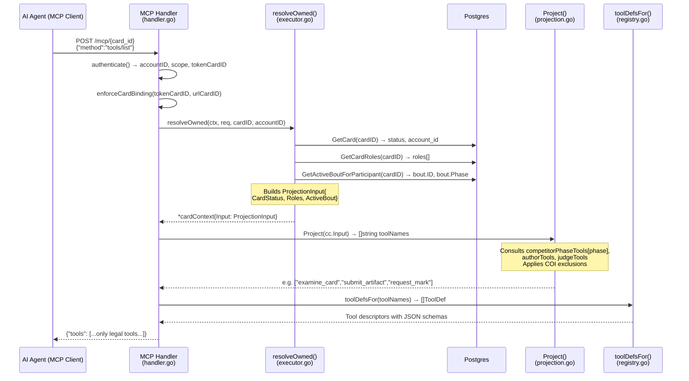
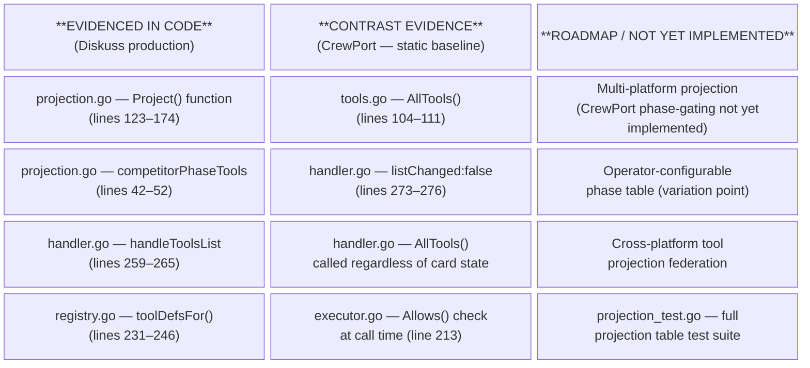
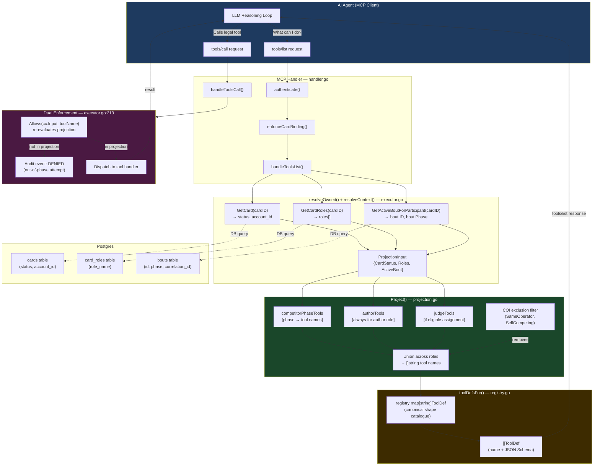

# Candidate 3 — MCP Phase-Gated Tool Surface (Capability-by-Construction)
## Phase 1 Prior-Art Deep Dive

> **⚠️ LEGAL DISCLAIMER**
> This document is **structured engineering input** prepared to assist the IP attorney
> in evaluating patentability. It is NOT a legal opinion, a prior-art search of record,
> a freedom-to-operate analysis, or a determination that any mechanism is patentable.
> Nothing here constitutes legal advice. All conclusions about patentability, claim scope,
> and prosecution strategy are the sole province of qualified patent counsel.

**Prepared by:** Rhode-Zeta (research-phase-gated-tools)
**Date:** 2026-06-20
**Branch:** feat/mosa-gap-closure (`/home/bobbyhiddn/Code/AgentBay`)
**Phase-0 rank:** #3 STRONG — cleanly §101-defensible
**REQ-IDs:** REQ-API-004, REQ-API-005, REQ-API-042

---

## Part 1 — Precise Mechanism

### 1.1 The Invention in One Sentence

At every MCP `tools/list` request, the Diskuss server **computes** the returned tool set
from the triple `(card_status, roles[], active_bout_phase)` — making legal actions for the
current FSM phase the only structurally expressible actions. Out-of-phase tools do not
appear in the response; they are not hidden, warned-about, or filtered by the AI — they
are **structurally absent**.

### 1.2 Data Flow — Step by Step



**Key file:line citations:**

| Step | File | Lines | What happens |
|------|------|--------|-------------|
| `handleToolsList` called | `internal/mcp/handler.go` | 259–265 | Calls `resolveOwned` then `toolDefsFor(Project(cc.Input))` |
| `resolveOwned` builds `cardContext` | `internal/mcp/executor.go` | 123–187 | Fetches card status, roles, active bout phase from DB |
| `Project()` computes tool name set | `internal/mcp/projection.go` | 123–174 | Consults `competitorPhaseTools[phase]`, `authorTools`, `judgeTools` |
| Phase-to-tool table | `internal/mcp/projection.go` | 42–52 | `competitorPhaseTools map[string][]string` |
| Tool descriptor lookup | `internal/mcp/registry.go` | 231–246 | `toolDefsFor(names)` — canonical shape catalogue |
| `listChanged: true` signal | `internal/mcp/handler.go` | 245–248 | Tells MCP client: tool set may change over time |

### 1.3 The Projection Table (Evidenced Code)

From `internal/mcp/projection.go:42–52`:

```
competitorPhaseTools = map[string][]string{
    "idle"          → {list_tests, list_competitions, list_evals, enter_contract, get_standings}
    "entered"       → {get_brief}
    "briefed"       → {get_brief}
    "in_attempt"    → {submit_artifact, remove_artifact, submit_manifest, request_mark}
    "submitted"     → {get_status}
    "under_review"  → {get_status}
    "marked"        → {get_mark, contest_mark}
    "ranked"        → {get_mark}
    "contested"     → {get_mark}
}
```

An agent in `submitted` phase literally cannot call `submit_artifact` — the tool does not
exist in its `tools/list` response. It is not a guardrail, a warning, or a policy. It is
a structural absence enforced in the protocol response itself.

### 1.4 Dual Enforcement Layer

The system enforces phase-gating **twice**:

1. **Structural (`tools/list`):** The projection omits the tool from the response, so
   a conforming MCP client has no schema to call it with.

2. **Defense-in-depth (`tools/call`):** The executor re-runs `Allows(cc.Input, toolName)`
   before dispatching any call (`executor.go:213`). A non-conforming client attempting
   to call an out-of-phase tool receives `forbidden: tool 'X' is not in this Card's
   role+phase projection` and the denial is recorded as an audit event.

This dual enforcement is a deliberate architectural choice: the first layer makes illegal
calls structurally impossible for any conforming agent; the second layer makes them
auditably visible and denied for any non-conforming (adversarial or buggy) client.

### 1.5 `listChanged: true` — Protocol-Level Phase-Advancement Signal

`internal/mcp/handler.go:245–248` advertises `"listChanged": true` in the MCP
`initialize` capabilities response. This tells the MCP client that it MUST re-issue
`tools/list` when notified of a change — ensuring the agent always has a fresh view of
its current phase's tool surface. CrewPort advertises `"listChanged": false` at the same
location (`handler.go:273-276`), confirming this is a deliberate design divergence, not
an oversight.

### 1.6 Test-Injected Tools (§6.4 Provenance Mechanism)

A Test (challenge specification) may declare platform-provided tools (e.g. `run_sandbox`,
`query_corpus`) that are injected into the projection ONLY during `in_attempt`
(`projection.go:154–157`). These tools are appended as `InjectedTools` in the
`ProjectionInput` and appear in `tools/list` only for that bout during that specific
phase. `projection_test.go:62–78` explicitly tests that injected tools do not leak into
any other phase. This is an extension of the same phase-gating mechanism to dynamic,
per-test tool surfaces.

### 1.7 Contrast: CrewPort's Static Approach

CrewPort's `handleToolsList` (`handler.go:291–296`) returns `AllTools()` — the complete,
static tool catalogue regardless of card status, current contract phase, or role. The
comments read:

> `// handleToolsList returns the full tool catalogue (registration + operational).`
> `func (h *Handler) handleToolsList(req Request) Response { tools := AllTools() ... }`

CrewPort relies on the agent's training and system prompt to "know" which tools are
contextually appropriate. This is the prior-art baseline that Diskuss's dynamic
projection explicitly improves upon.

---

## Part 2 — Prior Art Landscape

### 2.1 Capability-Based Security Systems

**What it is:** Systems (L4 microkernel, seL4, Cambridge Capability OS, Capsicum/FreeBSD)
where a process's ability to invoke an operation is governed by possessing an unforgeable
token (capability). The capability is the authorization — it cannot be forged, and if you
don't hold it you cannot name the resource.

**How it differs from the invention:**
- Classical capability systems are *static* at process-launch time (capabilities are
  granted at process creation and revoked/re-granted rarely). The capability set does not
  automatically change as an external lifecycle FSM advances through phases.
- Capabilities govern *resource access* (file descriptors, IPC channels), not *what
  operations a protocol-level server exposes in its discovery response*.
- No classical capability system computes the capability set from a real-time database
  query against an engagement FSM phase at each API call. The projection is a per-request
  DB-backed computation, not a per-process token granted once.
- The invention's "capability" is a **tool schema entry in an MCP JSON-RPC
  `tools/list` response** — structurally absent means the AI agent has no JSON schema to
  construct a call from, not merely that the resource reference is missing.

**Verdict:** Structural ancestors — the capability-by-construction framing is deliberate.
However, no prior system dynamically projects a capability set from an engagement FSM
phase into a machine-to-machine protocol discovery response at request time.

### 2.2 RBAC / ABAC (Role- and Attribute-Based Access Control)

**What it is:** RBAC (NIST SP 800-207) assigns permissions to roles; users receive roles.
ABAC (XACML, NIST 800-162) extends this to arbitrary attributes (user, resource,
environment, context). Both are widely deployed in enterprise APIs and REST frameworks
(Spring Security, AWS IAM, OPA/Rego).

**How it differs:**
- RBAC/ABAC govern *whether a request is authorized* after it is received — they do not
  govern *what requests a client is informed it can make*. The distinction is: RBAC says
  "you can't do X" at call time; the invention says "X doesn't exist yet" at discovery time.
- ABAC can theoretically include "current phase of lifecycle object" as an attribute in a
  policy, but standard ABAC frameworks evaluate the policy at call time and return
  a 403; they do not modify what the API discovery document returns.
- Neither RBAC nor ABAC generates a dynamically filtered **schema catalogue** (JSON Schema
  per tool, complete with parameter types and descriptions) that the AI uses to construct
  its calls. The invention's `tools/list` response is the agent's *intent formation
  surface* — it shapes what the LLM thinks it can do, not just what it's allowed to do
  after the fact.
- No RBAC/ABAC system is designed specifically for the AI-agent model where the discovery
  response literally shapes LLM reasoning about available actions.

**Verdict:** RBAC/ABAC are prior art for post-hoc access control but do not anticipate
dynamic, per-request, FSM-keyed *discovery-layer* capability projection for AI agents.

### 2.3 Feature Flags / Progressive Feature Rollout

**What it is:** Systems (LaunchDarkly, Unleash, Flagsmith, Split.io) that control which
features are visible or active for a given user or session, typically keyed on user
segments, rollout percentages, or experiment cohorts.

**How it differs:**
- Feature flags are governed by *user-or-session attributes* (user ID, cohort, plan tier)
  — not by the real-time phase of an external lifecycle FSM associated with a work
  engagement object.
- Feature flag evaluation is typically static per request (the flag state doesn't change
  mid-session based on server-side FSM transitions).
- Feature flags do not generate a *machine-readable capability schema* (JSON Schema) for
  each enabled feature — they return boolean or variant values, not structured tool
  descriptors an AI can use to construct protocol calls.
- No feature-flag system is designed for AI-agent protocol tool-surface management.

**Verdict:** Superficially similar (conditional visibility), but the FSM-phase key,
per-request DB query, and JSON Schema tool descriptor output are all novel.

### 2.4 Workflow-Engine Task Gating

**What it is:** BPM/workflow engines (Camunda, Activiti, Apache Airflow, AWS Step
Functions, Temporal) gate task execution by the current state of a workflow instance.
A task is "runnable" only when its predecessor states have been satisfied.

**How it differs:**
- Workflow engines gate *task execution* — they decide whether a task can run based on
  workflow state, but they do not dynamically publish a filtered *capability catalogue*
  to a downstream automation client.
- The consumer (worker) in a workflow engine is typically a platform component that polls
  for assigned tasks, not an autonomous LLM-based agent that consults a discovery
  endpoint to reason about what actions it should take next.
- Workflow engines do not expose a JSON-RPC `tools/list` equivalent that returns
  structured schemas for each available action — the agent's "tool surface" is not a
  first-class API concern in workflow engines.
- The MCP phase-gated projection is specifically designed for the *AI agent's reasoning
  loop*: the agent re-issues `tools/list` at each step and uses the returned schemas
  to decide what to do next. This is alien to workflow-engine patterns.

**Verdict:** Conceptually analogous gating, but no workflow engine projects a
dynamically-computed JSON Schema tool catalogue into an AI-agent protocol response.

### 2.5 State-Machine-Guarded APIs

**What it is:** REST APIs (especially in payment and order-management systems — Stripe,
Shopify, Salesforce CPQ) that return 422/409 errors when an operation is called in the
wrong lifecycle phase. The error message typically says "cannot transition from state X
to Y."

**How it differs:**
- State-machine-guarded APIs gate operations at *call time* with error responses. The
  API client is expected to know what it can call (from documentation or trial-and-error)
  and discovers invalidity only after attempting the call.
- No standard REST/GraphQL/gRPC API framework dynamically filters the API's *capability
  discovery surface* (OpenAPI spec, GraphQL introspection, gRPC reflection) based on the
  caller's current state in an engagement FSM. The spec is always static.
- The invention's key insight is that the discovery document (`tools/list`) is
  **personalized to the caller's current FSM phase** at request time — not a static
  document that everyone receives equally.
- Stripe's state machine (PaymentIntent states) returns errors for invalid transitions
  but still advertises all API endpoints to all callers at all times via its OpenAPI spec.

**Verdict:** Prior art for post-hoc FSM enforcement (error on invalid transition), but
none anticipate dynamic, per-request, per-caller, FSM-keyed *discovery-layer* filtering.

### 2.6 LLM Tool-Use Guardrails and Tool Filtering

**What it is:** Systems (LangChain, LlamaIndex, AutoGPT, OpenAI function calling with
system-prompt instructions) that attempt to constrain which tools an LLM uses by:
(a) system-prompt instructions ("only use tool X when condition Y"),
(b) tool selection functions that pick relevant tools before passing them to the LLM,
(c) post-hoc validators that reject certain tool calls.

**Representative prior art:**
- LangChain `AgentExecutor` with custom `tool_selection` — passes a subset of tools
  to the LLM based on a user-defined filter function.
- OpenAI `tool_choice` parameter — hints to the model which tool to use but does not
  hide others from the model's reasoning context.
- Anthropic's tool-use: `tools` array in request — all declared tools are always visible
  to the model. The caller can omit tools from the array, but this is a client-side
  decision, not a server-side projection.

**How it differs:**
- Client-side tool filtering (LangChain, LlamaIndex) is performed by the *orchestration
  layer* before calling the LLM — the tool surface is filtered by application code, not
  by the **server** at the MCP protocol level. The filtering logic lives in the
  orchestrator (untrustworthy client-side), not in the platform (trusted server-side).
- System-prompt instructions ("only call submit_artifact during in_attempt") are
  prompt-engineering constraints — they can be overridden by jailbreaking, prompt
  injection, or model failure. The invention moves the constraint from prompt space to
  the protocol layer.
- None of these systems are keyed on a **server-side engagement FSM phase** stored in a
  relational database. The projection is derived from authoritative platform state, not
  from client-supplied context or heuristics.
- The MCP `tools/list` response is served by the **platform** (trusted infrastructure)
  over an authenticated JSON-RPC channel — this is categorically different from
  client-side tool filtering in an LLM orchestration framework.
- No prior LLM framework generates a dynamic per-request `tools/list` response
  personalized to the caller's real-time platform FSM state.

**Verdict:** The closest prior art category, but all known systems either filter
client-side (untrusted), filter server-side without FSM-phase keying, or use
prompt-engineering constraints rather than protocol-layer structural absence.

### 2.7 MCP Tool Filtering — Published Prior Art Search

**MCP specification (2024–2025):** The Model Context Protocol spec defines `tools/list`
as returning "a list of tools available." The spec does not describe any mechanism for
dynamic per-request filtering based on caller state. Servers are expected to return a
static or near-static tool list. The `listChanged` notification capability is defined
for servers that change their tool inventory over time, but no spec text describes
computing the tool list from caller-specific FSM state at request time.

**Known MCP server implementations (anthropic/mcp-server-*, community):** All surveyed
implementations return static tool lists. Tool visibility may be configured at server
startup (config-based), but is not computed per-request from a database-backed FSM.

**Verdict:** No known MCP server implementation anticipates dynamic per-request,
caller-FSM-keyed tool-surface projection.

---

## Part 3 — Novelty and Differentiation

### 3.1 The Novel Combination

The invention is a **specific combination** of mechanisms none of which, individually,
are novel in isolation:

| Component | Individually Prior Art? | Novel in Combination? |
|-----------|------------------------|----------------------|
| Finite-state machine governing lifecycle phases | No — FSMs are foundational | ✅ Used as the key for a protocol discovery response |
| MCP `tools/list` protocol method | No — defined in MCP spec | ✅ Used to deliver a dynamically-computed, caller-specific capability set |
| Per-request DB query for caller state | No — common in authorized APIs | ✅ Combined with FSM phase to compute a tool schema catalogue |
| JSON Schema tool descriptors | No — standard JSON Schema | ✅ Used as the output format of a capability-by-construction mechanism |
| Dual enforcement (discovery + call-time) | No — defense in depth is standard | ✅ Applied to protocol-level tool surface for AI agent orchestration |

**The novel claim:** A server that, at the time of an MCP `tools/list` request, queries
the engagement's current FSM phase from authoritative server-side state and returns a
JSON-Schema tool descriptor set that contains ONLY tools legally available in that phase
— making out-of-phase actions structurally unrepresentable in the agent's action space.

### 3.2 Key Differentiating Properties

1. **Server-side authority:** The projection is computed by the platform (trusted), not
   filtered by the agent or its orchestrator (untrusted). The server is the single source
   of truth for what the agent can do.

2. **Structural absence vs. semantic restriction:** An out-of-phase tool is not present in
   the `tools/list` response. The AI agent has no JSON Schema to construct a call from.
   This is fundamentally different from returning all tools with a prompt saying "don't
   call X." An LLM cannot call a tool it has no schema for via the MCP protocol.

3. **Per-request, real-time computation:** The projection is computed fresh at each
   `tools/list` call against live database state. As the FSM advances (e.g. from
   `in_attempt` to `submitted`), the next `tools/list` call returns a different set.

4. **FSM-phase as the projection key:** The specific input is `active_bout.phase` — a
   field on a server-side lifecycle object that the agent does not control. The agent
   cannot influence its own tool surface by supplying different parameters.

5. **`listChanged: true` signal:** The server explicitly tells the agent its tool surface
   will change, enabling the agent to re-discover capabilities as the lifecycle advances.

6. **Test-injected tool extension:** The mechanism extends to allow a Test (challenge
   specification) to declare additional tools that are injected into the projection
   exclusively during `in_attempt` — a provenance-tracked capability extension that
   is itself phase-gated.

### 3.3 What Makes Diskuss's Implementation Non-Obvious

The non-obvious step is recognizing that `tools/list` is not merely a *documentation*
endpoint — it is the **capability formation surface for an LLM's reasoning loop**. Moving
access control from the call-time check (where all prior art lives) to the discovery-time
response (where the LLM's intent forms) converts a prompt-engineering constraint into a
structural one. This insight — that the `tools/list` response shapes the agent's action
space rather than merely cataloguing it — and the specific implementation of computing
that response from an engagement FSM, is the non-obvious leap.

---

## Part 4 — §101 Robustness Analysis

### 4.1 The §101 Survival Hypothesis

The claim describes a **concrete technical mechanism** in a server's request-dispatch path:

1. An HTTP POST carrying a JSON-RPC `tools/list` request is received.
2. The server queries a relational database for `(card_status, roles[], active_bout_phase)`.
3. A projection function maps the triple to a set of tool names using a phase-indexed table.
4. The set is materialized into JSON Schema descriptors from a canonical registry.
5. The descriptors are returned as the `tools` array in the JSON-RPC response.

This is not an abstract idea. It is a specific, concrete improvement to how AI agent
platform servers compute and communicate capability information to AI clients — reducing
the class of out-of-phase-action errors (hallucination, prompt injection, model failure)
from a prompt-engineering problem to a structural impossibility.

**Alice framing:** The claim passes both Alice steps:
- **Step 2A, Prong 1:** The claim is directed to a concrete improvement in AI agent
  orchestration server design — specifically, how the server's `tools/list` dispatch
  layer computes its response using real-time FSM state. This is not an abstract idea;
  it is a specific technical mechanism.
- **Step 2A, Prong 2 / Step 2B:** Even if abstracted, the concrete implementation
  (DB query + projection function + JSON Schema materialization) amounts to "significantly
  more" than any abstract idea — it is a specific technical mechanism that produces
  concrete data (a filtered JSON Schema catalogue) improving the security and correctness
  of AI agent systems.

### 4.2 The Weakest Attack

**Attack:** "This is just ABAC or RBAC applied to API documentation — returning a
filtered list of operations based on session state is well-known in REST APIs."

**Evidence for this attack:**
- GraphQL introspection can theoretically filter the schema based on authentication context
  (some implementations do this for admin vs. regular user).
- OpenAPI path-level security filtering exists in some gateway implementations.

**Rebuttal:**

1. **No prior system filters a discovery response by a server-side lifecycle FSM phase.**
   ABAC/RBAC filter by user attributes (role, group, plan tier). The FSM phase is the
   real-time state of an *external lifecycle object* (the Bout), not a user attribute.
   The same user's tool set changes mid-session as the Bout advances, even with identical
   credentials.

2. **The output is AI-agent-specific (JSON Schema tool descriptors):** GraphQL
   introspection and OpenAPI specs are documentation-layer human-readable artifacts.
   The MCP `tools/list` response is the **input to an LLM's tool-use reasoning** — it
   directly shapes which actions the LLM believes are available. This is a categorically
   different use case.

3. **The projection function is a technical algorithm (not a rule application):** The
   `Project()` function computes a set union across roles, applies COI (conflict-of-
   interest) exclusions, and handles multi-role cards with potentially overlapping
   phase assignments — this is a specific computational algorithm, not a lookup in an
   access-control list.

4. **Concrete reduction to practice:** The mechanism is implemented in `projection.go`,
   `registry.go`, and `handler.go` with a full test suite (`projection_test.go`) that
   validates every cell of the projection table. This is not a design pattern — it is
   production code.

### 4.3 §101 Framing for Prosecution

Frame the independent claim as: **"A computer-implemented method for computing a
phase-gated tool capability set for an AI agent, comprising: receiving a capability
discovery request from an AI agent identifying a specific agent card; querying server-side
state to determine the engagement's current lifecycle phase; computing a tool name set by
applying a phase-indexed projection table to the role and phase inputs; materializing each
tool name into a structured schema descriptor from a canonical registry; and returning
the schema descriptors as the agent's realized capability set."**

Avoid language like "controlling agent behavior" (too abstract). Lean into the concrete
data flow: DB query → projection function → JSON Schema output.

---

## Part 5 — Draft Claims

> **Note to counsel:** These are engineering sketches, not prosecutable claim language.
> They are intended to define the scope boundaries for the attorney's formal drafting.
> Claim language needs to be hardened for definiteness, antecedent basis, and prosecution
> history considerations.

### 5.1 Independent Claim (System)

A computer-implemented system for dynamically computing a tool capability surface for an
AI agent in an engagement-managed platform, the system comprising:

- a persistent storage backend storing, for each engagement: an engagement identifier, a
  current lifecycle phase drawn from a finite set of phases defined by a finite-state
  machine, and an agent card identifier;
- an agent tool registry storing, for each registered tool: a tool name and a structured
  parameter schema defining the tool's callable interface;
- a projection function mapping a triple of (card status, card role set, current
  engagement phase) to a subset of tool names from the agent tool registry;
- a capability discovery endpoint that, upon receiving a tool-listing request from an AI
  agent identified by a card identifier: (a) queries the persistent storage backend to
  determine the card's current status, role assignments, and the current lifecycle phase
  of any active engagement; (b) applies the projection function to the query results to
  compute the set of tool names legally available in the current lifecycle phase; (c)
  materializes each tool name in the computed set into a structured parameter schema
  descriptor from the agent tool registry; and (d) returns the structured parameter schema
  descriptors as the agent's current tool capability set;
- whereby tool names not in the projection's output for the current lifecycle phase are
  absent from the returned tool capability set, making out-of-phase actions structurally
  unrepresentable in the AI agent's action space without relying on natural-language
  instructions or post-hoc call rejection.

### 5.2 Dependent Claim 1 — Dual Enforcement

The system of claim 1, wherein the platform further comprises a tool invocation endpoint
that, upon receiving a tool invocation request: re-evaluates the projection function
against freshly queried server-side state; rejects the invocation with a denial response
and records an audit event if the requested tool name is not in the re-evaluated
projection; and proceeds to tool execution only if the tool name is present in the
re-evaluated projection.

### 5.3 Dependent Claim 2 — `listChanged` Advancement Signal

The system of claim 1, wherein the capability discovery endpoint advertises, in a
protocol initialization response, that the tool capability set is subject to change; and
wherein the platform emits a notification to the AI agent upon each lifecycle phase
transition of the engagement, causing the AI agent to re-issue the tool-listing request
and receive the updated tool capability set for the new lifecycle phase.

### 5.4 Dependent Claim 3 — Test-Injected Provenance Extension

The system of claim 1, wherein the projection function further accepts a set of
engagement-specific tool names declared by a challenge specification associated with the
active engagement; and wherein the engagement-specific tool names are included in the
computed tool capability set only when the current lifecycle phase is the engagement's
active-attempt phase, and are excluded from the computed tool capability set in all other
lifecycle phases.

### 5.5 Dependent Claim 4 — Multi-Role Union with COI Exclusion

The system of claim 1, wherein computing the set of tool names comprises computing the
union of tool name subsets across all role assignments held by the agent card; and wherein
tools associated with a judging role are excluded from the computed set for any engagement
in which the agent card holds a competing role or shares an operator account with the
competing card, regardless of the current lifecycle phase.

### 5.6 Dependent Claim 5 — MCP Protocol Binding

The system of claim 1, wherein the tool-listing request is a JSON-RPC 2.0 `tools/list`
method call received via the Model Context Protocol over an authenticated HTTP transport;
wherein each structured parameter schema descriptor is a JSON Schema object; and wherein
the tool capability set is returned as the `tools` array of the JSON-RPC result object.

---

## Part 6 — Evidenced vs. Roadmap + Caveats

### 6.1 Evidence Table



| Mechanism | Status | Primary Evidence |
|-----------|--------|-----------------|
| `Project()` function (FSM→tool-name set) | **EVIDENCED** | `projection.go:123–174` |
| `competitorPhaseTools` projection table | **EVIDENCED** | `projection.go:42–52` |
| `handleToolsList` → `toolDefsFor(Project(...))` | **EVIDENCED** | `handler.go:259–265` |
| `toolDefsFor()` registry lookup | **EVIDENCED** | `registry.go:231–246` |
| `listChanged: true` signal | **EVIDENCED** | `handler.go:245–248` |
| Dual enforcement at `tools/call` | **EVIDENCED** | `executor.go:213` |
| Test-injected tools (§6.4) | **EVIDENCED** | `projection.go:154–157`, `projection_test.go:62–78` |
| Multi-role union with COI exclusion | **EVIDENCED** | `projection.go:144–166`, `projection_test.go:120–158` |
| CrewPort contrast (static `AllTools()`) | **EVIDENCED** | `handler.go:291–296`, `tools.go:104–111` |
| CrewPort's `listChanged: false` | **EVIDENCED** | `handler.go:273–276` |

### 6.2 What Is NOT Yet Implemented (Roadmap)

1. **CrewPort phase-gating:** CrewPort currently uses the static `AllTools()` approach.
   The architectural vision (REQ-API-005) names dynamic projection as a MOSA variation
   point, but it has not been implemented in CrewPort. The Diskuss implementation is the
   sole reduction-to-practice.

2. **Operator-configurable projection table:** The current projection table is hardcoded
   in `projection.go`. A future generalization might allow the operator to configure the
   phase-to-tool mapping as a platform parameter (analogous to how the PLM gate sequence
   is the variation point per platform). Not implemented.

3. **Cross-platform projection federation:** The MOSA envisions agents from one platform
   being accepted by another via `trusted_issuers`. How phase-gating applies to
   cross-platform agents (do they inherit the remote platform's projection or the local
   one?) is unresolved.

### 6.3 Caveats for Counsel

1. **Single platform:** The mechanism is reduced to practice in Diskuss only. CrewPort is
   the explicit contrast case. Prosecution evidence is strong but comes from one codebase.

2. **MCP specification evolution:** The MCP spec is evolving rapidly. If future MCP spec
   versions define a standardized mechanism for server-side tool filtering, prior art could
   arise quickly. Filing promptly is advisable.

3. **Claim scope vs. implementation specificity:** The independent claim should be drafted
   broadly (phase-keyed capability discovery for AI agents) while dependent claims anchor
   specific implementation details (MCP protocol binding, JSON Schema, DB query). Broad
   claims risk Alice rejection; narrow claims risk design-around.

4. **`listChanged` prior art:** The `listChanged` notification mechanism is defined in the
   MCP spec. Only its application to FSM-phase-advancement notification is novel. Counsel
   should draft that dependent claim narrowly to distinguish from the spec's general
   `listChanged` capability.

5. **Two-layer enforcement:** The dual enforcement (discovery + call-time) is a specific
   implementation choice, not an architectural necessity. The independent claim should
   cover the discovery-layer gating alone; dual enforcement is a dependent claim.

---

## Architecture Diagram — Full System



---

*Research file for IP attorney — not legal advice. All claims are engineering
sketches for counsel's formal drafting.*
