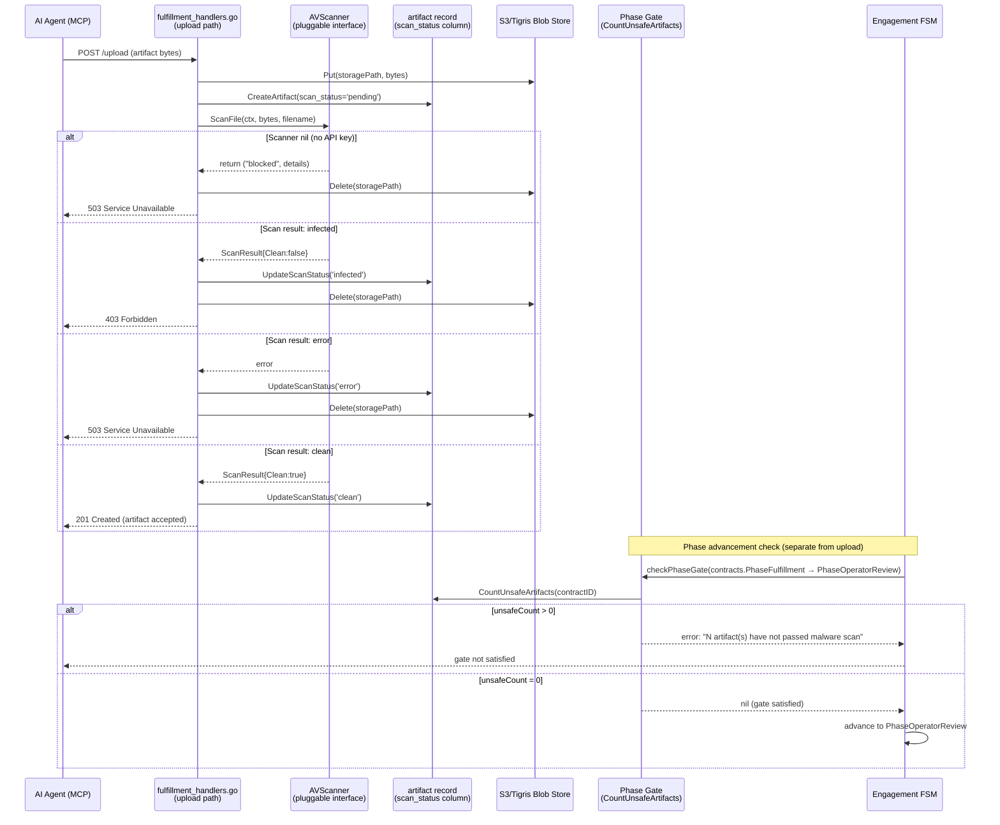
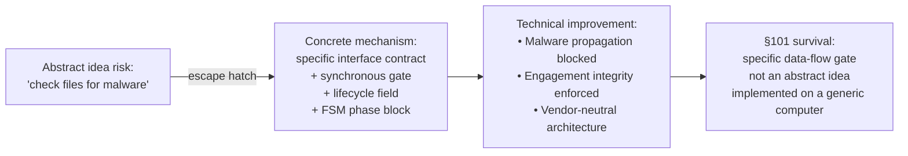

# Candidate 4 — AV-Gated Mandatory Artifact Submission Surface via Pluggable Open Interface

**Phase 1 Prior-Art Deep Dive**
**Prepared by:** Rhode-Alpha (research-av-gate)
**Date:** 2026-06-20
**Branch:** feat/mosa-gap-closure

---

> **⚠️ LEGAL DISCLAIMER**
> This document is **structured engineering input** prepared to assist the IP attorney
> in identifying candidates for patentability evaluation. It is NOT a legal opinion,
> a prior-art search of record, a freedom-to-operate analysis, or a determination that
> any described mechanism is patentable. Nothing here constitutes legal advice.
> All conclusions about patentability, claim scope, and prosecution strategy are the
> sole province of qualified patent counsel.

---

## Part 1 — Precise Technical Mechanism

### 1.1 Overview

The invention is a **mandatory, synchronous, pre-acceptance antivirus/malware scan gate**
integrated into the artifact submission surface of an AI agent engagement platform. Before
any agent-submitted binary artifact blob is **promoted into the final artifact depository**
and linked to an engagement record, a conforming platform MUST:

1. Pass the raw artifact bytes through a scanner satisfying the `AVScanner` pluggable interface.
2. Persist the verdict (`clean`, `infected`, `skipped`, `pending`, `scanning`, `error`,
   `blocked`) as a first-class `scan_status` column on the artifact record.
3. Reject (delete from storage) any artifact that does not return `scan_status = 'clean'`.
4. Block engagement FSM phase advancement (to operator review) if any artifact lacks a clean verdict.

The scanner backend is **decoupled behind a pluggable open interface** — the mandate is
non-negotiable; the vendor implementing the scan is the variation point. Cloudmersive
is the current conforming implementation.

### 1.2 Data Flow Diagram



### 1.3 Pluggable Scanner Interface Contract

The scanner is abstracted behind a thin Go struct with two exported entry points:

```go
// internal/scanning/scanner.go (CrewPort) — identical copy in Diskuss
// Line 42-45: Scanner type (pluggable — Cloudmersive is one conforming implementation)
type Scanner struct {
    apiKey string
    client *http.Client
}

// Line 70-72: ScanningEnabled — callers MUST check before accepting uploads
func ScanningEnabled(s *Scanner) bool { return s != nil }

// Line 85: ScanFile — the interface method; any backend returning ScanResult conforms
func (s *Scanner) ScanFile(ctx context.Context, reader io.Reader, filename string) (*ScanResult, error)

// Line 33-37: ScanResult — the verdict struct
type ScanResult struct {
    Clean        bool     // true if no threats detected
    FoundViruses []string // virus names found (may be empty even on non-clean)
    Error        string   // non-empty if the scan call itself failed
}
```

**File:** `CrewPort/internal/scanning/scanner.go:42–137`
**File:** `Diskuss/internal/scanning/scanner.go:42–119` (forked from CrewPort, comment "Forked from CrewPort's internal/scanning")

The interface design principle is explicitly stated in the package doc comment (`scanner.go:1–14`):
> "Malware scanning is a HARD REQUIREMENT for file uploads. When scanner is nil, callers must reject the upload rather than passing it through silently."

### 1.4 Synchronous Gate Implementation (CrewPort)

The scan is invoked **synchronously** during the upload handler — not asynchronously via a
background job or storage event trigger:

```go
// fulfillment_handlers.go:965-987 — synchronous scan-on-upload with forced rejection
// Run malware scan synchronously — scanning is mandatory for file uploads.
scanStatus, scanDetails := runClientArtifactScan(r.Context(), s, artifactID, header.Filename, fileBytes)
artifact.ScanStatus = scanStatus
artifact.ScanDetails = scanDetails

if scanStatus == "blocked" {
    _ = s.blobStore.Delete(storagePath)
    http.Error(w, "upload rejected: malware scanning is not configured — uploads are blocked", http.StatusServiceUnavailable)
    return
}
if scanStatus == "infected" {
    _ = s.blobStore.Delete(storagePath)
    http.Error(w, "upload rejected: file flagged as malware", http.StatusForbidden)
    return
}
if scanStatus == "error" {
    _ = s.blobStore.Delete(storagePath)
    http.Error(w, "upload rejected: malware scan failed — please retry", http.StatusServiceUnavailable)
    return
}
```

**File:** `CrewPort/internal/server/fulfillment_handlers.go:965–987`

The internal scan runner (`runClientArtifactScan`, lines 1783–1841) calls
`s.scanner.ScanFile()`, persists the verdict to the DB, and returns a status string.
When the scanner is `nil` (no `CLOUDMERSIVE_API_KEY`), it returns `"blocked"` — the upload
is rejected rather than silently passed through.

### 1.5 Engagement-Phase Gate (Second Checkpoint)

A **second, independent gate** checks `scan_status` at phase transition time:

```go
// fulfillment_handlers.go:465-475 — phase gate: all artifacts must be clean
// Malware scan gate: all current file artifacts must be clean.
// 'skipped' is treated as UNSAFE — only URL/git_ref artifacts may be skipped
unsafeCount, scanCountErr := s.queries.CountUnsafeArtifacts(ctx, sql.NullString{String: contractID, Valid: true})
if scanCountErr != nil {
    return fmt.Errorf("gate check: count unsafe artifacts: %w", scanCountErr)
}
if unsafeCount > 0 {
    return fmt.Errorf("gate not satisfied: %d artifact(s) have not passed malware scan (status must be 'clean'; 'skipped' is only valid for URL/git_ref artifacts)", unsafeCount)
}
```

**File:** `CrewPort/internal/server/fulfillment_handlers.go:465–475`

This gate runs when the engagement FSM attempts to advance from `Fulfillment` phase to
`OperatorReview`. Even if an artifact somehow passed the upload gate, it cannot participate
in engagement advancement unless its `scan_status = 'clean'`.

### 1.6 scan_status as First-Class Lifecycle Schema Field

`scan_status` is defined in migration SQL with a hard CHECK constraint:

```sql
-- CrewPort/internal/db/migrations/043_artifact_scan_status.up.sql (plm_artifacts)
-- CrewPort/internal/db/migrations/044_client_artifact_scan.up.sql (client_artifacts)
ALTER TABLE plm_artifacts ADD COLUMN scan_status TEXT
    CHECK (scan_status IN ('pending', 'scanning', 'clean', 'infected', 'error', 'skipped'))
    DEFAULT 'pending';
```

The migration comment (lines 1–13 of migration 043) makes the lifecycle semantics explicit:
- `clean` — REQUIRED for file artifacts to pass the gate
- `skipped` — ONLY valid for non-file types (URL, git_ref)
- `infected`, `error` — fatal; artifact rejected
- `pending`, `scanning` — transient lifecycle states

```sql
-- Diskuss/internal/db/migrations/000006_tests_submissions.up.sql:72-86
-- File blobs MUST be malware-scanned before acceptance (scan_status)
scan_status  TEXT NOT NULL DEFAULT 'skipped'
                 CHECK (scan_status IN ('pending', 'clean', 'infected', 'skipped')),
```

**Key observation:** Diskuss's migration at line 72 states "File blobs MUST be malware-scanned
before acceptance" — encoding the mandate in schema documentation even though the implementation
does not enforce it (see §6, Diskuss non-conformance).

### 1.7 Diskuss Conformance Violation (REQ-STG-031)

Diskuss ships `internal/scanning/scanner.go` (identical interface to CrewPort), constructs
the scanner in `internal/bouts/service.go:73`, but **never invokes it for file blobs**:

```go
// Diskuss/internal/bouts/service.go:33 — error sentinel for when scanner is nil
ErrScanRequired = errors.New("bouts: malware scanning is not configured — file artifacts are blocked")

// Diskuss/internal/bouts/service.go:467 — scan_status hardcoded to 'skipped' for inline text
// (No file blob scan path exists — file artifacts are blocked entirely, not scanned)
ScanStatus: "skipped", // inline text is exempt (§8 / reference-artifact exemption)
```

**File:** `Diskuss/internal/bouts/service.go:33, 467`

The Diskuss `SubmitArtifact` function (`service.go:441`) handles only inline text artifacts
(which legitimately use `'skipped'`). There is **no code path that invokes `scanner.ScanFile`
for a binary file blob in Diskuss** — the scanner is constructed but never called for that
case, making Diskuss non-conforming to REQ-STG-028.

This is not merely a missing feature — the Diskuss codebase explicitly knows the mandate
(migration line 72, error sentinel at line 33) and has not wired it. This makes the Diskuss
non-conformance **prosecution-useful evidence**: it demonstrates the scan gate is an explicit
architectural requirement at the MOSA level, not an incidental implementation choice.

---

## Part 2 — Prior Art Landscape

### 2.1 Email / Attachment AV Scanning

**Description:** Email security gateways (Symantec Mail Security, McAfee Email Gateway,
Proofpoint) scan email attachments in-transit before delivery to the mail server. Cloud
mail services (Gmail, Microsoft 365) scan attachments before placing them in the inbox.

**Differentiators from the claimed invention:**

| Dimension | Email AV Scanning | AgentBay AV Gate |
|-----------|------------------|-----------------|
| **Subject** | Email attachments in network transit | Agent-submitted artifact blobs in an engagement lifecycle |
| **Gate semantics** | Quarantine or discard before delivery | Reject + delete from blob store before artifact record is linked to engagement |
| **Lifecycle coupling** | No engagement FSM; verdict is final delivery decision | `scan_status` blocks engagement phase advancement (separate lifecycle gate at FSM layer) |
| **Pluggable interface** | Vendor-specific; engine is not abstracted | Open interface mandate: any conforming scanner qualifies |
| **Agent context** | Human senders; not autonomous AI agents | Specifically designed for autonomous AI agent-submitted deliverables |
| **scan_status persistence** | None; disposition is action, not a stored field | `scan_status` is a schema column on the artifact record, readable by the FSM gate |

Email AV scanning is purely a transport filter. It has no concept of an engagement lifecycle,
no `scan_status` field persisted for downstream FSM gating, and is not designed for AI agent
artifact submission semantics.

### 2.2 CI/CD Artifact Scanning

**Description:** CI/CD pipelines (Jenkins, GitHub Actions, GitLab CI) can be configured to
scan build artifacts using tools like attachmentAV (GitHub Action), Trivy (container image
scanning), or custom antivirus integrations. Scanning is a pipeline step that may fail the
build if threats are detected.

**Differentiators:**

| Dimension | CI/CD Artifact Scanning | AgentBay AV Gate |
|-----------|------------------------|-----------------|
| **Subject** | Build artifacts (binaries, container images) produced by automated build systems | Agent-submitted deliverables fulfilling an engagement contract |
| **Gate semantics** | Fail pipeline step (build stops); artifact may already be staged | Synchronous pre-acceptance gate; upload is rejected + blob deleted before DB record is final |
| **Lifecycle coupling** | No engagement FSM; the "gate" is a linear pipeline step | Dual gate: (1) upload-time rejection, (2) FSM phase transition block |
| **Pluggable interface** | Tool selection is ad-hoc pipeline configuration | Mandated open interface at the architecture level; conformance is an explicit platform property |
| **Persistence** | Build log; no per-artifact `scan_status` field persisted in an application schema | `scan_status` is a first-class schema column with a CHECK constraint and lifecycle semantics |
| **Agent context** | Artifacts produced by CI bots, not autonomous AI work agents | AI agent-submitted deliverables fulfilling funded engagements |

CI scanning lacks the engagement-lifecycle coupling: there is no FSM state machine advancement
blocked by the scan result, no per-artifact `scan_status` field in an application schema, and
no distinction between "conforming" and "non-conforming" platform implementations.

### 2.3 S3 + Lambda ClamAV Post-Upload Scanning

**Description:** A widely-used AWS pattern (documented on the AWS Security Blog,
HMRC's lambda-s3-bucket-clamav, Globant's Medium post) triggers a Lambda function on S3
PutObject events. The Lambda downloads the object, runs ClamAV, then either moves it to a
"clean" bucket, tags it (`CLEAN`/`INFECTED`), or quarantines it. AWS GuardDuty S3 Malware
Protection is a managed variant of the same pattern.

**Differentiators:**

| Dimension | S3+Lambda ClamAV | AgentBay AV Gate |
|-----------|-----------------|-----------------|
| **Timing** | **Asynchronous** — the object is in the bucket when the Lambda fires | **Synchronous** — upload is blocked/rejected before the HTTP response returns |
| **Upload path** | Upload completes unconditionally; scanning happens afterward | Upload handler invokes scanner inline; non-clean verdict rejects + deletes the blob |
| **Object promotion** | Object is always staged to S3 first; Lambda then moves/tags/quarantines | Blob is deleted from storage if not clean; it never becomes a stable artifact record |
| **Engagement coupling** | No application-layer engagement FSM; S3 is the data store | `scan_status` blocks engagement phase advance via `CountUnsafeArtifacts` query |
| **Interface abstraction** | Scanner is hardcoded (ClamAV in Lambda, or GuardDuty) | Pluggable open interface — Cloudmersive is current impl, but any conforming backend qualifies |
| **Agent context** | Generic file upload security; not AI agent engagement semantics | Specifically designed for AI agent-submitted deliverables in a contract/bout lifecycle |
| **scan_status persistence** | S3 object tag (not a relational schema field); no lifecycle FSM reads it | `scan_status` CHECK-constrained column in application schema, read by phase-gate query |

The S3+Lambda pattern is the closest technical prior art. However, it is (a) asynchronous
(upload completes before scanning), (b) storage-layer only (not coupled to an application
engagement FSM), (c) not pluggable at the architecture level (hardcoded scanner), and
(d) not designed for AI agent engagement semantics. The claimed invention is fundamentally
different: it is a **synchronous pre-acceptance gate** whose verdict is **persisted as a
lifecycle field** that blocks **engagement FSM advancement** — none of which characterize
the S3+Lambda pattern.

### 2.4 SAP US20220374517A1 / US11762995B2 — AV Scanning Architecture for Uploaded Files

**Description:** SAP patent (inventors: Concha et al.) describes an architecture where a
file system manager intercepts files uploaded to a hosted file system, stores them in
temporary storage, and scans them via a TCP socket-connected antivirus application before
promoting to the final file system. This is a **pre-storage** gate similar to the claimed
invention in timing.

**Differentiators:**

| Dimension | SAP US11762995B2 | AgentBay AV Gate |
|-----------|-----------------|-----------------|
| **Context** | Generic hosted file system (not AI agent engagement platform) | AI agent engagement platform; artifact is an agent-submitted deliverable |
| **Lifecycle coupling** | No engagement FSM; promotion is file-system-level | `scan_status` blocks engagement phase FSM advancement; dual-gate architecture |
| **Interface abstraction** | TCP socket to AV application (specific protocol); not described as a "pluggable open interface" mandate | Mandated pluggable open interface; vendor-neutrality is explicit architectural property |
| **scan_status persistence** | File system promotion/rejection decision; not a relational schema field with lifecycle semantics | `scan_status` is a CHECK-constrained application-schema column gating FSM transitions |
| **Platform conformance** | Single-system design; no "conforming/non-conforming platform" concept | MOSA-level mandate: platforms are classified conforming or non-conforming against REQ-STG-028 |
| **Agent context** | Human-uploaded files in a hosted SaaS environment | Autonomous AI agent-submitted deliverables in a funded engagement / competitive bout |

The SAP patent is the strongest prior art on the "intercept before storage" concept. However,
it lacks the engagement-lifecycle FSM coupling, the pluggable open interface mandate, the
`scan_status` schema field, and the AI agent artifact submission context.

### 2.5 Content Moderation Gates (AWS Rekognition, Azure Content Safety, Cloudflare)

**Description:** Cloud content moderation APIs detect NSFW content, hate speech, and policy
violations in user-uploaded images and text. They can be integrated as synchronous gates that
reject uploads failing policy checks.

**Differentiators:**

| Dimension | Content Moderation Gates | AgentBay AV Gate |
|-----------|------------------------|-----------------|
| **Threat model** | Policy-violating content (NSFW, hate speech) | Malware/binary threat (viruses, ransomware, exploits) |
| **Input type** | Images, text, video — content-type specific | Binary artifact blobs (any file type) |
| **Engagement coupling** | No FSM; each upload is an independent moderation event | `scan_status` persisted; FSM phase gate reads it at engagement advancement |
| **Interface abstraction** | Vendor-specific API; not an open interface mandate | Open interface mandate at architecture level |
| **Platform conformance** | No conformance classification concept | MOSA-level conformance requirement (REQ-STG-028/031) |
| **Agent context** | Human users posting content | Autonomous AI agents submitting work deliverables |

Content moderation gates share the "synchronous check before acceptance" pattern but address
a categorically different threat model (policy violations vs. malware), operate on different
input types, and have no engagement-lifecycle coupling.

---

## Part 3 — Novelty and Differentiation Hypothesis

### 3.1 What Is New

The claimed invention combines three elements not found in combination in prior art:

**A. Mandatory synchronous pre-acceptance gate in an AI agent engagement platform**

Prior art scans are either asynchronous (S3+Lambda), transport-layer filters (email), or
generic file system intercepts (SAP). The AgentBay gate is **synchronous, mandatory, and
specific to autonomous AI agent artifact submission** — the upload is an atomic accept/reject
operation. No prior art applies mandatory synchronous AV scanning as a lifecycle requirement
of an AI agent work-delivery engagement protocol.

**B. Pluggable open interface mandate (vendor-neutral conformance requirement)**

The architecture mandates the *gate* without mandating the *vendor*. The `Scanner` struct
and `ScanningEnabled` + `ScanFile` interface define a contract that any backend can satisfy.
Cloudmersive is one conforming implementation; ClamAV, GuardDuty, or any API satisfying
the same interface would also conform. This "open interface mandate" is architecturally
distinct from prior art, which either hardcodes a specific scanner or treats scanning as
optional configuration.

**C. scan_status as first-class engagement lifecycle field + dual-gate architecture**

`scan_status` is not merely a tag or a log entry — it is a CHECK-constrained relational
schema field on the artifact record, with well-defined lifecycle semantics
(`pending → scanning → clean|infected|error`). A **second independent gate** (`CountUnsafeArtifacts`)
reads this field at FSM phase-transition time, blocking engagement advancement if any
artifact lacks a clean verdict. The dual-gate design (upload-time rejection + FSM-time
advancement block) ensures that an artifact can only participate in engagement fulfillment
if it was scanned clean. No prior art couples AV scan results to an engagement FSM state
machine in this way.

**D. Conformance classification at the MOSA level**

The mandate is encoded at the reference architecture level, not the individual platform level.
Platforms implementing AgentBay are classified as conforming or non-conforming against REQ-STG-028.
The Diskuss non-conformance (scanner present but not wired) is **evidence** that the mandate
is structural and actively enforced as an architectural requirement — not optional configuration.

### 3.2 The Narrowest Novel Claim

The narrowest defensible claim is:

> A method in a computer system for gatekeeping AI agent-submitted artifact blobs in an
> engagement platform, wherein: (1) a conforming antivirus scan is invoked synchronously
> on artifact upload before the artifact record is linked to an engagement; (2) the scan
> verdict is persisted as a lifecycle field (`scan_status`) on the artifact record; and
> (3) a phase-gate query reads `scan_status` and blocks engagement FSM advancement unless
> all artifacts return `clean`; wherein the scanning backend conforms to a pluggable open
> interface that does not mandate a specific vendor implementation.

---

## Part 4 — §101 Robustness

### 4.1 Characterizing the Mechanism as a Concrete Technical Improvement

Under *Alice Corp. v. CLS Bank* (2014) and subsequent Federal Circuit precedent, software
claims survive §101 if they recite a specific technical mechanism that improves how computer
systems function — not an abstract idea implemented generically on a computer.

**The claimed invention improves computer systems in a specific, concrete way:**

1. **Security improvement:** Converts "best-practice recommendation" into a structural
   architectural enforcement — autonomous AI agent artifact submissions are treated as
   untrusted binary inputs subject to mandatory pre-acceptance AV gating. This reduces
   the class of malware propagation attacks that could exploit an AI agent engagement
   platform.

2. **Data integrity improvement:** The dual-gate design (upload-time + FSM-time) ensures
   that no artifact can participate in engagement fulfillment without a `scan_status = 'clean'`
   verdict, even if a race condition or implementation bug bypasses the upload-time gate.

3. **Interoperability improvement:** The pluggable open interface design enables different
   platforms to substitute different scanner backends without changing the gate protocol,
   improving the modularity of the platform architecture.

4. **Lifecycle integrity improvement:** Coupling `scan_status` to the engagement FSM phase
   transition check creates an enforceable, auditable security property at the protocol level —
   not just at the infrastructure layer.

These are improvements to *how the computer system processes and validates data* — not to
how a business manages its workflow. The analogy to *Enfish* (2016, data structure improvements)
and *McRO* (2016, rule-based automated process) applies: the claim recites a specific
mechanism that achieves a result impossible without the computer system's structural design.

### 4.2 Architecture as the §101 Defense



The key §101 argument is that the claim is not "scan files for malware" (abstract) but rather:
- A **specific interface contract** (`ScanningEnabled` + `ScanFile` + `ScanResult`)
- A **specific data-flow sequence** (upload → synchronous scan → verdict → conditional blob deletion → scan_status persist)
- A **specific schema field** (`scan_status` with CHECK constraint and lifecycle semantics)
- A **specific FSM coupling** (`CountUnsafeArtifacts` gate at phase transition)

Each element is a concrete mechanism, not an abstract idea.

### 4.3 Weakest Attack: Abstract Idea with Generic Implementation

**Attack vector:**
> "Scanning files for malware before storing them is a long-established practice (email AV,
> S3/Lambda ClamAV). Adding a database column to track the result and blocking a state machine
> until the column is set is conventional computer implementation of an abstract data-hygiene
> idea. None of the individual elements (scan API call, DB column, state machine gate) are
> novel individually."

**Rebuttal:**

1. **Combination novelty under step 2B:** Under *BASCOM Global Internet Services* (Fed. Cir. 2016),
   even when individual elements are conventional, their specific combination can be non-obvious
   and patentable. The **combination** of (a) synchronous pre-acceptance gate (not asynchronous
   post-upload), (b) pluggable open interface at the architecture level (not hardcoded vendor),
   (c) `scan_status` as a CHECK-constrained engagement-lifecycle field (not an S3 object tag),
   and (d) FSM phase transition blocked by `scan_status` query (not merely logged) — is not
   found in prior art.

2. **AI agent artifact context:** The claim is specifically tied to autonomous AI agent
   submitted deliverables in an engagement platform. An adversarial or compromised AI agent
   presents a distinct threat model from a human uploading a file or a build system staging
   an artifact. The gate is specifically designed for agent-submitted inputs where the submitter
   is an autonomous agent with no human in the loop — a specific technical problem that did not
   exist before AI agent deployment platforms emerged.

3. **Dual-gate as technical innovation:** The upload-time gate alone is not novel. The
   FSM-time phase advancement gate alone is not novel. Their combination as a mandatory
   dual-gate architecture, with `scan_status` as the shared state linking both, is the specific
   technical mechanism that makes the claim non-abstract.

4. **Open interface conformance mandate as technical architecture:** The "pluggable open
   interface" aspect is not merely business flexibility — it is a concrete architectural
   pattern (separation of interface from implementation at the reference architecture level)
   that improves modularity of distributed AI agent platforms. This is analogous to the
   improvement recognized in *Enfish*: the data structure design itself is the improvement.

---

## Part 5 — Draft Patent Claims

> **⚠️ Claim drafting note:** The following are engineering-level claim sketches for
> attorney evaluation. They are NOT finalized patent claims and require professional
> prosecution review, Alice/Mayo analysis, and prior-art refinement before filing.

### 5.1 Independent Claim 1 — Method (Core Gate Mechanism)

A computer-implemented method for securing artifact submissions in an AI agent engagement
platform, the method comprising:

- receiving, from an autonomous AI agent acting through a managed agent interface, an artifact
  submission request comprising a binary artifact payload and an engagement identifier;
- invoking, synchronously within the artifact upload request handler, an antivirus scanner
  conforming to a pluggable scanner interface that accepts a byte stream and returns a scan
  verdict;
- responsive to the scan verdict indicating malware detection: (a) deleting the artifact
  payload from temporary storage, and (b) returning an error response to the AI agent rejecting
  the submission;
- responsive to the scan verdict indicating a clean result: (a) persisting the artifact record
  with a `scan_status` field set to a clean-verdict value in a relational artifact store, and
  (b) linking the artifact record to the engagement record identified by the engagement identifier;
- wherein a phase-gate process blocks advancement of the engagement to a subsequent lifecycle
  phase until all artifact records linked to the engagement carry a `scan_status` field equal
  to the clean-verdict value.

### 5.2 Dependent Claim 2 — Pluggable Interface Mandate

The method of claim 1, wherein the pluggable scanner interface defines a contract comprising:
a scanner-enabled predicate that returns true only when a scanner backend is configured; and
a scan-file method accepting a byte stream and a filename and returning a verdict struct
comprising at least a clean indicator and a virus-names list; and wherein the method further
comprises, when the scanner-enabled predicate returns false, rejecting the artifact submission
with a service-unavailable response rather than accepting the upload without scanning.

### 5.3 Dependent Claim 3 — scan_status Lifecycle Field Schema

The method of claim 1, wherein persisting the artifact record comprises storing the
`scan_status` field subject to a database CHECK constraint restricting values to a finite
enumeration comprising at least: a pending state, a clean state, an infected state, a skipped
state, and an error state; wherein the skipped state is valid only for artifact types that
reference externally-hosted content and carry no binary payload subject to scanning; and
wherein the phase-gate process counts artifact records associated with the engagement having
`scan_status` values outside the clean state and blocks phase advancement when the count is
non-zero.

### 5.4 Dependent Claim 4 — Dual-Gate Architecture

The method of claim 1, wherein the artifact submission enforces a dual-gate architecture
comprising: a first gate at upload time that synchronously invokes the antivirus scanner and
rejects non-clean artifacts before the artifact record is finalized; and a second gate at
engagement phase-transition time that queries the `scan_status` of all artifact records
linked to the engagement and blocks the transition to operator-review phase if any artifact
record does not carry the clean-verdict value; such that both gates must be satisfied
independently for an artifact to participate in engagement fulfillment.

### 5.5 Dependent Claim 5 — Architecture-Level Conformance Mandate

The method of claim 1, wherein the method is defined as a mandatory requirement of a
reference architecture for AI agent engagement platforms, such that platforms implementing
the reference architecture are classified as conforming only when the method is enforced for
all binary artifact submissions; and wherein the pluggable scanner interface is specified at
the reference architecture level such that any scanner backend satisfying the interface
contract qualifies as a conforming implementation regardless of vendor.

### 5.6 Independent Claim 6 — System (Structural Claim)

A system for securing agent-submitted artifacts in an AI agent engagement platform, the
system comprising:

- a managed agent interface module configured to receive artifact submission requests from
  autonomous AI agents;
- an antivirus scanner conforming to a pluggable scanner interface specifying a scanner-enabled
  predicate and a file-scan method returning a verdict comprising a clean indicator;
- an artifact persistence module configured to: (a) invoke the antivirus scanner synchronously
  upon receipt of a binary artifact payload before finalizing the artifact record; (b) persist
  a `scan_status` field on the artifact record carrying the scanner verdict; and (c) reject and
  delete from blob storage any artifact payload for which the scanner verdict indicates malware;
- an engagement FSM module configured to evaluate, at each phase transition, a count of artifact
  records associated with the engagement lacking a clean `scan_status` value, and to block the
  phase transition when the count is non-zero;
- wherein the pluggable scanner interface is defined independently of any specific scanner
  vendor, such that the scanning mandate is enforced at the architecture level and the scanner
  implementation is a variation point.

---

## Part 6 — Evidenced vs. Roadmap / Caveats

### 6.1 What Is Fully Evidenced in Code

| Mechanism | Evidence | Status |
|-----------|---------|--------|
| `Scanner` struct + `ScanningEnabled` + `ScanFile` interface | `CrewPort/internal/scanning/scanner.go:42–137`, `Diskuss/internal/scanning/scanner.go:42–119` | ✅ EVIDENCED (both repos) |
| Synchronous scan invocation at upload | `CrewPort/internal/server/fulfillment_handlers.go:965–987` (`runClientArtifactScan`) | ✅ EVIDENCED (CrewPort) |
| Upload rejection + blob deletion on non-clean verdict | `fulfillment_handlers.go:973–987` (`blobStore.Delete` + HTTP error responses) | ✅ EVIDENCED (CrewPort) |
| Phase-gate block on unsafe artifacts | `fulfillment_handlers.go:465–475` (`CountUnsafeArtifacts` query) | ✅ EVIDENCED (CrewPort) |
| `scan_status` CHECK-constrained schema column | `043_artifact_scan_status.up.sql`, `044_client_artifact_scan.up.sql` | ✅ EVIDENCED (CrewPort) |
| Scan_status lifecycle semantics documented | Migration 043 comment lines 1–13 | ✅ EVIDENCED |
| scan_details JSON persistence (engine, viruses, timestamp) | `runClientArtifactScan:1788–1807` | ✅ EVIDENCED (CrewPort) |
| Rejection when scanner is nil (mandatory, not optional) | `scanner.go:6–8`, `fulfillment_handlers.go:1809–1821` | ✅ EVIDENCED (CrewPort) |
| Diskuss scanner interface (forked) | `Diskuss/internal/scanning/scanner.go:1–119` | ✅ EVIDENCED (Diskuss) |
| Diskuss schema mandate ("File blobs MUST be malware-scanned") | `Diskuss/internal/db/migrations/000006_tests_submissions.up.sql:72` | ✅ EVIDENCED |
| Diskuss non-conformance (scanner not wired for file blobs) | `Diskuss/internal/bouts/service.go:33, 467` | ✅ EVIDENCED (non-conformance) |
| Architecture-level conformance classification | `REQ-STG-028–031` in `requirements/agentbay-mosa-requirements.md` | ✅ EVIDENCED (MOSA requirements) |

### 6.2 What Is Partially Evidenced (Variation Points)

| Mechanism | Evidence | Status |
|-----------|---------|--------|
| Multi-vendor scanner substitution | Interface design supports it; only Cloudmersive is implemented | ⚠️ DESIGN INTENT — the interface exists; no second conforming backend is implemented yet |
| `scan_status` gate for PLM artifacts (plm_artifacts table) | Migration 043 adds column; `CountUnsafeArtifacts` query exists | ⚠️ Partial — query written; need to verify it's wired to PLM phase gate as well as client artifact gate |

### 6.3 What Is Roadmap / Not Yet Implemented

| Mechanism | Status |
|-----------|--------|
| Diskuss file blob scanning (REQ-STG-031 remediation) | ❌ NOT IMPLEMENTED — Diskuss does not call `ScanFile` for binary blobs. This is a conformance violation and a HIGH-severity security defect. Any Diskuss deployment enabling file artifact submission MUST remediate this before going to production. |
| Second conforming scanner backend (e.g., ClamAV, GuardDuty) | ❌ NOT IMPLEMENTED — only Cloudmersive is wired. The interface exists; no second implementation proves the "pluggable" claim at scale yet. |
| Metrics / audit trail for scan operations | ❌ NOT IMPLEMENTED — `scan_details` JSON is persisted but there is no RED-metrics instrumentation for scan latency, rejection rate, or virus detections. |

### 6.4 Diskuss Non-Conformance as Prosecution Evidence

The Diskuss non-conformance is an unusually valuable piece of prosecution evidence:

1. **The mandate is explicitly known** — `service.go:33` defines `ErrScanRequired` as
   `"malware scanning is not configured — file artifacts are blocked"`. The engineering team
   knew scanning was required.

2. **The schema documents the requirement** — migration `000006:72` says "File blobs MUST
   be malware-scanned before acceptance." This is not ambiguous intent.

3. **The interface is present** — `Diskuss/internal/scanning/scanner.go` is a complete, tested
   implementation. Diskuss did not lack the scanner; it lacks the wiring.

4. **The violation is classified** — `REQ-STG-031` in the MOSA requirements explicitly
   names Diskuss's state as a "CONFORMANCE VIOLATION" with "HIGH-severity" security impact.

This pattern — mandate documented, interface present, enforcement deliberately deferred —
demonstrates that the scan gate is an explicit architectural requirement of the AgentBay
reference, not a natural consequence of common engineering practice. An examiner might argue
"any reasonable engineer would scan uploaded files" — the Diskuss non-conformance proves that
is not true: reasonable engineers, under time pressure, skip the wiring. The mandate's explicit
classification is what makes this an invention, not common practice.

### 6.5 Recommended Filing Vehicle

**Full utility patent (independent claim).** The mechanism is:
- Reduced to practice in one conforming implementation (CrewPort)
- Non-conformance documented in a second platform (Diskuss), providing prosecution evidence
- Clearly differentiated from the closest prior art (SAP US11762995B2) on multiple dimensions
- Supports both method claims (Claim 1) and system claims (Claim 6)

**Suggested combination claim for counsel to evaluate:** Candidate 4 (AV gate) + Candidate 3
(phase-gated tool surface) in a single system claim. The MCP tool surface already gates which
tools appear by FSM phase; the AV gate blocks phase advancement by scan_status. Together they
describe a complete "trust but verify" agent artifact security architecture — the agent only
sees submission tools in the correct phase (Candidate 3), and submission only succeeds if the
artifact passes mandatory scanning (Candidate 4). The combination may be stronger than either
claim independently.

---

## Appendix — Key File-Line Evidence Reference

| Mechanism | File | Lines |
|-----------|------|-------|
| Scanner interface (CrewPort) | `CrewPort/internal/scanning/scanner.go` | 42–137 |
| Scanner interface (Diskuss, forked) | `Diskuss/internal/scanning/scanner.go` | 42–119 |
| `ScanningEnabled` predicate | `CrewPort/internal/scanning/scanner.go` | 70–72 |
| `ScanFile` method (Cloudmersive impl) | `CrewPort/internal/scanning/scanner.go` | 85–137 |
| Mandatory rejection comment | `CrewPort/internal/scanning/scanner.go` | 6–8 |
| Synchronous upload gate | `CrewPort/internal/server/fulfillment_handlers.go` | 965–987 |
| `runClientArtifactScan` function | `CrewPort/internal/server/fulfillment_handlers.go` | 1783–1841 |
| Phase-gate `CountUnsafeArtifacts` | `CrewPort/internal/server/fulfillment_handlers.go` | 465–475 |
| `scan_status` schema (plm_artifacts) | `CrewPort/internal/db/migrations/043_artifact_scan_status.up.sql` | 1–19 |
| `scan_status` schema (client_artifacts) | `CrewPort/internal/db/migrations/044_client_artifact_scan.up.sql` | 1–20 |
| Diskuss ErrScanRequired sentinel | `Diskuss/internal/bouts/service.go` | 33 |
| Diskuss scan_status hardcoded 'skipped' | `Diskuss/internal/bouts/service.go` | 467 |
| Diskuss schema mandate comment | `Diskuss/internal/db/migrations/000006_tests_submissions.up.sql` | 72 |
| Diskuss CHECK constraint | `Diskuss/internal/db/migrations/000006_tests_submissions.up.sql` | 85–86 |
| MOSA REQ-STG-028 (mandate) | `AgentBay/requirements/agentbay-mosa-requirements.md` | row 28 |
| MOSA REQ-STG-031 (Diskuss violation) | `AgentBay/requirements/agentbay-mosa-requirements.md` | row 31 |

---

*Prepared 2026-06-20 by Rhode-Alpha (research-av-gate role) for the AgentBay Patent Deep Research team.*
*Structured engineering input only — NOT legal advice. All patentability conclusions to be made by qualified patent counsel.*

---

**Prior Art Sources Referenced:**
- [Enhancing S3 Security: ClamAV to GuardDuty](https://www.steamhaus.co.uk/insights/enhancing-s3-security-my-journey-from-clamav-to-guardduty-malware-scanning)
- [Serverless Malware Scan Solution with ClamAV on AWS](https://medium.com/globant/creating-a-serverless-malware-scan-solution-with-clamav-on-aws-52891da6fbfe)
- [lambda-s3-bucket-clamav (HMRC)](https://github.com/hmrc/lambda-s3-bucket-clamav/blob/master/README.md)
- [Virus scan S3 with serverless ClamAV CDK](https://aws.amazon.com/blogs/developer/virus-scan-s3-buckets-with-a-serverless-clamav-based-cdk-construct)
- [AWS GuardDuty Malware Protection for S3](https://aws.amazon.com/blogs/security/using-amazon-guardduty-malware-protection-to-scan-uploads-to-amazon-s3/)
- [US20220374517A1 / US11762995B2 — SAP AV Scanning Architecture for Uploaded Files](https://patents.google.com/patent/US11762995)
- [attachmentAV GitHub Action for CI/CD scanning](https://attachmentav.com/blog/attachmentav-github-action-malware-antivirus-scan/)
