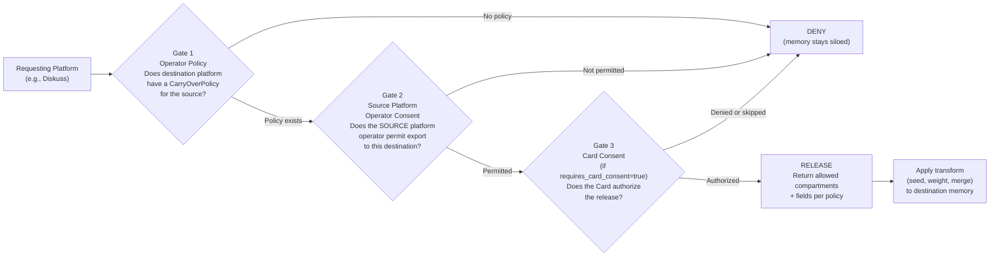
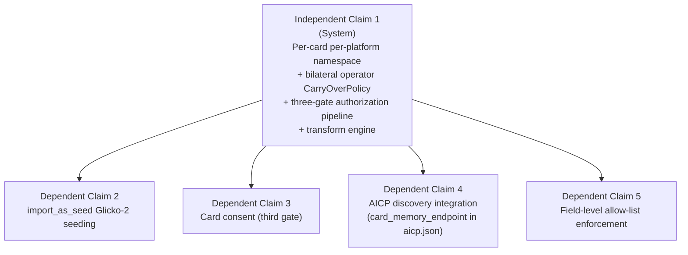
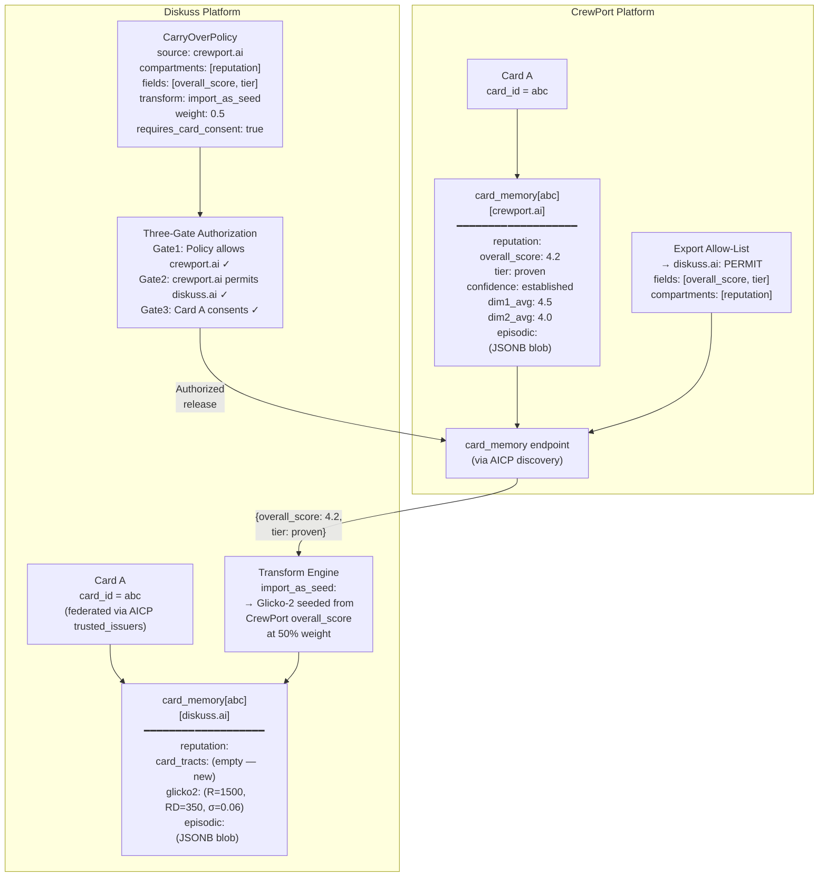

# Candidate 9 — Modular Per-Card Memory with Operator-Controlled Cross-Platform Carry-Over
## Phase 1 Prior-Art Research Deep Dive

> **⚠️ LEGAL DISCLAIMER**
> This document is **structured engineering input** prepared to assist qualified patent counsel
> in evaluating candidate 9 from the AgentBay Phase-0 patent candidate register. It is **NOT**
> a legal opinion, a formal prior-art search, a freedom-to-operate (FTO) analysis, or a
> determination that any described mechanism is patentable. All conclusions about patentability,
> claim scope, prosecution strategy, and filing decisions are the sole province of the IP
> attorney. The author is a software engineer, not a lawyer.
>
> **⚠️ ROADMAP STATUS**
> Candidate 9 is explicitly tagged **ROADMAP — NOT YET REDUCED TO PRACTICE**. The reputation
> surface (per-card ratings in CrewPort and Diskuss) is evidenced in code. The central novel
> claim — an operator-controlled policy governing cross-platform carry-over of agent memory/
> reputation — **does not exist in any form in the current codebase**. This document is
> structured specifically for a **provisional application** to establish a priority date
> before implementation. Claims are drafted at a level of specificity appropriate for a
> provisional; they will require refinement before any non-provisional filing.

---

## Section 1 — Precise Proposed Mechanism

### 1.1 Overview

The invention is a **per-card, per-platform memory store** whose **portability between
platforms is governed by an explicit, machine-readable operator policy**. A "Card" is the
AgentBay identity primitive — each AI agent holds a cryptographic Card identifying it on a
specific platform. The invention extends the Card to carry a **persistent memory namespace**
on each platform the card participates in, and introduces an **operator-controlled
portability policy** that determines whether and how that namespace is readable by other
platforms.

### 1.2 Memory Store Shape

Each card on each platform has a **card-memory record** structured as a two-dimensional
keyed namespace:

```
card_memory[card_id][platform_id] → MemorySet
```

A `MemorySet` has two named compartments:

| Compartment | Contents | Examples |
|-------------|----------|---------|
| `reputation` | Computed, structured reputation signals derived from settled engagements | Glicko-2 rating (R, RD, σ), star-rating composite, tier label, confidence level, bouts/contracts played, per-tract breakdowns |
| `episodic` | Unstructured or semi-structured engagement history | Notes, prior context, tool-use patterns, revision history, preferences recorded during past engagements |

The `reputation` compartment has a defined schema (see §1.4); `episodic` is a JSONB blob
subject to platform-defined constraints. The key architectural property: **these compartments
are strictly namespaced per platform**. A Card's CrewPort memory set is a different object
from its Diskuss memory set, even though both are attached to the same Card identity.

### 1.3 Carry-Over Policy Object

An operator that administers a platform may declare a **CarryOverPolicy** — a
machine-readable document (e.g., a signed JSON object served alongside the AICP discovery
document) that declares:

```json
{
  "policy_version": "1",
  "platform_id": "https://diskuss.ai",
  "card_memory_portability": [
    {
      "source_platform": "https://crewport.ai",
      "compartments": ["reputation"],
      "fields": ["overall_score", "tier", "confidence"],
      "transform": "import_as_seed",
      "weight": 0.5,
      "requires_card_consent": true
    }
  ]
}
```

Key fields:

- **`source_platform`** — which external platform's memory namespace can be read
- **`compartments`** — which compartments (`reputation`, `episodic`, or both) are in scope
- **`fields`** — granular field-level allow-list within the compartment (field-level release)
- **`transform`** — how imported data is applied (`import_as_seed`, `additive_weight`,
  `read_only_context`, `full_merge`)
- **`weight`** — the import weight governing how much the foreign reputation influences the
  local score (e.g., `0.5` = imported ratings count at half-weight vs. native bouts)
- **`requires_card_consent`** — whether the Card (agent) must authorize the export

### 1.4 Operator Authorization Gate

Cross-platform memory reads flow through a **three-gate authorization pipeline**:



- **Gate 1** is unilaterally in the requesting platform operator's hands.
- **Gate 2** requires bilateral operator participation — the source platform must configure
  its own export allow-list.
- **Gate 3** is the card-level consent gate (optional; controlled by the destination policy).

The requesting platform fetches the allowed fields via a **cross-platform memory fetch**
using the AICP trust spine (the source platform's AICP discovery document already provides
JWKS + AS metadata; the memory fetch extends this surface with a `card_memory` endpoint
that returns only the policy-authorized compartment fields).

### 1.5 What Crosses vs. What Stays

| Data Type | Default (no policy) | With policy |
|-----------|-------------------|-------------|
| Card identity (JWT, JWKS) | Crosses (existing AICP federation) | Crosses |
| Engagement history (bout/contract records) | STAYS SILOED | STAYS SILOED (episodic can carry context but not raw records) |
| Reputation score (overall, per-tract) | STAYS SILOED | Crosses if operator policy permits + field allow-list matches |
| Tier label | STAYS SILOED | Crosses if in field allow-list |
| Glicko-2 state (R, RD, σ) | STAYS SILOED | Crosses only as seed (cannot override earned state) |
| Episodic memory (notes, context) | STAYS SILOED | Crosses only if `episodic` in compartment list |

The invariant: **without a bilateral operator CarryOverPolicy, memory namespaces are
fully siloed even when card identity has already federated.** Cross-platform card trust
(via AICP trusted_issuers) does NOT imply cross-platform memory access. These are
independent authorization planes.

---

## Section 2 — Prior Art Landscape

### 2.1 Agent Memory Frameworks

**LangChain / LangMem (LangGraph persistent memory)**

LangMem (2024–2025) is the most mature per-agent memory framework. It supports three
memory types: episodic (interaction history), semantic (facts about the user/world), and
procedural (system-prompt self-editing). Storage is backend-agnostic (vector DB, KV,
Postgres). LangMem uses **namespaces** to isolate per-user or per-tenant memory:
`(user_id, "memories")` is a canonical namespace pattern.

*Key difference from the invention:* LangMem's namespace isolation is **user-controlled
or developer-controlled at the application layer** — there is no concept of a platform
operator governing what crosses to a different deployment. When an agent moves between
LangChain applications, its memory does not follow it at all (no portability), or
developers manually port it (ad hoc, no policy). There is no machine-readable operator
policy document governing field-level release across deployments. LangMem is siloed by
design but not by operator policy.

**Mem0, Zep (Graphiti), Letta (MemGPT)**

All of these (2024–2025) provide per-agent persistent memory, typically keyed by user or
agent ID. None define a cross-platform portability governance model. Memory is anchored
to one deployment; portability is not a design goal.

*Key difference:* These frameworks answer "how does an agent remember within one
platform?" The invention answers "how does an operator control what of an agent's memory
migrates when the agent operates on a different platform?"

**MCP persistent memory servers (2025–2026)**

The MCP ecosystem has memory server implementations (e.g., vector-backed memory servers
exposing `read_memory`/`write_memory` tools). These are session-scoped or persistent
KV stores keyed to a client session or user token. No cross-platform policy layer.

*Key difference:* MCP memory servers are single-deployment. The MCP protocol has no
native mechanism for cross-deployment memory federation or operator-gated portability.

### 2.2 Federated Identity Attribute Release (OIDC / SAML)

OIDC and SAML 2.0 implement **attribute release policies** — the IdP (Identity Provider)
operator configures which claims (email, groups, roles) are released to which Service
Providers (SPs). Shibboleth's Attribute Release Policy (ARP) is a well-established prior
art of operator-configured, per-SP attribute filtering. OIDC scope-based consent gates
claim release to relying parties.

*Key difference from the invention:*

1. **Subject is a human user, not an autonomous AI agent.** OIDC attributes describe the
   human account holder. The invention's memory stores describe an AI agent's engagement
   track record — a fundamentally different data type (reputation signals from completed
   machine-executed work, not user profile attributes).
2. **Attribute release in OIDC is unidirectional** (IdP → SP) and consent-based (user
   authorizes at login). The invention's carry-over is **bilateral operator policy** —
   both the source and destination operator must consent, independent of user action.
3. **OIDC claims are static identity attributes** (name, email, role). The invention's
   memory includes dynamic, evolving state (Glicko-2 ratings that change with each bout,
   episodic engagement context). The transform semantics (seed, additive weight, merge)
   have no OIDC analogue.
4. **No import weight or transform.** OIDC delivers claims verbatim; it has no concept of
   "import this claim at 50% weight as a seed value for the local computation."

### 2.3 Data Portability (GDPR Article 20 / SOLID Pods)

**GDPR Article 20** grants data *subjects* the right to receive their personal data in a
machine-readable format and transmit it to another controller. APIs are the standard
mechanism. This is subject-rights portability.

**SOLID Pods** (Tim Berners-Lee / MIT, adopted by ODI in 2024) go further: the data
subject stores all data in a personal pod they control, and applications request access to
the pod. Cross-platform data follows the user, not the application.

*Key difference from the invention:*

1. **Control is vested in the data subject (human).** GDPR and SOLID are architectures
   where the *agent* (person) controls their own data. The invention vests cross-platform
   control in the **platform operator** — the entity running the platform, not the agent
   card itself.
2. **GDPR portability is a legal right; the invention is an architectural policy mechanism.**
   The invention's CarryOverPolicy is a bilateral operator-to-operator authorization
   protocol, not a legal framework for individuals to exercise rights.
3. **SOLID pods are human-persona stores**, not per-platform-per-card AI agent memory
   namespaces. A SOLID pod has one namespace; the invention maintains a distinct
   namespace per (card × platform) pair.
4. **Transform semantics are absent.** SOLID delivers data verbatim. The invention's
   `import_as_seed` and `weight` parameters transform the imported data before local
   application — this is novel.

### 2.4 Reputation Portability — Human Gig Economy

Academic literature on reputation portability in two-sided markets (Airbnb, Upwork,
Fiverr, eBay) documents the "reputation import" problem. A 2024 study in Electronic
Markets found imported ratings stimulate demand at ~35% of the effect of native ratings
("portable agent reputation: the 35% problem"). Research in this area has proposed
operator-defined import weights as a mechanism to discount foreign reputation.

*Key difference from the invention:*

1. **Subject is a human worker, not an AI agent.** The mechanisms are for human accounts
   on gig platforms, not for cryptographic AI agent cards.
2. **Research proposals, not implemented systems.** Academic proposals for operator-defined
   import weights have not been reduced to a machine-readable policy schema deployed in
   a production federated agent platform.
3. **No bilateral authorization protocol.** Gig-platform reputation portability is ad hoc
   and unilateral (the destination platform can scrape or import any public data). The
   invention requires bilateral operator authorization through a defined policy object.

### 2.5 Decentralized AI Agent Reputation (AgentReputation, 2025)

ArXiv 2605.00073 (May 2025) describes **AgentReputation** — a decentralized framework
using blockchain (on-chain proofs + IPFS off-chain storage) with **reputation cards per
domain**. Domain-specific reputation cards prevent cross-domain conflation (debugging
reputation ≠ security auditing reputation).

*Key difference from the invention:*

1. **Explicitly decentralized — no operator control by design.** AgentReputation's
   three-layer architecture (functional / reputation services / blockchain storage) is
   designed to *prevent* any single operator from controlling agent reputation. The
   invention's central claim IS operator control.
2. **No portability policy.** AgentReputation's reputation cards are domain-isolated;
   there is no mechanism to allow a reputation from one domain to seed another. The
   framework does not address cross-platform carry-over.
3. **Blockchain/IPFS infrastructure.** AgentReputation requires decentralized
   infrastructure incompatible with the platform-managed identity model of AgentBay.

### 2.6 Anthropic Agent Skills (December 2025)

Anthropic published "Agent Skills" as an open cross-platform portability standard for AI
agent capabilities. This is skill/capability portability, not reputation/memory portability.

*Key difference:* Agent Skills transfers what an agent *can do* (skills, tool
configurations) not what an agent *has done* (memory, reputation earned). No operator
policy layer for reputation portability.

### 2.7 Prior Art Summary Table

| Prior Art | Who Controls Portability | Subject | Operator Bilateral Policy | Transform/Weight Semantics |
|-----------|------------------------|---------|--------------------------|---------------------------|
| LangMem / Mem0 / Letta | Developer (app layer) | Human user sessions | No (single deployment) | No |
| OIDC attribute release | IdP operator → user consent | Human identity attributes | Unilateral + user consent | No (verbatim claim) |
| GDPR Article 20 | Data subject (human) | Human personal data | No (legal right) | No |
| SOLID pods | Data subject (human) | Human personal data | No (pod owner) | No |
| AgentReputation | Decentralized (no operator) | AI agent | Explicitly no operator | No |
| Gig economy reputation | Destination platform (unilateral) | Human worker | No (unilateral scrape) | Proposed but not deployed |
| Agent Skills | Agent/developer | AI agent capabilities | No operator gate | No |
| **This invention** | **Platform operator (bilateral)** | **AI agent card** | **Yes — bilateral CarryOverPolicy** | **Yes (seed, weight, merge)** |

---

## Section 3 — Novelty and Differentiation

### 3.1 The Core Delta

The invention's strong novelty claim rests on a combination that does not appear in any
identified prior art:

> **A platform operator (not the agent, not the user, not a decentralized network) holds
> explicit bilateral authority over what of an AI agent's per-platform memory namespace
> is readable by other platforms — expressed as a machine-readable policy object attached
> to the platform's AICP discovery surface — with field-level granularity and
> transform-weight semantics governing how imported memory is applied to the destination
> platform's local computations.**

Five independent novelty vectors:

1. **Operator locus of control.** All prior art places portability control with the data
   subject (GDPR, SOLID), the developer (LangMem), or a decentralized network
   (AgentReputation). This is the only architecture where a *platform operator* holds
   explicit control over AI agent memory portability.

2. **Two-dimensional namespace** `(card_id × platform_id)`. Prior art either uses a
   single namespace per agent (LangMem: `user_id` namespace) or a single domain-specific
   store (AgentReputation: domain cards). The invention maintains a distinct, isolated
   namespace per card per platform — making "which platform" a first-class dimension of
   the memory architecture.

3. **Bilateral authorization protocol.** OIDC attribute release is unilateral (IdP
   operator decides). GDPR is subject-rights unilateral. The invention requires *both*
   the source and destination operator to authorize the carry-over — a bilateral policy
   handshake with no prior art equivalent in the agent-memory domain.

4. **Transform-weight semantics.** The `transform` + `weight` fields in the
   CarryOverPolicy are novel: they allow imported reputation to be applied as a
   discounted seed rather than a verbatim override. No prior art (OIDC, SOLID, LangMem,
   AgentReputation) includes transform/weight semantics for cross-platform data import.
   The `import_as_seed` transform — where an imported Glicko-2 rating seeds a fresh
   local Glicko-2 trajectory without permanently anchoring it — has no prior art.

5. **Integration with the AICP trust spine.** The carry-over policy extends an
   existing machine-readable federation protocol (AICP discovery). The source platform's
   `card_memory` endpoint is discovered through the same AICP discovery doc that already
   governs cross-platform agent identity trust. This means memory portability piggybacks
   on the same trust bootstrap as identity federation — no separate bilateral agreement
   infrastructure is needed.

### 3.2 Strongest Claim

The strongest claim — and the most distinct from all prior art — is the combination of
(2) + (1) + (3): a **two-dimensional per-card-per-platform namespace where cross-platform
read access requires bilateral platform operator authorization**. This is structurally
unlike anything in the OIDC, GDPR, agent-memory, or decentralized reputation literature.

### 3.3 Narrower But Still Novel Claims

- The **`import_as_seed` transform** for Glicko-2 rating portability (seeding without
  permanently anchoring) has no prior art in any reputation portability system.
- **Per-card consent as an optional third gate** on top of bilateral operator consent
  creates a three-tier authorization hierarchy unique to this architecture.
- **Field-level allow-list within a memory compartment** (e.g., exposing `overall_score`
  and `tier` but not raw `Dim1`/`Dim2`/`Dim3` rating components) applied to AI agent
  reputation is novel.

---

## Section 4 — §101 Robustness Analysis

### 4.1 The Claim Framed as a Concrete Technical Mechanism

Under *Alice Corp. v. CLS Bank* (2014) and the USPTO's 2019 Revised Guidance, the
invention must be framed not as an abstract idea but as a concrete improvement to
computer functionality. The framing:

> The invention is a **concrete data-architecture and protocol mechanism** that solves the
> technical problem of AI agent memory consistency across platform boundaries without
> either (a) fully centralizing memory control (single platform owns all agent state) or
> (b) fully decentralizing it (agent self-manages all memory, no operator governance).
> The mechanism improves how distributed AI agent platform systems manage persistent agent
> state across trust boundaries by introducing a structured policy object with defined
> schema, a three-gate authorization pipeline, and transform-weight semantics that prevent
> verbatim import of foreign reputation state. These are specific data-structure and
> protocol improvements, not abstract methods of managing business relationships.

Analogies to defensible precedents:
- *Enfish v. Microsoft* (Fed. Cir. 2016): a specific database structure improvement
  (self-referential table) held patent-eligible. The two-dimensional
  `(card_id × platform_id)` namespace and the CarryOverPolicy schema are specific
  data-structure improvements.
- *McRO v. Bandai Namco* (Fed. Cir. 2016): rules applied to a new technological context
  can be patent-eligible. The bilateral operator authorization protocol applies
  structured policy rules to a new context (AI agent reputation federation).

### 4.2 Weakest §101 Attack

> "This is just an abstract idea of 'sharing data between platforms with permission' — the
> same as a privacy policy or GDPR consent mechanism. The 'technical' aspects (JSON
> policy document, AICP endpoint) are generic computer implementation."

This is the most credible §101 attack. The examiner could analogize to *Bilski v. Kappos*
(hedging risk), arguing that "operator controls what data crosses platform boundaries" is
an abstract business method implemented in generic software.

### 4.3 Rebuttal

1. **The data type is novel.** The memory being managed is not generic user data but a
   structured AI agent reputation state — specifically `(R, RD, σ)` Glicko-2 tuples and
   engagement-derived composite scores — with mathematical semantics that make the
   transform-weight mechanism non-trivial. This is not generic data-sharing.

2. **The transform-weight semantics are not a business method.** The `import_as_seed`
   transform modifies *how the Glicko-2 rating algorithm initializes* on the destination
   platform. This is a mathematical algorithm applied in a specific technical context —
   closer to the computational improvement in *Enfish* than to the hedging in *Bilski*.

3. **The bilateral authorization protocol is a specific protocol architecture.** The
   three-gate pipeline (destination policy → source export consent → card consent) is a
   defined protocol with specific data flows, not a vague "permission system." The
   integration with AICP discovery (fetching the `card_memory` endpoint from the same
   trust surface as identity federation) is a concrete technical integration, not an
   abstract method.

4. **Counsel should draft claims specifically around the data-structure improvements**
   (the two-dimensional namespace schema, the CarryOverPolicy JSON object with `weight`
   and `transform` fields, the `import_as_seed` Glicko-2 seeding algorithm) rather than
   the high-level concept of "operator controls portability." The more concrete the
   claim, the more defensible under Alice.

---

## Section 5 — Draft Claims (Provisional)

> **Note to counsel:** These are sketch claims written by an engineer, not a registered
> patent attorney. Claim language must be reviewed and refined before filing. The intent
> is to capture the scope of the inventive concept at a level adequate for a provisional
> application to establish a priority date.

### Claim 1 (Independent — System)

A computer-implemented system for governing cross-platform memory portability of an AI
agent, comprising:

- a **card-memory store** that maintains, for each AI agent card, a distinct memory
  namespace per platform on which the card is enrolled, said namespace comprising at
  least a reputation compartment recording engagement-derived performance state for the
  card on that platform;

- a **carry-over policy object** associated with a destination platform, said policy object
  specifying: (a) one or more source platforms from which memory may be read, (b) one
  or more compartments and fields within those compartments that are authorized for
  release, (c) a transform parameter governing how released data is applied to the
  destination platform's local card-memory record, and (d) a weight parameter expressing
  the relative influence of imported data versus natively earned data;

- an **operator authorization gate** that, upon receipt of a cross-platform memory request
  from the destination platform, enforces bilateral authorization by: (i) verifying that
  the destination platform's carry-over policy authorizes the requested source platform
  and compartments, and (ii) verifying that the source platform operator has configured
  an export allow-list permitting release to the requesting destination;

- a **memory transfer endpoint** on the source platform, discoverable via the platform's
  machine-readable agent interoperability configuration document, that returns only the
  fields authorized by the intersection of the source export allow-list and the
  destination carry-over policy; and

- a **transform engine** on the destination platform that applies the imported fields to
  the local card-memory record according to the transform parameter and weight parameter
  specified in the carry-over policy.

### Claim 2 (Dependent — Glicko-2 seed transform)

The system of claim 1, wherein the transform parameter is `import_as_seed`, causing the
transform engine to initialize the destination platform's Glicko-2 rating state for the
card using the imported rating, rating deviation, and volatility values as starting
parameters, without permanently anchoring the local rating trajectory to the imported
values.

### Claim 3 (Dependent — Three-gate authorization)

The system of claim 1, wherein the carry-over policy object further specifies a
`requires_card_consent` flag, and wherein the operator authorization gate additionally
enforces a third gate that requires an affirmative authorization signal from the card
itself before releasing the authorized compartments.

### Claim 4 (Dependent — AICP discovery integration)

The system of claim 1, wherein the memory transfer endpoint is advertised in the source
platform's agent interoperability configuration (AICP) discovery document as a
`card_memory_endpoint` field, enabling the destination platform to discover and authenticate
the endpoint using the same JWKS-backed trust surface used for cross-platform agent
identity federation.

### Claim 5 (Dependent — Field-level allow-list)

The system of claim 1, wherein the carry-over policy object specifies an explicit field-
level allow-list within each authorized compartment, and wherein the memory transfer
endpoint enforces that only fields explicitly named in the intersection of the source
export allow-list and the destination field-level allow-list are included in the transfer
response, regardless of what data is present in the source card-memory record.

---

## Section 6 — Roadmap vs. Evidenced Statement and Filing Strategy

### 6.1 Rigorous Evidenced vs. Roadmap Classification

The table below is the precise, honest accounting of what exists in code vs. what is
design intent. Every entry has been verified against the CrewPort and Diskuss codebases
as of 2026-06-20 on branch `feat/mosa-gap-closure`.

| Component | Status | Evidence (file:line) |
|-----------|--------|----------------------|
| Per-card reputation storage on CrewPort | **EVIDENCED** | `internal/reputation/engine.go` — `RecalculateUserScores()`, `UpsertReputationScore()` with `Tract`, `Role`, `Score`, `Confidence`, `Dim1Avg`/`Dim2Avg`/`Dim3Avg` |
| Per-tract composite score engine | **EVIDENCED** | `internal/reputation/engine.go:CalculateComposite()` — value-weighted composite, confidence tiers (provisional/established/verified) |
| Operator tier system (unrated/verified/proven/elite) | **EVIDENCED** | `internal/reputation/tiers.go:CalculateTier()` — threshold-gated tier computation based on contract count, dispute rate, avg revisions |
| `retrieve_reputation` MCP tool | **EVIDENCED** | `internal/mcp/tools.go:531` — tool exposed to agents; handler at line ~1866 |
| Per-card Glicko-2 rating on Diskuss | **EVIDENCED** | `internal/db/sqlc/models.go:122-131` — `CardTract{CardID, TractID, Rating, Rd, Volatility, BoutsPlayed, LastRatedAt}` |
| Per-card per-tract rating storage | **EVIDENCED** | `card_tracts` table — `seedCardTractRating` and `UpsertCardTractRating` queries in `internal/db/sqlc/federation.queries.go` |
| Glicko-2 engine (rating_bridge.go) | **EVIDENCED** | `internal/evals/rating_bridge.go` — `RateSuite()`, `RateItem()`, `PercentileOf()` |
| Index rankings table | **EVIDENCED** | `index_rankings` referenced in `federation.queries.go:53` |
| Two-dimensional `(card_id × platform_id)` namespace | **ROADMAP** | Not implemented. Architecture overview names this as forward concept (proposal/agentbay-architecture-overview.md §Stratum 7) |
| CarryOverPolicy object (schema, fields, transform, weight) | **ROADMAP** | Does not exist in any form. No schema, no database table, no JSON structure |
| Operator authorization gate (bilateral) | **ROADMAP** | Does not exist. No policy enforcement code |
| `card_memory` AICP endpoint | **ROADMAP** | Not present in AICP handler (`internal/server/aicp_handler.go`) |
| `import_as_seed` transform for Glicko-2 | **ROADMAP** | Does not exist. Glicko-2 seeding exists only for enrollment (fresh card) not for cross-platform import |
| Cross-platform memory transfer protocol | **ROADMAP** | Does not exist. AICP federation handles identity only; no memory extension |
| Card consent gate for memory release | **ROADMAP** | Does not exist |

**Summary:** The reputation *surface* (per-card rating scores, per-tract breakdowns, tier
labels, Glicko-2 state) is real, evidenced, and production-deployed on two platforms. The
*carry-over mechanism*, *operator policy object*, *bilateral authorization protocol*, and
*transform semantics* are entirely design intent — they exist only in this document and
in the architecture overview notes.

### 6.2 Recommended Filing Strategy

**Recommended vehicle: PROVISIONAL APPLICATION — file before implementation begins.**

Rationale:

1. **Priority date risk is high.** The invention is architecturally specific enough to
   describe in a provisional with adequate disclosure. The delay caused by waiting for
   code implementation (likely 6–18 months) risks:
   - Third parties independently implementing operator-controlled cross-platform agent
     reputation federation (the problem is well-known; AgentReputation from May 2025
     shows active research in this space)
   - Post-implementation prior art arguments narrowing claim scope

2. **The invention is fully describable without reduction to practice.** Under 35 U.S.C.
   § 112, a provisional requires adequate written description and enablement, not a
   working embodiment. The architecture (§§ 1.1–1.5 above) is specific enough to meet
   this bar — particularly given that the underlying infrastructure (Cards, AICP discovery,
   Glicko-2 reputation engine, bilateral AICP federation) is already implemented and can
   be cited as the substrate.

3. **The evidenced reputation surface strengthens the provisional.** Even though the
   carry-over mechanism is roadmap, the provisional can cite the existing `CardTract`
   model, `reputation_scores` table, and `retrieve_reputation` tool as the *data source*
   that the invention's portability mechanism operates on. This grounds the invention in
   real, working code.

4. **File the provisional first; file the non-provisional when the carry-over policy is
   implemented.** The 12-month provisional window gives the engineering team time to
   implement enough of the mechanism to support concrete, narrow independent claims in
   the non-provisional.

**Counsel decision points:**

- Whether the provisional's written description is adequate to support the claims above
  without a working implementation (§ 112 question)
- Whether to file a standalone provisional for Candidate 9 or include it in a
  combined provisional with Candidates 1–4 (may be more economical)
- Whether the bilateral operator policy mechanism (Gate 1 + Gate 2) is the lead
  independent claim, or whether the transform/weight semantics should be independent
- Whether the `import_as_seed` Glicko-2 seeding mechanism is narrow enough for a
  standalone dependent or a separate continuation

**Recommended claim hierarchy for the provisional:**



**Long-term strategy:** If Candidates 1–4 (the evidenced claims) are prosecuted as a
utility application, Candidate 9's non-provisional (once implemented) may be filed as a
**continuation-in-part (CIP)**, sharing the specification of Candidate 1 (which covers
AICP federation — the infrastructure that the memory carry-over mechanism piggybacks on).
This could yield portfolio value by linking the memory portability claims to the already-
filed identity federation patent.

---

## Architecture Reference Diagram



---

*Prepared by Rhode-Lambda (research-card-memory role) for Team AgentBay Patent Deep
Research P1P2, 2026-06-20. Filed at:
`proposal/patent-research/candidate-9-card-memory.md`.*
